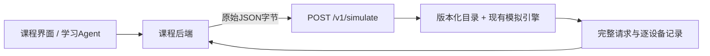

# Agent 专用同步接口

版本1.20新增独立的课程Agent接口。现有 `mlsys-sim`、Python API 和本地
`mlsys-sim-web` 保持可用。新服务复用同一模拟引擎，不依赖课程平台、Pydantic、
GPU或第三方Web框架，也不承担Agent对话、任务评分或语义质量评估。

契约依据为[课程团队的对接文档](https://github.com/taowangcheng/hello-mlsys-lab/tree/d28137bfb2d87e5ee247305325f34f1b7824c639/integrations/mlsys-simulator)，
固定于 `d28137bfb2d87e5ee247305325f34f1b7824c639`。
原请求、协议Schema及来源哈希保存在[examples/agent](../examples/agent)。



## 启动与HTTP入口

```bash
mlsys-sim-agent --port 8877
# 或在源码目录
python -m mlsys_sim.agent_service --port 8877
```

| 项目 | 当前约定 |
| --- | --- |
| 服务地址 | `http://127.0.0.1:8877`，仅loopback，无外部监听开关 |
| 执行 | `POST /v1/simulate`，`Content-Type: application/json`，同步返回 |
| 目录 | `GET /v1/catalog`，包括身份、支持范围、HTTP限制 |
| 认证 | 本机loopback不需要密钥；不开放跨域浏览器调用 |
| 单次body | 最大2 MiB，严格UTF-8 JSON，不允许重复字段、非有限数或未知字段 |
| 并发 | 每个服务进程1个执行槽，忙时429 `AGENT_BUSY`，附 `Retry-After: 1` |
| 墙钟 | 请求中的 `evaluation.timeout_s`，不超过1800秒；独立进程超时返回504 |
| 模拟预算 | 最多10000条请求、1000000事件，最大模拟时间86400000 ms；实际请求截止由 `execution.max_simulated_ms` 决定 |

合法且已处理的模拟结果返回HTTP200，包括模拟OOM、请求失败或模拟截止。
400表示无效JSON，422表示格式/目录/策略不支持，500表示worker服务故障。
错误体为 `{"error":{"code":"...","message":"...","field":null}}`。
连接中断不证明服务已经停止；当前没有幂等重试、持久任务ID、轮询、取消或队列。
同机课程后端可以直接调用；跨机器部署与认证需单独设计，不能把这个loopback服务直接公开。

## 首个目录的明确范围

`catalog_version` 必须是 **`mlsys-agent-catalog-v1`**。未知版本和 `to-be-agreed`
会拒绝执行，不自动使用“最新”目录。

| ID / 选项 | 来源与支持 |
| --- | --- |
| `qwen3-0.6b`、`qwen3-1.7b`、`qwen3-4b` | 已随库提供的课程Qwen3架构；revision为 `course-7df2dae493eb-geometry`，不是下载权重的checkpoint revision |
| 模型精度 | 本目录仅接受BF16权重及BF16 KV，不自动转换FP8/INT4 |
| `rx9070xt` | 课程名义16 GiB、195 TFLOP/s、640 GB/s；不是硬件自动探测或新采集Profile |
| 并行与副本 | 单卡或TP degree=1，单部署最多16个独立单卡副本；多部署设备互斥 |
| TP>1 / PP | 没有已确认的通信拓扑目录，明确拒绝；原CLI/Python API仍可使用其显式配置 |
| 调度 | FIFO优先级；连续批处理，或并发1的逐请求FIFO；显式无抢占 |
| Cache / 推测解码 | 首轮关闭；`prefix_group`仅是标签，不证明token前缀一致 |

`llm-3b`、`llm-7b`、`llm-32b`、`w7900d` 均未映射。
真实课程基线需要双方确认具体模型、硬件、精度和目录版本；服务不会按参数量字符串猜架构。
已有量化、TP/PP、swap等核心能力不会因此被删除，但不冒充已确认的Agent目录组合。

## 三种执行模式

1. **open_loop（9.2）**：完整内联请求按原始 `arrival_ms` 到达，保留ID、输入长度和输出目标。
   不重采样Poisson流，不把异构请求变成统一长度。
2. **sequential（9.1）**：固定数组顺序；第一条在0 ms释放，之后跟随上一条真实终态。
   一个持久EventDriver保留部署状态。单请求失败后继续；全局终止后未释放项为 `not_started`。
3. **dag（9.3）**：使用原模型池/副本引擎。子节点在最后一个成功父节点结束后加
   `gap_after_deps_ms` 释放；根节点使用绝对arrival。父失败阻塞后代，独立分支可继续。

核心 `DAGNode.gap_after_deps_ms` 是可选扩展；同时有绝对release时，核心公式为
`max(release_ms, max(parent_completion)+gap)`。Agent契约禁止子节点同时传绝对arrival，
避免两种时钟混用。未指定gap的旧计划维持原结果与trace身份。

`max_concurrency` 是**每副本活动请求准入上限**，不是一次batch的成员数。
核心新增可选 `StrategySpec.max_active_requests`，默认None保留原行为；活动槽一直保持到终态，
不会因为recompute或swap就另行释放。
独立副本之间固定使用现有 `least_loaded` 路由；请求进入副本后保持归属，
副本内使用FIFO优先级。首轮协议不新增其他路由策略字段。

服务端明确使用65536的迭代token预算，可以完整处理样例中的16384-token输入；
`chunked_prefill_tokens=null` 时仍关闭chunking，不静默改变策略。
输出目标仅用于执行回放，不用于优先级排序。

## 显存政策与时间口径

- `gpu_memory_utilization` 对每设备真实容量计算可用预算，容量本身不变。
  核心新增可选同名 `MemoryConfig` 字段，默认None保留旧账本。
- `kv_budget_gib` 为每副本、每rank固定池字节预算，GiB=2^30字节。
- `kv_fraction` 乘以“真实容量×utilization”，不乘以扣除权重后的剩余量；与绝对预算互斥。
- 两者均null时，自动政策先扣除权重、64 MiB基础Workspace、128 MiB Runtime、
  256 MiB安全余量及最坏迭代Workspace（1024 bytes/token），再将剩余量向下取整为完整KV块。
  这些是 `agent-analytical-v1` 的未校准声明，不是新的真机归因结果。
- 显式预算不被静默缩小；不够用时保留模拟OOM。每条响应日志与逐设备记录给出实际池预留量。

三个时间量独立：`evaluation.duration_s` 只是平台统计分母元数据；
`execution.max_simulated_ms` 是模拟截止；`evaluation.timeout_s` 是worker墙钟限制。
恰好截止时刻完成有效；其他已进入引擎的请求保留部分输出与截止终态，未来请求保留为未启动。

响应对每个输入ID恰好返回一行。失败、blocked、not_started、unknown不被删除；
数量与时间未知时不伪造0。`service_ms` 暂为null并说明原因，不把含排队的原DAG critical path改名使用。
逐设备物理峰值、KV使用峰值和池预留分开，不重复相加；初始化失败尚无账本时内存字段为null。

`input_sha256` 是收到的**原始body字节**的SHA256（带 `sha256:` 前缀），不是重新序列化JSON。
`workload.source_sha256` 是调用方提供的原JSONL来源声明；服务没有该文件字节，不能据此宣称已验证文件。
响应保持 `evidence_level=simulated`、校准 `uncalibrated/in_domain=null`，不授予硬件精度结论。

## 可复现的联调顺序

`task-9.x.unconfirmed.request.json` 完整保留对方样例，必须返回明确的未确认目录/身份错误。
`task-9.x.protocol.request.json` 是**单独命名的协议测试变体**：显式改用已公开的Qwen/BF16和
RX9070XT名义配置，保留原ID、长度、到达时间、依赖间隔；9.3的目标模型引用同步改为这些不同的模型。
这些变体不是原FP8/3B/32B/7B/W7900D课程基线的性能或验收结果。

先运行9.2变体，再9.1、9.3。可以在源码目录将请求文件通过HTTP提交：

```bash
curl --fail-with-body --silent --show-error \
  -H 'Content-Type: application/json' \
  --data-binary @examples/agent/task-9.2.protocol.request.json \
  http://127.0.0.1:8877/v1/simulate > response.json
```

保留原始发送字节与响应，使用 `validate_agent_response(raw_bytes, response)` 校验身份、所有ID、
时间因果、截止、部署归属、可空观测与显存字段。Python调用也可通过
`mlsys_sim.agent_adapter.simulate_agent_request(raw_bytes)` 直接使用相同适配器。
静态目录和Schema通过不能替代真实HTTP联调，更不能证明原课程平台已注册并调用该服务。

本版本的实际HTTP记录见[协议联调证据](../examples/agent/evidence/http-verification.json)：
9.2/9.1/9.3变体分别12/6/10条完成，保存完整响应、请求body及响应SHA、服务源码SHA。
三个未确认原样请求均返回422。上述记录只证明本服务的协议/执行语义，
没有将不同模型和硬件的测试变体标记为原课程基线验收。
