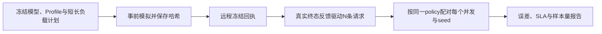

# 冻结有限队列预测，再做独立并发实测

`load_validation.py` 提供独立的 `finite_cohort_closed_loop_v1` 协议。
每次运行有明确的 N 条请求，初始投递 `min(concurrency,N)` 条；每个 client 只有收到真实终态反馈，
再等待 `think_ms`，才投递下一条。累计投递到 N 后停止补位，并完成必要排空。
N 是本轮目标队列长度，不是旧负载生成器的截断上限；该协议没有修改 `run_load_sweep()` 的原有持续时间语义。



## 先冻结请求流和预测

```python
from mlsys_sim.load_validation import (
    generate_request_stream, closed_loop_policy_sha256, predict_closed_loop,
)

spec = {
    "schema_version": 1, "study_id": "9070xt-tail", "cohort": "short",
    "concurrency_grid": [1, 2, 4, 8], "requests_per_run": 1000,
    "replications": 3, "seed": 42, "think_ms": 0,
    "input_lengths": [64, 128], "output_tokens": 16,
    "timeout_ms": 10000, "max_run_ms": 600000,
}
stream = generate_request_stream(spec, replication=0)
policy_sha = closed_loop_policy_sha256(spec, concurrency=4, replication=0)
predictions = predict_closed_loop(experiment, spec)
```

`input_lengths` 是按原顺序声明、等权抽取的整数类别，不是区间。
每个 replication 使用新的 SHA 派生 RNG 子流，生成固定 N 条 ID 与长度。
同一 replication 的 ID / 长度序列不随 concurrency 改变；client 与 arrival 只在该次真实或模拟反馈释放时生成。
可选 `prompt_token_id` 默认 100，规则是把该 ID 重复 `input_tokens` 次，避免文本分词和 chat template 引入额外长度。
采集器使用同一个生成函数，固定输出目标应配置 `ignore_eos=True` 并核对实际输出数量。

请求流包含 `request_id`、`input_tokens`、`output_tokens`、`prompt_token_id`、`timeout_ms` 与 `priority`，
不包含伪造的 arrival。实际请求账本在原引擎记录外增加 `client_id`、`stream_index`、`preceding_request_id` 及 prompt ID 哈希，
这些字段没有加入原 `RequestSpec`。

预测使用 `EventDriver`，TP / PP、多个副本、缓存、swap 和混合批处理仍由原引擎负责。
失败和超时也释放 client，从而保留之后的请求；它们始终否决整轮成功。
硬时间或事件预算中止时，只保留已经真实释放的请求和 `not_offered_count`，不会给未来请求编造到达时间。
所有并发 × replication 都保留；一个 cell 失败不能变成选择其他 seed 的理由。

Profile 会在整个预测生命周期开始时冻结成只读快照，包含 timing / native PP / Workspace 各角色。
不同 cell 始终读取同一批字节，原文件持续改变会拒绝整个预测；临时路径不进入稳定结果。
预测函数没有 GPU、SSH、自动拟合或时钟等待行为。声明的 `max_run_ms` 是该协议独立的每轮执行预算。

## 实测边界需要保留

现有 `collect_vllm()` 是按预先展开的 arrival 提交 HTTP 工作；它的 worker 数不能代替完成后 refill 的 client 数。
客户端 SSE 的 delta token IDs 能证明交付数量，却不能证明 GPU / server 的逐 token ready 时间。
多个 token 合并在一个 SSE 包里时，其内部生成时刻未知。

此轮 server-ready 验证应保留 Scheduler 的实际 enqueue、token-ready、finish，
同 session 的 Runner / runtime 身份、单调时钟域及真实 ID 映射。构造器原始 capture 必须保留；
warmup 后程序化重装 hook 不能自动取得 fresh-state 证明。
客户端或 `runtime_API_feedback_v1` 可以作为独立诊断，但不能改名后通过 server-ready 对比。

观测集合的接口是：

```python
observations = {
    "schema_version": 1, "study_id": predictions["study_id"], "cohort": predictions["cohort"],
    "spec_sha256": predictions["spec_sha256"],
    "identity_sha256": predictions["identity_sha256"],
    "runs": [
        # 一个cell一个记录：concurrency, replication, policy_sha256,
        # request_stream_sha256, result, requests, resources_drained,
        # source={kind:"measured",reference:...}, session_id,
        # timing_boundary="server_token_ready_v1",
        # collection_started_at / collection_ended_at（正式测量ISO时间）
    ],
}
```

`result` 与 `requests` 使用完整的普通模拟结果口径；实际 `token_times_ms` 必须来自声明边界。
每条请求还需保留实际 `input_tokens`、`output_tokens_target`（或 `max_output_tokens`）、
`prompt_token_ids_sha256` 和 client 元数据。
模块核对实际长度、目标和 prompt 哈希，不能只相信声明的 policy SHA。
同一个 client 的新 enqueue 不得早于前一终态加 think；浮点检查只允许表示误差，没有额外放宽发送延迟的阈值。

实际硬件快慢会改变 arrival 和整体耗时，所以闭环对比匹配的是 **冻结的负载策略和固定请求流**，
不要求两边 arrival SHA 相同。用实测 arrival 重跑得到的是另一个条件重放诊断，不能替代已存预测。

## 参数化的验证与留出

```python
from mlsys_sim.load_validation import validate_closed_loop

contract = {
    "schema_version": 1,
    "prediction_frozen_at": "2026-11-11T01:00:00+00:00",
    "min_completed_samples": 1000,
    "timing_boundary": "server_token_ready_v1",
    "max_relative_error": {
        "ttft_p99_ms": 0.30, "tpot_p99_ms": 0.30,
        "end_to_end_p99_ms": 0.30, "elapsed_output_tokens_per_s": 0.30,
    },
    "constraints": constraints,
}
report = validate_closed_loop(predictions, observations, contract)
```

上面的误差界只是 API 示例，必须在采样前由实验计划注册，不是库自动给出的验收标准。
可选 `max_absolute_error` 使用相同指标键；可选 `prediction_payload_sha256` 将整个预测对象固定到 canonical JSON 哈希。
正式采样 start 必须严格晚于带时区的预测冻结时间，end 不得早于 start。
该检查验证声明时间的顺序，独立冻结证明由外部远程回执提供，不能用本地回填时间冒充。

每个 cell 必须完成全部 N 条请求，并满足声明的最小完成 / 对应延迟样本数。
约束复用 `evaluate_simulation_constraints()`；输出 16 token 的每条完成请求应有 TPOT 样本。
真实 token trace 没有完整显存账本时，内存约束返回 `UNKNOWN`，不能贴上模拟器内存使之通过；
本轮 P99 / SLA 可单独声明延迟与 `elapsed` 吞吐约束。

误差定义为 `abs(predicted−measured)/measured`；分母为 0 时，除两者都为 0 外均不可定义。
P99 和吞吐的误差、预测 SLA、实测 SLA、二者一致性与采集完整性分别保留。
整体分析可以 `status=COMPLETED, verdict=FAIL`，表示失败结果已经诚实出具报告。
未采集的声明 cell 保留 `UNKNOWN`；已有预测或实测失败则保留 `FAIL`，不挑掉该 seed。

吞吐是 **固定队列实际 token / 从首次正式 enqueue 到必要排空的 elapsed**，并非稳态服务率。
不能以 hook flush、写文件或进程退出耗时延长分母，也不能用请求尚未全部结束的测量窗口公式代替。
报告只返回逐并发 / seed 的汇总指标、状态、计数、检查和哈希；原始请求 ID、token 流、源路径与采集参考串不复制到公开报告。

短 prompt 和长 prompt 应分别冻结 spec，例如 `[64,128]` 与 `[512,1024]`，在相同并发网格、seed 和重复数上留出验证。
若冻结 Profile 不覆盖长 prompt / batch 形状，应保留域外或未知结果；不能在看到留出误差后扩 grid、改系数、重拟合或删除 seed。
所有时延、吞吐、容差、模型及硬件身份都来自显式输入，模块没有针对 9070 XT 的隐式精度修正。
