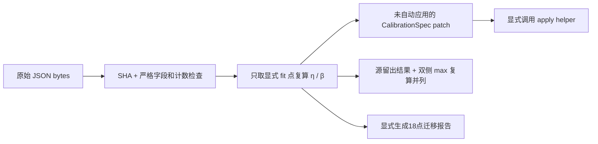

# 导入课程 η/β 校准并显式应用

`import-course-calibration` 读取课程 `bench_cal.py` 生成的原始 JSON，核对计数和拟合成员，保留源结果，另外计算正确的双侧 Roofline 时间。它输出可审阅的参数 patch；提供第1章 plan 时，另生成显式 η/β 迁移后的18点图文报告。整个过程在 CPU 上完成，不运行课程程序或 GPU。

先用仓库内的手算测试夹具走通流程：

```bash
python3 -m mlsys_sim import-course-calibration \
  --input examples/course/course-calibration.fixture.json \
  --source-kind test_fixture \
  --source-label hand-calculated-fixture \
  --chapter1-plan examples/course/chapter1.plan.json \
  --out runs/course-calibration-fixture
```

该夹具的 η=0.5、β=0.8，顶层有 `test_fixture:true`，环境也明确写着没有采样硬件。必须显式传 `--source-kind test_fixture`；省略该参数时不会将它升级成真实测量。

导入自己的原始课程文件时，使用默认的 `course_external_report` 来源，可选核对已知文件 hash：

```bash
python3 -m mlsys_sim import-course-calibration \
  --input cal_9070xt.json \
  --source-label hello-mlsys-chapter2-historical-reference \
  --expected-sha256 a49f5e5da620c931facd0c5a372f2f22e6ae3e2fd40d30e25fc81d3a8e0f4770 \
  --out runs/course-calibration-import
```

上面的 SHA256 对应固定课程提交 [7df2dae493eb 的原始结果](https://github.com/amdjiahangpan/hello-mlsys/blob/7df2dae493eb30c0f7e845b6d587b905288c0d7a/code/part1-modeling/chapter2/results/cal_9070xt.json)。它只核对文件身份，不证明来源声明、计时顺序或适用域。原始结果保留在用户选择的输出目录；仓库只附手算夹具。

## 从原始数据到可审阅 patch



实际课程格式包含8个校准点、4个拟合成员和5个留出点：

| 部分 | 内容 |
| --- | --- |
| `environment` / `config` | 原始环境声明、seed、计时协议字符串 |
| `nominal_constants` | 矩阵峰值、带宽、nominal 拐点 |
| `calibration.gemm` | 2048³、4096³、5120³、8192³ |
| `calibration.ln` | 2048×1024、8192×4096 |
| `calibration.softmax` | 4096×4096、8192×4096 |
| `fit` | 发布的 η/β、fit成员、逐点系数和原始时间戳 |
| `holdout_prediction` | 5个源预测与原始时间戳 |
| `holdout_measured` / `holdout_err_pct` | 5个源测量、源误差及汇总 |

每点有 FLOPs、bytes、AI、nominal 两侧时间、median、3轮 median、fit标记和对应效率诊断。原文件没有150次逐迭代样本，也没有独立的留出测量起止时间；导入器不会补造这些字段。输入上限1MiB，拒绝重复JSON键、未知字段、非有限值、布尔值冒充数值、错误计数、错误拟合成员或与原始计数不符的名义时间。

η仅使用 GEMM4096³/5120³；β仅使用 LN8192×4096 与 Softmax8192×4096：

```text
η = sum(这些拟合点的 t_comp_ms) / sum(这些拟合点的 median_ms)
β = sum(这些拟合点的 t_mem_ms)  / sum(这些拟合点的 median_ms)
```

导入器复算上述加权比值，核对源发布系数到四位小数的舍入容差。实际文件的发布值是 η=0.6243、β=0.9054；从源记录的五位名义时间复算约0.624335593和0.905448580。最终使用源发布值，同时保留按精确 FLOPs/bytes 复算的另一组对照，避免暗中改变已有课程参数。

非拟合诊断点完整保留。例如源 Softmax4096×4096 的 β_point=1.3061，是计数/L2复用异常的诊断信息，不会被钳到1，也不会加入β拟合。可应用的最终 η、β 必须在 `(0,1]`。系数与拟合记录实质不一致时，导入失败，不产生可应用 patch。留出测量从不用于重新拟合。

## 校准后必须重新比较两侧时间

每个组件独立计算：

```text
t_compute_cal = t_compute_nominal / η
t_memory_cal  = t_memory_nominal  / β
t_component   = max(t_compute_cal, t_memory_cal)
ridge_cal     = ridge_nominal × η / β
t_step        = sum(t_component) + 原有 T_fixed
```

不能沿用 nominal 的瓶颈侧再只缩放一个时间。原始课程脚本正有这个可复现的区别：Attention MHA16、S512 的 nominal AI=256，小于304.6875，所以源预测选择了 memory 分支。η/β缩放后，compute 反而更慢：

| 原始课程 S512 Attention | 时间 / 判定 |
| --- | ---: |
| 源预测，冻结 nominal memory 分支 | 0.01448 ms |
| 双侧复算 compute | 0.017640136 ms |
| 双侧复算 memory | 约0.014477 ms |
| 正确 max 与校准后瓶颈 | 0.017640136 ms，compute |
| 源声明测量 | 0.05272 ms |
| 源误差 | +264.1% |
| 双侧 max 后重新计算的误差 | 约+198.864% |

两列误差统一为 `(measured/prediction−1)×100`，正值表示预测偏乐观。报告并列保留 source 与 recomputed，不覆盖原结果，也不声称后者成为新的独立留出验证。相关源程序见 [bench_cal.py](https://github.com/amdjiahangpan/hello-mlsys/blob/7df2dae493eb30c0f7e845b6d587b905288c0d7a/code/part1-modeling/chapter2/bench_cal.py)。

第1章18点迁移使用新协议 `hello_mlsys_ch1_eta_beta_transfer_v1`，每个组件保留 `nominal` 对照并重新计算 bound。矩阵和向量屋顶按同一 η、β 缩放；η原本来自矩阵 GEMM，将它用于向量计算也是报告明示的迁移假设。原来的 `run_chapter1` 仍返回 `hello_mlsys_ch1_nominal_v1`，未增加校准字段或改变默认计数。

## 输出与时间证据

打开 `artifacts/report.html` 可阅读拟合点/诊断点效率图、8点表和5点源结果/max复算表。输出还包括：

| 文件 | 内容 |
| --- | --- |
| `source.json` | 精确原始字节，经原样UTF-8回写，SHA保持一致 |
| `report.json` | 来源、环境、原始文本、拟合域、成员、重算值和数据hash |
| `calibration_points.csv` / `holdout_points.csv` | 8个校准点和5个留出点，误差方向明确 |
| `calibration_patch.json` | 未自动应用的三字段 patch 与边界说明 |
| `report.html` / `report.md` / `calibration.svg` | 中文图文报告与可复现效率图 |
| `chapter1-calibrated/` | 提供 plan 时生成的新18点报告和四张图；表中 B/C 对账仍保留 nominal 基线 |

`stored_at` 是本次实际导入的 UTC 时间；原始 `fit.stored_at` 和 `holdout_prediction.stored_at` 分开保存。原脚本先在内存中赋预测时间，完成所有留出测量后才统一调用 `save_json`。因此 `historical_prediction_before_measurement_established=false`：不能仅凭同文件里的时间字符串认定预测提前落盘。这个证据等级不会因误差较小而升级。

导入历史存档后可以重复生成图表，历史导入时间只要求格式为UTC，无需伪造“当前导入”。新建导入的时间必须是真实当前UTC。writer核对报告hash，并从保留的原始文本重新推导报告，拒绝只修改η/β后自行重算hash的篡改；已有输出目录不会覆盖。

## 显式应用到现有分析后端

导入与生成18点报告都不会改写现有实验。patch的结构为：

```json
{
  "kind": "calibration_spec_patch",
  "requires": {"backend": "analytical"},
  "patch": {
    "compute_efficiency": 0.6243,
    "bandwidth_efficiency": 0.9054,
    "profile_version": "course-eta-beta-<原始SHA前16位>"
  },
  "apply_automatically": false
}
```

若明确要迁移到服务分析模型，调用helper得到一个新实验：

```python
from pathlib import Path
from mlsys_sim import load_experiment
from mlsys_sim.course_calibration import import_course_calibration, apply_course_calibration

report = import_course_calibration(
    Path("examples/course/course-calibration.fixture.json").read_bytes(),
    source={"kind": "test_fixture", "label": "hand-calculated fixture"},
)
original = load_experiment("my-analytical-experiment.json")
experiment = apply_course_calibration(original, report, allow_test_fixture=True)
```

夹具应用需要helper显式 `allow_test_fixture=True`；此开关不写入旧 `CalibrationSpec.allow_test_fixture` 字段。`profile` 和 `synthetic` 后端直接拒绝。helper只改 `compute_efficiency`、`bandwidth_efficiency`、`profile_version`，保持原始实验不变，保留所有 TP/PP、缓存、CPU swap、混合批处理、副本、基础设施、native PP通信、Workspace路径及版本选择。

CPU dispatch 的 `T_launch` 不等于已识别的 `framework_overhead_us`，单算子event时间也不能给出每kernel或每step的统一launch常数。helper因此不修改 `launch_overhead_us` 或 `framework_overhead_us`，不自动切换 backend，不生成/覆盖 whole-stage Profile，不替换 PP通信和Workspace的独立校准。

所有迁移结果保持 `hardware_validated=false`。`COMPLETED` 仅表示导入、复算或18点计算完成；从少数饱和/流式 primitive 迁移到 dense 全模型、Attention或 TP/PP 是显式域外假设，不是全模型或整个组合配置的硬件PASS。以上参数也不识别容量、OOM或swap开销。
