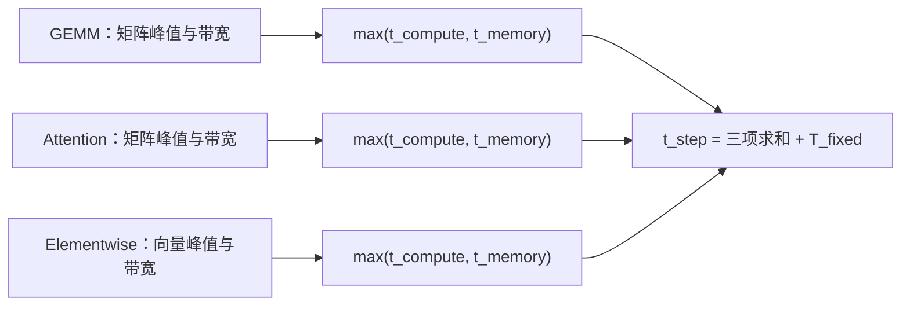

# 第 1 章：可复现的 18 点 Roofline 实验

课程模式将三种 Qwen3 模型的 18 个离线配置展开成逐组件预测，同时输出四张 SVG、CSV、中文 HTML 和 Markdown 报告。它是显式的 `hello_mlsys_ch1_nominal_v1` 教学协议，采用课程的 full-square attention 公式；现有服务仿真、TP/PP、Profile、缓存、swap 和混合批处理保持各自原有口径。

从仓库根目录运行，无需 GPU 或第三方运行依赖：

```bash
python3 -m mlsys_sim chapter1 \
  --plan examples/course/chapter1.plan.json \
  --out runs/chapter1
```

打开 `runs/chapter1/artifacts/report.html` 阅读图文报告。`--out` 必须是新目录。再次运行换一个输出目录，旧预测不会被覆盖。Python API 同样可用：

```python
import json
from pathlib import Path
from mlsys_sim.course_roofline import run_chapter1, write_chapter1_report

plan = json.loads(Path("examples/course/chapter1.plan.json").read_text())
report = run_chapter1(plan)
write_chapter1_report(report, Path("runs/chapter1-python"))
```

## 实验轴与参数来源

| 项目 | 冻结口径 |
| --- | --- |
| 模型 | Qwen3-0.6B / 1.7B / 4B，BF16，tied embeddings |
| Prefill | B=1，S=128 / 512 / 2048 |
| Decode | B=1 / 4 / 16，ctx=1024，包含当前 token 的 attention 位置 |
| 校准 | 显式 nominal，η=1，T_fixed=0，尚未校准 launch |
| RX9070XT | 课程声明的矩阵195 TFLOP/s、向量48.7 TFLOP/s、带宽640 GB/s |
| W7900D | 算力与带宽为 null，状态 pending_parameters |
| 单位 | FLOPs、bytes、ms，十进制 GB/s 和 TFLOP/s；FMA=2 FLOPs |

课程原文固定到 [hello-mlsys 的第 1 章，提交 7df2dae493eb](https://github.com/amdjiahangpan/hello-mlsys/blob/7df2dae493eb30c0f7e845b6d587b905288c0d7a/docs/part1-modeling/chapter1/index.md)，文件 SHA256 为 `0c0c01a90d35b1b107cc88ccd2c48e776de141bb698356d4b8696baa401ec231`。plan 内联最小 HF 几何配置，并为每份输入保存 hash；`course-7df2dae493eb-geometry` 是课程几何快照标识，**不是模型权重的 HF commit**。生产采样和 Profile 仍须提供真实模型 revision。

这些硬件数字是输入假设，不是本功能新采集的实测规格。W7900D 没有已知峰值和带宽，报告中的第二张图仅显示全部 18 点的算术强度与配置索引，清楚标为“待确认参数”。不能给它画一条有数值意义的硬件屋顶线，也不能声称完成了该机器的预测或验收。

## 各组件先取 max，step 再求和



每个组件假定内部计算与访存可以重叠；组件之间按串行相加。全模型 FLOPs/bytes 也会输出，但全局 AI 只作展示，不用于替代组件瓶颈判定。

用 `L` 表示层数、`h` 表示 hidden、`d_q=n_q×head_dim`、`d_kv=n_kv×head_dim`：

| 组件 | FLOPs | HBM 读写 bytes |
| --- | --- | --- |
| Prefill GEMM | `2×P_linear×S` | `2×P_linear + a_prefill×L×h×S` |
| Decode GEMM | `2×(P_linear+P_head)×B` | `2×(P_linear+P_head) + a_decode×L×h×B` |
| Prefill Attention | `4×L×d_q×S²` | `4×S×(d_q+d_kv)×L` |
| Decode Attention | `4×L×B×ctx×d_q` | `4×L×B×ctx×d_kv` |
| Elementwise | `f_elementwise×L×h×tokens` | `d_elementwise×L×h×tokens` |

`P_linear=L×(2×h×d_q+2×h×d_kv+3×h×intermediate)`，复用现有模型几何计算；`P_head=h×vocab`。0.6B 的精确计数是 `P_linear=440401920`、`P_head=155582464`。tied embeddings 共享存储，输出投影仍执行一次。

Prefill 默认 `prefill_lm_head="omitted"`，对应课程主项省略最后一个 token 的 LM head。若改成 `"last_token"`，GEMM 的 FLOPs 和 bytes 各增加 `2×P_head`，并改变 plan hash 和 prediction_id；decode 的 head 始终计入。没有把该投影对每个 prefill token 重复收费。

plan 中声明的流量系数为：

- `prefill_gemm_activation_bytes_per_layer_hidden=28`，即0.6B每 token 802816 bytes，约0.803 MB，表达课程约0.8 MB/token 的未融合流量假设。
- `decode_gemm_activation_bytes_per_layer_hidden=0`，明确省略课程公式中未定量的 O(B) 激活项，保留教学恒等式 GEMM AI=B。
- Elementwise 每层、每 hidden、每 token 为8 FLOPs、4 bytes，AI=2；这是公开的宏观假设，并非算子实现的逐指令计数。

以上系数可以显式更改，报告保留实际值并改变预测标识；不能把不同流量假设的结果当成同一配置。所有数据必须有限且有界，未知字段、错误模型几何、布尔值冒充数值、隐式校准、无效时间戳都被拒绝。

0.6B 的 prefill S512 得到 Attention FLOPs `60129542144`、bytes `176160768`、AI `341.333333`。矩阵拐点 `195000/640=304.6875`，故 compute-bound。向量组件使用独立拐点 `48700/640=76.09375`。Decode Attention AI=2，与 B 和 ctx 无关；4B 的 Q/KV 头比为4，对应 AI=4。

## 图、表和底稿

`artifacts/` 中全部文件从同一 report 对象产生：

| 文件 | 用途 |
| --- | --- |
| `report.json` | 18点、54组件、4个 primitive 条目、公式、输入和 provenance |
| `components.csv` | 54行逐组件精确值，含 prediction_id、stored_at、时间和判定 |
| `report.html` / `report.md` | 中文图文报告、18点表和对账说明 |
| `roofline-rx9070xt.svg` | 矩阵/向量双屋顶，保留18点的全部54个组件 marker，编号与AI见右表 |
| `roofline-w7900d-pending.svg` | 全18点的 AI 索引；参数未知，**不是已完成的硬件 Roofline** |
| `batching.svg` | 三模型的 decode step 与聚合生成吞吐，固定 ctx1024 |
| `prefill.svg` | 三模型的 prefill step，固定 B=1 |

SVG 带 report data hash，组件点有可访问标题、编号和完整配置 ID。图内不堆叠数字标签；精确重合的 marker 位于同一位置并覆盖，编号与配置在右侧静态表查询，没有把相近 AI 合并成同一点。HTML 有可读表格，CSV 可用于独立复算。Prefill token/s 表示输入处理率，decode token/s 表示生成速率，两者不是同一种服务吞吐。

Primitive 练习包括4096³ BF16 GEMM、2048×1024 LayerNorm，以及0.6B S512 的 Flash/naive Attention 两个计数版本。LayerNorm 冻结为4 FLOPs和4 bytes/元素，忽略 affine 和额外 reduction 流量；Flash/naive 不套用来自外部测例的统一1.13重算系数。

## 原文中需要保留的两处对账

报告不拟合课程近似表的时间。默认 plan 的0.6B prefill 三点约为1.628570 / 2.712782 / 14.551406 ms；decode 三点约为2.046131 / 2.597171 / 4.801331 ms。课程表里的1.5 / 2.7 / 14和2.1 / 2.6 / 4.9是近似值；并非每一项都能与精确参数、显式激活流量和组件求和同时保持一位小数相同。报告逐项列出差值与舍入是否一致，将其标为公式/口径对账，绝不标为“硬件误差”或“校准通过”。

原文还同时给出 `F=4×L×q_heads×head_dim×S²` 和 naive 新增流量 `4×L×q_heads×S²`，因此大 S 的 AI 极限是 `head_dim=128`，推不出原文写的0.5。S512 的 naive bytes为645922816、AI约93.090909，仍 memory-bound；课程想说明的该点瓶颈转换成立，渐近值需单独纠正。报告同时保存原文声称值、公式推导值和不一致状态。

## 时间留痕与验收边界

每点带 `prediction_id`、当前 UTC `stored_at`、nominal 校准版本与公式版本。指定 `stored_at` 时，只接受当前 UTC 附近的时间（最多60秒旧、5秒未来时钟偏差），拒绝历史回填。存档 report 可以原样重复生成图表，数据 hash 不变；修改数值却不重新生成报告会被 writer 拒绝。

plan、公式、模型配置和实现文件都有 SHA256。`hardware_validated=false`，`measurement_sources=[]`，`historical_prediction_before_measurement_established=false`：本次新生成的预测不能追溯证明早于课程已有14点实测。后续真机实验须保存新的预测，再以 prediction_id 和相同计数边界关联独立测量。W7900D 参数、课程原始实测与发射开销诊断属于单独证据，不能由本命令的 `COMPLETED` 状态代替；该状态只表示18点名义计算已完成。
