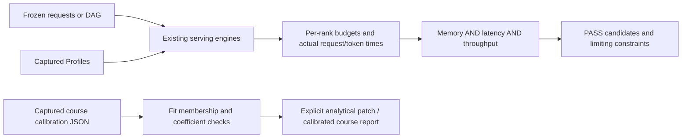

# Joint constraints and course calibration

Version 1.17 connects the course's capacity decisions and primitive calibration
results to the existing CPU workflows. The new entry points keep source
evidence, prediction time and hardware validation separate.

| Task | Entry point | Result |
| --- | --- | --- |
| Evaluate one serving run | `evaluate_simulation_constraints` | Every rank's budget, requested latency quantiles and explicitly timed throughput |
| Evaluate dependent model pools | `evaluate_dag_constraints` | Overall and optional per-pool checks on one causal DAG |
| Select a configuration | `screen` | All candidate outcomes, joint PASS/FAIL/UNKNOWN, limiting constraints and eligible ranking |
| Extend a load scan | `sweep` with optional `constraints` | Every point and repetition must satisfy the joint criteria |
| Import the course's primitive fit | `import-course-calibration` | Raw source, declared and recomputed coefficients, holdout diagnostics and guarded analytical patch |
| Recompute the 18-point grid | `--chapter1-plan` during import | Nominal/calibrated comparisons using separate compute and bandwidth efficiencies |



## Choose a configuration

Each candidate runs the same workload under its own model, layout, batching,
cache and memory settings. Candidate screening supports ordinary simulations,
load sweeps and heterogeneous model-pool DAGs. Plans use inline experiments;
relative Profile paths resolve against the plan's directory.

```bash
mlsys-sim screen --plan examples/course/screen-simulation.plan.json --out runs/course/screen
```

Only candidates satisfying all declared constraints enter the ranking. Failed,
unresolved, low-sample and missing-metric cases remain in the report. A missing
TPOT from one-token output is not a zero-latency observation. All repetitions
must pass; pooled results cannot hide a failed repetition.

Memory is checked per physical rank using the existing peak budget, including
the entire reserved KV pool and declared safety/external budgets. Logical KV
usage is not added again. Latency starts at request arrival; DAG node latency
starts when dependencies release that node into its serving pool. Whole-task
DAG latency is a separate makespan check.

Throughput declares its denominator. Measurement-window counts use actual
completion/token timestamps in that window. Elapsed counts include drain;
DAG task-makespan counts stop at the final task output. Node request throughput
is not whole-workflow throughput. Missing timing evidence stays UNKNOWN.

See [joint constraint schemas](joint-constraints.md) and
[candidate screening](candidate-screening.md) for exact fields, supported
objectives, replay and resource limits.

## Import a course fit

```bash
mlsys-sim import-course-calibration --input cal_9070xt.json --out runs/course/calibration --chapter1-plan examples/course/chapter1.plan.json
mlsys-sim import-course-calibration --input examples/course/course-calibration.fixture.json --source-kind test_fixture --out runs/course/calibration-fixture --chapter1-plan examples/course/chapter1.plan.json
```

The importer reads the course's existing `cal_9070xt.json` format without
executing its benchmark scripts. It preserves original bytes, SHA256,
environment, explicit fit points and held-out observations. Published
coefficients are checked against ratios of sums of the fitting measurements;
held-out measurements never select or refit the coefficients.

The output patch requires the analytical backend. Applying it is explicit and
does not overwrite whole-stage timing, communication or Workspace Profiles.
The import cannot identify launch or framework overhead from primitive
efficiencies, so those fields are omitted from the patch.

The calibrated course report recomputes both sides of each component's
roofline before taking the maximum. Calibration can move a component across
the ridge, so its old nominal bottleneck is not frozen. Components are then
summed, preserving independent fixed overhead. Original source predictions
and recomputed diagnostics are reported separately.

These are imported primitive observations and CPU model predictions. They do
not establish new GPU measurements, the performance of TP/PP or quantized
kernels, or that a historical prediction was written before measurement.
See [course calibration](course-calibration.md) for source and domain limits.
