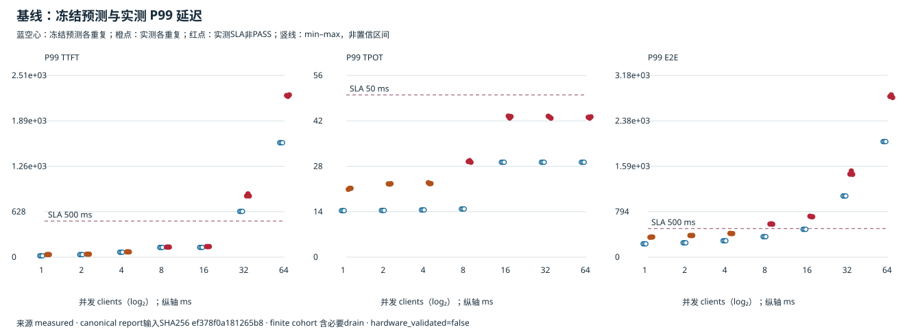
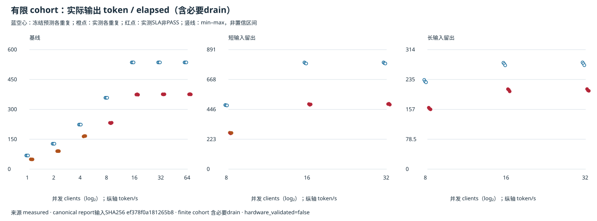
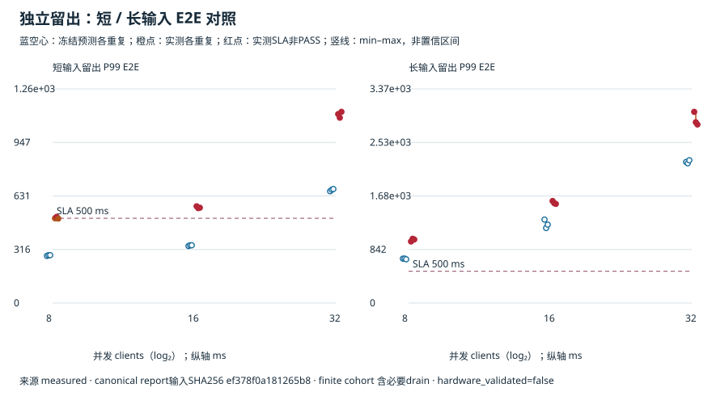

# RX9070XT：冻结预测后的 P99/SLA 并发扫描与短／长输入留出

本轮已完成39个正式单元、39个独立Runtime、39,000个完整请求，采集完整性通过。
**现有primitive η/β迁移模型未达到预注册精度目标：预测安全并发16，基线实测最大已观测安全网格点为4。**
39个单元均至少一项精度指标未达标；SLA判定29/39一致，10个单元出现预测通过但实测失败。未回拟合、改阈值、重采或选择有利重复。

[完整HTML](report.html) · [逐单元CSV](cells.csv) · [脱敏报告JSON](report.json) · [分层汇总](summary.json) · [完整生成版Markdown](report.md)

## 预注册场景与顺序

- 单RX9070XT/gfx1201，Qwen3-4B BF16、TP1×PP1、eager MRv1、异步调度关闭。实际vLLM为0.29.1.dev0+g98dff2a81.d20261002；镜像tag中的0.29.0没有被当作实际版本。
- Runtime最大16条运行序列，2048-token迭代预算，最大模型长度2048，KV池3GiB；Prefix Cache关闭，Chunked Prefill和混批开启。客户端并发与运行序列上限分开。
- 基线输入256tokens，并发1/2/4/8/16/32/64；短留出为64/128等权分类，长留出为512/1024等权分类。输出固定16tokens，greedy、ignore_eos，预分词token100重复，不推断chat模板长度。
- 每点3次fresh Runtime，每次1000请求；基准seed20261111按重复编号派生长度子流，Runtime采样seed固定0。各并发共享同一重复的冻结请求流，实际到达由前序完成反馈决定。
- 先完成声明形状warmup，再排空队列并核对KV空闲块数恢复；Runner采样在正式计时前关闭，仅Scheduler保留逐token事件。warmup和4请求启动诊断不进入正式样本。
- SLA：P99 E2E≤500ms、P99 TTFT≤500ms、P99 TPOT≤50ms、聚合elapsed输出吞吐≥20tokens/s。每次重复均须满足；精度目标为三种P99相对误差≤25%、elapsed输出吞吐误差≤15%。
- 本地先生成全部预测，按预测基线cap16固定留出点8/16/32。完整预测本地留档，远端在2026-11-11 07:32:21.597972 UTC收到其raw/canonical SHA承诺；正式采集07:35:22至09:00:50 UTC执行。
- 全部GPU单元结束后，仅用冻结代码和输入CPU重算预测，两种SHA均与测前承诺完全一致，再比较实际测量。未使用实测arrivals重新模拟预测。

## 基线：吞吐饱和后，增加客户端主要增加排队

表中预测值为三次重复中位数，实测范围为三次重复min–max，**不是置信区间**。全部数据均为服务端Scheduler enqueue→token-ready/finish边界；不是HTTP客户端SLA。

| 客户端C | 预测P99 E2E ms | 实测P99 E2E ms（三次范围） | 实测elapsed输出token/s | SLA通过重复 |
| ---: | ---: | ---: | ---: | ---: |
| 1 | 233.2 | 347.4–352.4 | 48.7–49.5 | 3/3 |
| 2 | 250.9 | 377.3–379.6 | 90.2–91.0 | 3/3 |
| 4 | 286.3 | 411.5–416.2 | 164.2–166.6 | 3/3 |
| 8 | 357.1 | 576.0–583.3 | 230.3–233.1 | 0/3 |
| 16 | 486.7 | 706.6–715.5 | 373.6–376.1 | 0/3 |
| 32 | 1070.0 | 1448.0–1506.8 | 375.0–376.1 | 0/3 |
| 64 | 2021.1 | 2791.9–2837.4 | 375.2–377.0 | 0/3 |

基线C4三次均满足500ms E2E目标，C8三次均超标，因此当前观察到的通过／失败区间是 **4→8**，没有对中间并发插值。预测给出的最大通过点16没有得到实测支持。
C16/32/64的实测吞吐均约375tokens/s，而P99 E2E由约0.71s增加到1.45s、2.81s。这是本固定Runtime和负载下的有限cohort观察，不是开放系统稳定性定理。

吞吐分母为1000请求cohort从首个正式enqueue到必要drain结束的elapsed，包含启动客户端群和收尾阶段；不称长期稳态服务率。

## 分布留出：原预测cap没有得到安全性确认

留出点在正式测量前固定为8/16/32，没有根据基线实测cap4补测更低点。因而留出只检验这些预选点，不提供短／长分布的新安全容量。

| 分布 | C | 预测P99 E2E ms | 实测P99 E2E ms（三次范围） | SLA通过重复 |
| --- | ---: | ---: | ---: | ---: |
| 短64/128 | 8 | 282.5 | 498.2–508.0 | 2/3 |
| 短64/128 | 16 | 340.7 | 559.8–570.7 | 0/3 |
| 短64/128 | 32 | 668.1 | 1093.0–1127.6 | 0/3 |
| 长512/1024 | 8 | 699.2 | 968.9–1011.3 | 0/3 |
| 长512/1024 | 16 | 1233.8 | 1560.5–1606.2 | 0/3 |
| 长512/1024 | 32 | 2219.7 | 2809.8–3008.8 | 0/3 |

短输入C8的两次通过与一次失败全部保留，没有取最好重复。两个留出分布在预选网格中都没有“三次全部通过”的点；这不表示其安全容量为0，也不能据此证明C4对长输入安全。
长输入C8等点的预测本身已超SLA，预测与实测同为FAIL应计为SLA一致，不能改称采集失败。

## 误差与已知边界

相对误差统一为`abs(predicted−measured)/measured`，逐单元表见CSV。精度判定与SLA可服务性分层：有意过载导致SLA FAIL，并不自动意味着模型不准确；本轮的39个精度FAIL来自实际误差超出预注册阈值。

| 指标 | 达到精度目标的单元 | 目标 |
| --- | ---: | ---: |
| P99 TTFT | 27/39 | 25% |
| P99 TPOT | 0/39 | 25% |
| P99 E2E | 5/39 | 25% |
| elapsed输出token/s | 0/39 | 15% |

1. **主要可见偏差在持续decode成本。** 基线C8的TTFT预测约134.4ms、实测138.7–139.2ms，但TPOT预测约14.85ms、实测29.23–29.75ms，进而把E2E从预测357.1ms推高到576.0–583.3ms。短输入C16的TTFT也较接近，而TPOT仍显著偏低。不能把这种方向稳定、远大于重复范围的偏差归为测量噪声。
2. **参数是primitive→whole-model迁移。** 本轮沿用课程η=0.6243、β=0.9054，未训练Qwen3-4B端到端成本，launch/framework参数保留默认2/5µs。独立算子的效率不能识别eager框架、发射和多kernel流水开销；它们是后续独立Profile应核查的候选原因，不是本轮已量化的唯一归因。
3. **调度只对齐顶层限制。** 模拟器冻结的每请求prefill chunk上限512与native vLLM按剩余2048-token预算切块不完全相同，尤其影响长输入混批。本轮没有改该参数或用留出重拟合。
4. **未采集逐kernel或功耗轨迹。** 因此不能唯一分离HBM效率、CPU调度、kernel融合和降频的贡献。Torch allocator与KV空闲块记录只是诊断，不构成完整物理显存/Workspace验收。

## 决策记录

- 否决“直接采用预测cap16满足本SLA”。它在基线C8/C16和部分短输入点产生了共10个false-safe单元。
- 在本基线网格、固定16输出及服务端边界下，C4是最大已观测三次通过点；结论不扩展到HTTP、其它输出长度或未知prompt分布。
- 对短／长留出预选点不宣称安全。若需要为长输入确定新cap，应另建测前冻结的更低并发实验；本轮不追加点或回拟合后重评。
- 后续模型修正应使用独立训练数据，再准备新的未见工作负载验证；当前留出已被观察，不能重新用作未见集。

## 证据与复现

- 远端预测承诺回执SHA256：`8a04caf27814ac43ee7ad21a4a9d783b1b58b24c15f118d31760c96bf0bd171f`。
- 原始采样完整私有归档：24,323,009 bytes，SHA256 `d47878c5058eab8308765ec8c23165d1f70f2c8c029841ad458bb2b7ccc2f94e`。包含全部39次尝试、Scheduler/Runner原始文件、API反馈、服务端trace、日志、冻结配置与源码快照；未将私密连接信息或原始prompt/机器日志发布到仓库。
- `report.json`是脱敏的验证汇总，`cells.csv`保留每次重复、样本数、实测/预测/误差与判据；三图来自同一报告输入。完整预测raw/canonical承诺与模型/源码指纹见生成报告的追溯表。
- 可复现工具：[协议/API](../closed-loop-validation.md)、[可选GPU worker](../../mlsys_sim/vllm_sla_worker.py)、[测前承诺接收](../../scripts/freeze_course_sla_commitment.py)、[测后CPU揭示与验证](../../scripts/analyze_course_sla_study.py)。归一化JSON输入后生成预测；不得以实测到达时间替换冻结的client反馈策略。
- `hardware_validated=false`：本轮是具体单卡/模型/配置/有限负载的实测与阴性精度结论，不授予通用硬件精度或生产SLA认证。
