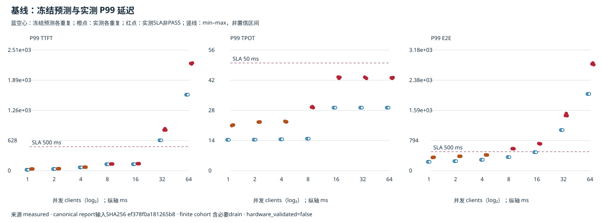
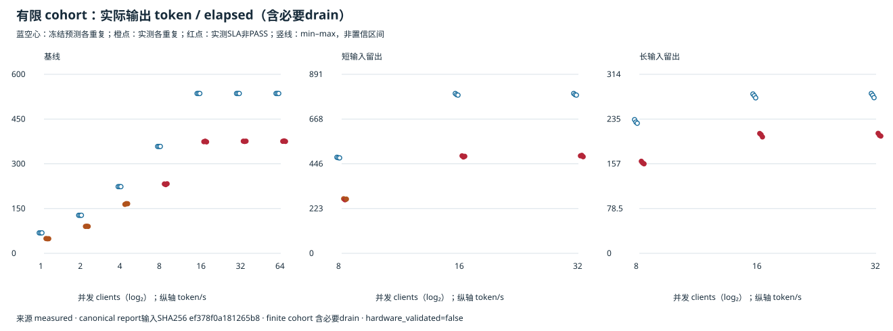
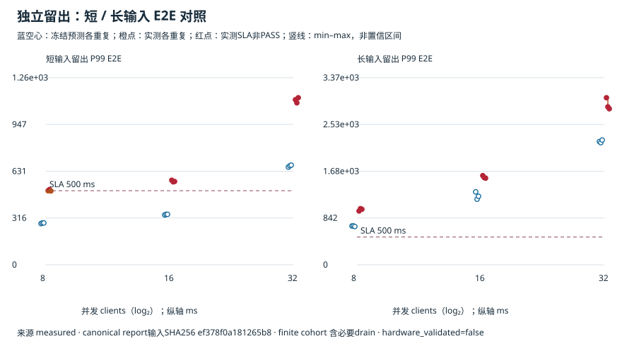

# RX9070XT × Qwen3-4B：测前冻结的 P99/SLA 并发扫描与分布留出

真机采集来源声明：有限冻结网格研究。单元数39；冻结预测安全上限C=16；server token-ready（非HTTP）。SLA过载点与采集/精度分开判断；不重拟合、不挑重复、不插值。

| 证据层 | 结论 | 分母与细分 |
| --- | --- | --- |
| 协议/采集检查 | PASS | {"PASS": 39} |
| 预注册精度目标 | FAIL | {"FAIL": 39} |
| SLA判定一致 | 29/39 已知且采集PASS单元 | UNKNOWN/协议未PASS=0 |
| 预测PASS但实测未PASS | 10 | 实测FAIL=10；实测UNKNOWN=0 |
| 观测完整性 | 39/39 | 缺测=0；删失=0 |

## 基线延迟：冻结预测与实测

每个点显示各重复；范围为可用重复的min–max，不是置信区间。红色实测点SLA非PASS仍完整保留。

## 有限队列吞吐

分母是有限cohort实际elapsed，含必要drain；不是稳态负载或容量证明。

## 短/长输入独立留出

## 已观测安全网格点

| cohort | 最大已观测安全C | 要求重复数 | FAIL后再PASS（非单调） |
| --- | --- | --- | --- |
| 基线 | 4 | 3 | False |
| 短输入留出 | — | 3 | False |
| 长输入留出 | — | 3 | False |

安全点要求所有预定重复均SLA PASS且完整；UNKNOWN和删失不能算安全。非单调时尤其不能解释为连续安全区间。

## 采集尝试记录（输入声明）

| 尝试记录 | 值 |
| --- | --- |
| attempted_cells | 39 |
| completed_cells | 39 |
| expected_cells | 39 |
| failed_cells | 0 |
| formal_completed_requests | 39000 |
| fresh_runtime_sessions | 39 |

## 每个预定单元

重复r序号是base seed派生的长度子流编号，不是不同Runtime采样seed。缺样本为—，CSV中为空。

| cohort | clients | replication | stream | acquisition | prediction_error | predicted_sla | observed_sla | sla_agreement | false_safe_or_unconfirmed | completed_samples | ttft_samples | tpot_samples | e2e_samples | predicted_ttft_p99_ms | observed_ttft_p99_ms | relative_error_ttft_p99_ms | predicted_tpot_p99_ms | observed_tpot_p99_ms | relative_error_tpot_p99_ms | predicted_end_to_end_p99_ms | observed_end_to_end_p99_ms | relative_error_end_to_end_p99_ms | predicted_elapsed_output_tokens_per_s | observed_elapsed_output_tokens_per_s | relative_error_elapsed_output_tokens_per_s | flags | metric_errors_json | nonpass_checks |
| --- | --- | --- | --- | --- | --- | --- | --- | --- | --- | --- | --- | --- | --- | --- | --- | --- | --- | --- | --- | --- | --- | --- | --- | --- | --- | --- | --- | --- |
| baseline | 1 | 0 | r0（base seed 20261111 子流） | PASS | FAIL | PASS | PASS | True | False | 1000 | 1000 | 1000 | 1000 | 18.303 | 35.214 | 0.480 | 14.326 | 20.894 | 0.314 | 233.195 | 347.407 | 0.329 | 68.612 | 49.493 | 0.386 |  | {"elapsed_output_tokens_per_s":{"absolute_error":19.119393910081172,"measured":49.49262310157451,"measured_sample_count":1000,"predicted":68.61201701165568,"predicted_sample_count":1000,"relative_error":0.3863079528204058,"verdict":"FAIL"},"end_to_end_p99_ms":{"absolute_error":114.21153665605817,"measured":347.4068382499798,"measured_sample_count":1000,"predicted":233.1953015939216,"predicted_sample_count":1000,"relative_error":0.3287544287596211,"verdict":"FAIL"},"tpot_p99_ms":{"absolute_error":6.567621505294502,"measured":20.893807721333076,"measured_sample_count":1000,"predicted":14.326186216038574,"predicted_sample_count":1000,"relative_error":0.314333394510413,"verdict":"FAIL"},"ttft_p99_ms":{"absolute_error":16.91141381663983,"measured":35.21392216999738,"measured_sample_count":1000,"predicted":18.302508353357553,"predicted_sample_count":1000,"relative_error":0.480247946678559,"verdict":"FAIL"}} | [{"actual":0.3863079528204058,"id":"error.elapsed_output_tokens_per_s.max_relative_error","limit":0.15,"reason":"abs_prediction_minus_measured_divided_by_measured","verdict":"FAIL"},{"actual":0.3287544287596211,"id":"error.end_to_end_p99_ms.max_relative_error","limit":0.25,"reason":"abs_prediction_minus_measured_divided_by_measured","verdict":"FAIL"},{"actual":0.314333394510413,"id":"error.tpot_p99_ms.max_relative_error","limit":0.25,"reason":"abs_prediction_minus_measured_divided_by_measured","verdict":"FAIL"},{"actual":0.480247946678559,"id":"error.ttft_p99_ms.max_relative_error","limit":0.25,"reason":"abs_prediction_minus_measured_divided_by_measured","verdict":"FAIL"}] |
| baseline | 1 | 1 | r1（base seed 20261111 子流） | PASS | FAIL | PASS | PASS | True | False | 1000 | 1000 | 1000 | 1000 | 18.303 | 35.397 | 0.483 | 14.326 | 21.228 | 0.325 | 233.195 | 352.091 | 0.338 | 68.612 | 48.675 | 0.410 |  | {"elapsed_output_tokens_per_s":{"absolute_error":19.937354118648273,"measured":48.67466289300741,"measured_sample_count":1000,"predicted":68.61201701165568,"predicted_sample_count":1000,"relative_error":0.4096043595098523,"verdict":"FAIL"},"end_to_end_p99_ms":{"absolute_error":118.89581767605239,"measured":352.091119269974,"measured_sample_count":1000,"predicted":233.1953015939216,"predicted_sample_count":1000,"relative_error":0.33768479569314636,"verdict":"FAIL"},"tpot_p99_ms":{"absolute_error":6.902224643295417,"measured":21.22841085933399,"measured_sample_count":1000,"predicted":14.326186216038574,"predicted_sample_count":1000,"relative_error":0.32514090145662294,"verdict":"FAIL"},"ttft_p99_ms":{"absolute_error":17.094634796646716,"measured":35.39714315000427,"measured_sample_count":1000,"predicted":18.302508353357553,"predicted_sample_count":1000,"relative_error":0.4829382621135247,"verdict":"FAIL"}} | [{"actual":0.4096043595098523,"id":"error.elapsed_output_tokens_per_s.max_relative_error","limit":0.15,"reason":"abs_prediction_minus_measured_divided_by_measured","verdict":"FAIL"},{"actual":0.33768479569314636,"id":"error.end_to_end_p99_ms.max_relative_error","limit":0.25,"reason":"abs_prediction_minus_measured_divided_by_measured","verdict":"FAIL"},{"actual":0.32514090145662294,"id":"error.tpot_p99_ms.max_relative_error","limit":0.25,"reason":"abs_prediction_minus_measured_divided_by_measured","verdict":"FAIL"},{"actual":0.4829382621135247,"id":"error.ttft_p99_ms.max_relative_error","limit":0.25,"reason":"abs_prediction_minus_measured_divided_by_measured","verdict":"FAIL"}] |
| baseline | 1 | 2 | r2（base seed 20261111 子流） | PASS | FAIL | PASS | PASS | True | False | 1000 | 1000 | 1000 | 1000 | 18.303 | 35.541 | 0.485 | 14.326 | 21.204 | 0.324 | 233.195 | 352.448 | 0.338 | 68.612 | 48.963 | 0.401 |  | {"elapsed_output_tokens_per_s":{"absolute_error":19.648564879835135,"measured":48.963452131820546,"measured_sample_count":1000,"predicted":68.61201701165568,"predicted_sample_count":1000,"relative_error":0.4012904324420756,"verdict":"FAIL"},"end_to_end_p99_ms":{"absolute_error":119.25289926608633,"measured":352.44820086000794,"measured_sample_count":1000,"predicted":233.1953015939216,"predicted_sample_count":1000,"relative_error":0.3383558178906791,"verdict":"FAIL"},"tpot_p99_ms":{"absolute_error":6.877337101294353,"measured":21.203523317332927,"measured_sample_count":1000,"predicted":14.326186216038574,"predicted_sample_count":1000,"relative_error":0.3243487885653626,"verdict":"FAIL"},"ttft_p99_ms":{"absolute_error":17.238632866643968,"measured":35.54114122000152,"measured_sample_count":1000,"predicted":18.302508353357553,"predicted_sample_count":1000,"relative_error":0.4850331833729235,"verdict":"FAIL"}} | [{"actual":0.4012904324420756,"id":"error.elapsed_output_tokens_per_s.max_relative_error","limit":0.15,"reason":"abs_prediction_minus_measured_divided_by_measured","verdict":"FAIL"},{"actual":0.3383558178906791,"id":"error.end_to_end_p99_ms.max_relative_error","limit":0.25,"reason":"abs_prediction_minus_measured_divided_by_measured","verdict":"FAIL"},{"actual":0.3243487885653626,"id":"error.tpot_p99_ms.max_relative_error","limit":0.25,"reason":"abs_prediction_minus_measured_divided_by_measured","verdict":"FAIL"},{"actual":0.4850331833729235,"id":"error.ttft_p99_ms.max_relative_error","limit":0.25,"reason":"abs_prediction_minus_measured_divided_by_measured","verdict":"FAIL"}] |
| baseline | 2 | 0 | r0（base seed 20261111 子流） | PASS | FAIL | PASS | PASS | True | False | 1000 | 1000 | 1000 | 1000 | 34.893 | 41.086 | 0.151 | 14.400 | 22.584 | 0.362 | 250.900 | 378.880 | 0.338 | 127.541 | 90.269 | 0.413 |  | {"elapsed_output_tokens_per_s":{"absolute_error":37.27236463246851,"measured":90.26869394033601,"measured_sample_count":1000,"predicted":127.54105857280452,"predicted_sample_count":1000,"relative_error":0.41290466279598603,"verdict":"FAIL"},"end_to_end_p99_ms":{"absolute_error":127.98015321358145,"measured":378.8797486700094,"measured_sample_count":1000,"predicted":250.89959545642796,"predicted_sample_count":1000,"relative_error":0.33778567913126323,"verdict":"FAIL"},"tpot_p99_ms":{"absolute_error":8.183751105121175,"measured":22.58415821799956,"measured_sample_count":1000,"predicted":14.400407112878383,"predicted_sample_count":1000,"relative_error":0.3623668868294914,"verdict":"FAIL"},"ttft_p99_ms":{"absolute_error":6.1921588667643235,"measured":41.08564763001744,"measured_sample_count":1000,"predicted":34.89348876325312,"predicted_sample_count":1000,"relative_error":0.1507134297243082,"verdict":"PASS"}} | [{"actual":0.41290466279598603,"id":"error.elapsed_output_tokens_per_s.max_relative_error","limit":0.15,"reason":"abs_prediction_minus_measured_divided_by_measured","verdict":"FAIL"},{"actual":0.33778567913126323,"id":"error.end_to_end_p99_ms.max_relative_error","limit":0.25,"reason":"abs_prediction_minus_measured_divided_by_measured","verdict":"FAIL"},{"actual":0.3623668868294914,"id":"error.tpot_p99_ms.max_relative_error","limit":0.25,"reason":"abs_prediction_minus_measured_divided_by_measured","verdict":"FAIL"}] |
| baseline | 2 | 1 | r1（base seed 20261111 子流） | PASS | FAIL | PASS | PASS | True | False | 1000 | 1000 | 1000 | 1000 | 34.893 | 41.039 | 0.150 | 14.400 | 22.502 | 0.360 | 250.900 | 377.274 | 0.335 | 127.541 | 90.955 | 0.402 |  | {"elapsed_output_tokens_per_s":{"absolute_error":36.585655849629845,"measured":90.95540272317467,"measured_sample_count":1000,"predicted":127.54105857280452,"predicted_sample_count":1000,"relative_error":0.4022373026149894,"verdict":"FAIL"},"end_to_end_p99_ms":{"absolute_error":126.37408787357401,"measured":377.273683330002,"measured_sample_count":1000,"predicted":250.89959545642796,"predicted_sample_count":1000,"relative_error":0.33496661298539177,"verdict":"FAIL"},"tpot_p99_ms":{"absolute_error":8.101899240454276,"measured":22.50230635333266,"measured_sample_count":1000,"predicted":14.400407112878383,"predicted_sample_count":1000,"relative_error":0.36004750416413916,"verdict":"FAIL"},"ttft_p99_ms":{"absolute_error":6.145455476748758,"measured":41.038944240001875,"measured_sample_count":1000,"predicted":34.89348876325312,"predicted_sample_count":1000,"relative_error":0.1497469194336291,"verdict":"PASS"}} | [{"actual":0.4022373026149894,"id":"error.elapsed_output_tokens_per_s.max_relative_error","limit":0.15,"reason":"abs_prediction_minus_measured_divided_by_measured","verdict":"FAIL"},{"actual":0.33496661298539177,"id":"error.end_to_end_p99_ms.max_relative_error","limit":0.25,"reason":"abs_prediction_minus_measured_divided_by_measured","verdict":"FAIL"},{"actual":0.36004750416413916,"id":"error.tpot_p99_ms.max_relative_error","limit":0.25,"reason":"abs_prediction_minus_measured_divided_by_measured","verdict":"FAIL"}] |
| baseline | 2 | 2 | r2（base seed 20261111 子流） | PASS | FAIL | PASS | PASS | True | False | 1000 | 1000 | 1000 | 1000 | 34.893 | 41.310 | 0.155 | 14.400 | 22.633 | 0.364 | 250.900 | 379.569 | 0.339 | 127.541 | 90.165 | 0.415 |  | {"elapsed_output_tokens_per_s":{"absolute_error":37.37560711751959,"measured":90.16545145528492,"measured_sample_count":1000,"predicted":127.54105857280452,"predicted_sample_count":1000,"relative_error":0.4145224863212158,"verdict":"FAIL"},"end_to_end_p99_ms":{"absolute_error":128.66953757357123,"measured":379.5691330299992,"measured_sample_count":1000,"predicted":250.89959545642796,"predicted_sample_count":1000,"relative_error":0.33898841179849537,"verdict":"FAIL"},"tpot_p99_ms":{"absolute_error":8.233086871121358,"measured":22.63349398399974,"measured_sample_count":1000,"predicted":14.400407112878383,"predicted_sample_count":1000,"relative_error":0.36375677908773435,"verdict":"FAIL"},"ttft_p99_ms":{"absolute_error":6.416913746735808,"measured":41.310402509988926,"measured_sample_count":1000,"predicted":34.89348876325312,"predicted_sample_count":1000,"relative_error":0.15533408916033165,"verdict":"PASS"}} | [{"actual":0.4145224863212158,"id":"error.elapsed_output_tokens_per_s.max_relative_error","limit":0.15,"reason":"abs_prediction_minus_measured_divided_by_measured","verdict":"FAIL"},{"actual":0.33898841179849537,"id":"error.end_to_end_p99_ms.max_relative_error","limit":0.25,"reason":"abs_prediction_minus_measured_divided_by_measured","verdict":"FAIL"},{"actual":0.36375677908773435,"id":"error.tpot_p99_ms.max_relative_error","limit":0.25,"reason":"abs_prediction_minus_measured_divided_by_measured","verdict":"FAIL"}] |
| baseline | 4 | 0 | r0（base seed 20261111 子流） | PASS | FAIL | PASS | PASS | True | False | 1000 | 1000 | 1000 | 1000 | 68.075 | 73.056 | 0.068 | 14.549 | 22.936 | 0.366 | 286.308 | 416.167 | 0.312 | 223.535 | 164.153 | 0.362 |  | {"elapsed_output_tokens_per_s":{"absolute_error":59.38223747879883,"measured":164.15311274707287,"measured_sample_count":1000,"predicted":223.5353502258717,"predicted_sample_count":1000,"relative_error":0.3617490797770919,"verdict":"FAIL"},"end_to_end_p99_ms":{"absolute_error":129.85912251854052,"measured":416.16730570000936,"measured_sample_count":1000,"predicted":286.30818318146885,"predicted_sample_count":1000,"relative_error":0.3120358585115486,"verdict":"FAIL"},"tpot_p99_ms":{"absolute_error":8.386836493439237,"measured":22.93568540000027,"measured_sample_count":1000,"predicted":14.548848906561034,"predicted_sample_count":1000,"relative_error":0.36566757640646474,"verdict":"FAIL"},"ttft_p99_ms":{"absolute_error":4.980085006939774,"measured":73.05553458999493,"measured_sample_count":1000,"predicted":68.07544958305516,"predicted_sample_count":1000,"relative_error":0.06816848353638362,"verdict":"PASS"}} | [{"actual":0.3617490797770919,"id":"error.elapsed_output_tokens_per_s.max_relative_error","limit":0.15,"reason":"abs_prediction_minus_measured_divided_by_measured","verdict":"FAIL"},{"actual":0.3120358585115486,"id":"error.end_to_end_p99_ms.max_relative_error","limit":0.25,"reason":"abs_prediction_minus_measured_divided_by_measured","verdict":"FAIL"},{"actual":0.36566757640646474,"id":"error.tpot_p99_ms.max_relative_error","limit":0.25,"reason":"abs_prediction_minus_measured_divided_by_measured","verdict":"FAIL"}] |
| baseline | 4 | 1 | r1（base seed 20261111 子流） | PASS | FAIL | PASS | PASS | True | False | 1000 | 1000 | 1000 | 1000 | 68.075 | 73.096 | 0.069 | 14.549 | 22.625 | 0.357 | 286.308 | 411.536 | 0.304 | 223.535 | 166.577 | 0.342 |  | {"elapsed_output_tokens_per_s":{"absolute_error":56.95834917738057,"measured":166.57700104849113,"measured_sample_count":1000,"predicted":223.5353502258717,"predicted_sample_count":1000,"relative_error":0.34193405343394195,"verdict":"FAIL"},"end_to_end_p99_ms":{"absolute_error":125.22795283853549,"measured":411.53613602000434,"measured_sample_count":1000,"predicted":286.30818318146885,"predicted_sample_count":1000,"relative_error":0.3042939413525725,"verdict":"FAIL"},"tpot_p99_ms":{"absolute_error":8.076324293438422,"measured":22.625173199999455,"measured_sample_count":1000,"predicted":14.548848906561034,"predicted_sample_count":1000,"relative_error":0.35696187702282944,"verdict":"FAIL"},"ttft_p99_ms":{"absolute_error":5.020823816949118,"measured":73.09627340000428,"measured_sample_count":1000,"predicted":68.07544958305516,"predicted_sample_count":1000,"relative_error":0.0686878220107569,"verdict":"PASS"}} | [{"actual":0.34193405343394195,"id":"error.elapsed_output_tokens_per_s.max_relative_error","limit":0.15,"reason":"abs_prediction_minus_measured_divided_by_measured","verdict":"FAIL"},{"actual":0.3042939413525725,"id":"error.end_to_end_p99_ms.max_relative_error","limit":0.25,"reason":"abs_prediction_minus_measured_divided_by_measured","verdict":"FAIL"},{"actual":0.35696187702282944,"id":"error.tpot_p99_ms.max_relative_error","limit":0.25,"reason":"abs_prediction_minus_measured_divided_by_measured","verdict":"FAIL"}] |
| baseline | 4 | 2 | r2（base seed 20261111 子流） | PASS | FAIL | PASS | PASS | True | False | 1000 | 1000 | 1000 | 1000 | 68.075 | 72.666 | 0.063 | 14.549 | 22.684 | 0.359 | 286.308 | 412.615 | 0.306 | 223.535 | 166.285 | 0.344 |  | {"elapsed_output_tokens_per_s":{"absolute_error":57.250491446335275,"measured":166.28485877953642,"measured_sample_count":1000,"predicted":223.5353502258717,"predicted_sample_count":1000,"relative_error":0.34429166832464914,"verdict":"FAIL"},"end_to_end_p99_ms":{"absolute_error":126.30662989853755,"measured":412.6148130800064,"measured_sample_count":1000,"predicted":286.30818318146885,"predicted_sample_count":1000,"relative_error":0.30611268886763543,"verdict":"FAIL"},"tpot_p99_ms":{"absolute_error":8.135191560105888,"measured":22.68404046666692,"measured_sample_count":1000,"predicted":14.548848906561034,"predicted_sample_count":1000,"relative_error":0.3586306227966817,"verdict":"FAIL"},"ttft_p99_ms":{"absolute_error":4.590518606944784,"measured":72.66596818999994,"measured_sample_count":1000,"predicted":68.07544958305516,"predicted_sample_count":1000,"relative_error":0.06317288162929227,"verdict":"PASS"}} | [{"actual":0.34429166832464914,"id":"error.elapsed_output_tokens_per_s.max_relative_error","limit":0.15,"reason":"abs_prediction_minus_measured_divided_by_measured","verdict":"FAIL"},{"actual":0.30611268886763543,"id":"error.end_to_end_p99_ms.max_relative_error","limit":0.25,"reason":"abs_prediction_minus_measured_divided_by_measured","verdict":"FAIL"},{"actual":0.3586306227966817,"id":"error.tpot_p99_ms.max_relative_error","limit":0.25,"reason":"abs_prediction_minus_measured_divided_by_measured","verdict":"FAIL"}] |
| baseline | 8 | 0 | r0（base seed 20261111 子流） | PASS | FAIL | PASS | FAIL | False | True | 1000 | 1000 | 1000 | 1000 | 134.439 | 138.745 | 0.031 | 14.846 | 29.461 | 0.496 | 357.125 | 578.795 | 0.383 | 358.418 | 232.528 | 0.541 |  | {"elapsed_output_tokens_per_s":{"absolute_error":125.88975899595474,"measured":232.52780197053707,"measured_sample_count":1000,"predicted":358.4175609664918,"predicted_sample_count":1000,"relative_error":0.5413965896942761,"verdict":"FAIL"},"end_to_end_p99_ms":{"absolute_error":221.66961325844966,"measured":578.7949718900003,"measured_sample_count":1000,"predicted":357.1253586315506,"predicted_sample_count":1000,"relative_error":0.38298469064893303,"verdict":"FAIL"},"tpot_p99_ms":{"absolute_error":14.615256372740351,"measured":29.460988866666685,"measured_sample_count":1000,"predicted":14.845732493926334,"predicted_sample_count":1000,"relative_error":0.49608845238988647,"verdict":"FAIL"},"ttft_p99_ms":{"absolute_error":4.306038977340762,"measured":138.7454102,"measured_sample_count":1000,"predicted":134.43937122265925,"predicted_sample_count":1000,"relative_error":0.031035541796544143,"verdict":"PASS"}} | [{"actual":0.5413965896942761,"id":"error.elapsed_output_tokens_per_s.max_relative_error","limit":0.15,"reason":"abs_prediction_minus_measured_divided_by_measured","verdict":"FAIL"},{"actual":0.38298469064893303,"id":"error.end_to_end_p99_ms.max_relative_error","limit":0.25,"reason":"abs_prediction_minus_measured_divided_by_measured","verdict":"FAIL"},{"actual":0.49608845238988647,"id":"error.tpot_p99_ms.max_relative_error","limit":0.25,"reason":"abs_prediction_minus_measured_divided_by_measured","verdict":"FAIL"}] |
| baseline | 8 | 1 | r1（base seed 20261111 子流） | PASS | FAIL | PASS | FAIL | False | True | 1000 | 1000 | 1000 | 1000 | 134.439 | 139.064 | 0.033 | 14.846 | 29.752 | 0.501 | 357.125 | 583.311 | 0.388 | 358.418 | 230.348 | 0.556 |  | {"elapsed_output_tokens_per_s":{"absolute_error":128.06916018580768,"measured":230.34840078068413,"measured_sample_count":1000,"predicted":358.4175609664918,"predicted_sample_count":1000,"relative_error":0.555980244498172,"verdict":"FAIL"},"end_to_end_p99_ms":{"absolute_error":226.18556238845076,"measured":583.3109210200014,"measured_sample_count":1000,"predicted":357.1253586315506,"predicted_sample_count":1000,"relative_error":0.3877615766098351,"verdict":"FAIL"},"tpot_p99_ms":{"absolute_error":14.906666506073815,"measured":29.75239900000015,"measured_sample_count":1000,"predicted":14.845732493926334,"predicted_sample_count":1000,"relative_error":0.501024018469023,"verdict":"FAIL"},"ttft_p99_ms":{"absolute_error":4.624401627343019,"measured":139.06377285000227,"measured_sample_count":1000,"predicted":134.43937122265925,"predicted_sample_count":1000,"relative_error":0.03325381968696489,"verdict":"PASS"}} | [{"actual":0.555980244498172,"id":"error.elapsed_output_tokens_per_s.max_relative_error","limit":0.15,"reason":"abs_prediction_minus_measured_divided_by_measured","verdict":"FAIL"},{"actual":0.3877615766098351,"id":"error.end_to_end_p99_ms.max_relative_error","limit":0.25,"reason":"abs_prediction_minus_measured_divided_by_measured","verdict":"FAIL"},{"actual":0.501024018469023,"id":"error.tpot_p99_ms.max_relative_error","limit":0.25,"reason":"abs_prediction_minus_measured_divided_by_measured","verdict":"FAIL"}] |
| baseline | 8 | 2 | r2（base seed 20261111 子流） | PASS | FAIL | PASS | FAIL | False | True | 1000 | 1000 | 1000 | 1000 | 134.439 | 139.234 | 0.034 | 14.846 | 29.231 | 0.492 | 357.125 | 575.954 | 0.380 | 358.418 | 233.130 | 0.537 |  | {"elapsed_output_tokens_per_s":{"absolute_error":125.28716497740945,"measured":233.13039598908236,"measured_sample_count":1000,"predicted":358.4175609664918,"predicted_sample_count":1000,"relative_error":0.537412397237453,"verdict":"FAIL"},"end_to_end_p99_ms":{"absolute_error":218.82833177845362,"measured":575.9536904100042,"measured_sample_count":1000,"predicted":357.1253586315506,"predicted_sample_count":1000,"relative_error":0.37994084493612024,"verdict":"FAIL"},"tpot_p99_ms":{"absolute_error":14.385759372740722,"measured":29.231491866667056,"measured_sample_count":1000,"predicted":14.845732493926334,"predicted_sample_count":1000,"relative_error":0.49213223322155986,"verdict":"FAIL"},"ttft_p99_ms":{"absolute_error":4.79419298734075,"measured":139.23356421,"measured_sample_count":1000,"predicted":134.43937122265925,"predicted_sample_count":1000,"relative_error":0.034432739077984637,"verdict":"PASS"}} | [{"actual":0.537412397237453,"id":"error.elapsed_output_tokens_per_s.max_relative_error","limit":0.15,"reason":"abs_prediction_minus_measured_divided_by_measured","verdict":"FAIL"},{"actual":0.37994084493612024,"id":"error.end_to_end_p99_ms.max_relative_error","limit":0.25,"reason":"abs_prediction_minus_measured_divided_by_measured","verdict":"FAIL"},{"actual":0.49213223322155986,"id":"error.tpot_p99_ms.max_relative_error","limit":0.25,"reason":"abs_prediction_minus_measured_divided_by_measured","verdict":"FAIL"}] |
| baseline | 16 | 0 | r0（base seed 20261111 子流） | PASS | FAIL | PASS | FAIL | False | True | 1000 | 1000 | 1000 | 1000 | 135.200 | 146.275 | 0.076 | 29.254 | 43.478 | 0.327 | 486.688 | 715.527 | 0.320 | 535.944 | 374.272 | 0.432 |  | {"elapsed_output_tokens_per_s":{"absolute_error":161.671634963313,"measured":374.2722513705739,"measured_sample_count":1000,"predicted":535.9438863338869,"predicted_sample_count":1000,"relative_error":0.4319626538469691,"verdict":"FAIL"},"end_to_end_p99_ms":{"absolute_error":228.8392651781702,"measured":715.5273682300001,"measured_sample_count":1000,"predicted":486.6881030518299,"predicted_sample_count":1000,"relative_error":0.3198190248742684,"verdict":"FAIL"},"tpot_p99_ms":{"absolute_error":14.223628590574197,"measured":43.4778996653336,"measured_sample_count":1000,"predicted":29.254271074759405,"predicted_sample_count":1000,"relative_error":0.3271461754146136,"verdict":"FAIL"},"ttft_p99_ms":{"absolute_error":11.074856026154038,"measured":146.27471362999964,"measured_sample_count":1000,"predicted":135.1998576038456,"predicted_sample_count":1000,"relative_error":0.07571271719709376,"verdict":"PASS"}} | [{"actual":0.4319626538469691,"id":"error.elapsed_output_tokens_per_s.max_relative_error","limit":0.15,"reason":"abs_prediction_minus_measured_divided_by_measured","verdict":"FAIL"},{"actual":0.3198190248742684,"id":"error.end_to_end_p99_ms.max_relative_error","limit":0.25,"reason":"abs_prediction_minus_measured_divided_by_measured","verdict":"FAIL"},{"actual":0.3271461754146136,"id":"error.tpot_p99_ms.max_relative_error","limit":0.25,"reason":"abs_prediction_minus_measured_divided_by_measured","verdict":"FAIL"}] |
| baseline | 16 | 1 | r1（base seed 20261111 子流） | PASS | FAIL | PASS | FAIL | False | True | 1000 | 1000 | 1000 | 1000 | 135.200 | 146.044 | 0.074 | 29.254 | 42.868 | 0.318 | 486.688 | 706.595 | 0.311 | 535.944 | 376.079 | 0.425 |  | {"elapsed_output_tokens_per_s":{"absolute_error":159.86498971150786,"measured":376.07889662237903,"measured_sample_count":1000,"predicted":535.9438863338869,"predicted_sample_count":1000,"relative_error":0.42508364906214974,"verdict":"FAIL"},"end_to_end_p99_ms":{"absolute_error":219.90675749817126,"measured":706.5948605500012,"measured_sample_count":1000,"predicted":486.6881030518299,"predicted_sample_count":1000,"relative_error":0.3112204316445207,"verdict":"FAIL"},"tpot_p99_ms":{"absolute_error":13.61335506990746,"measured":42.867626144666865,"measured_sample_count":1000,"predicted":29.254271074759405,"predicted_sample_count":1000,"relative_error":0.31756727148748565,"verdict":"FAIL"},"ttft_p99_ms":{"absolute_error":10.844275856154098,"measured":146.0441334599997,"measured_sample_count":1000,"predicted":135.1998576038456,"predicted_sample_count":1000,"relative_error":0.07425341641076091,"verdict":"PASS"}} | [{"actual":0.42508364906214974,"id":"error.elapsed_output_tokens_per_s.max_relative_error","limit":0.15,"reason":"abs_prediction_minus_measured_divided_by_measured","verdict":"FAIL"},{"actual":0.3112204316445207,"id":"error.end_to_end_p99_ms.max_relative_error","limit":0.25,"reason":"abs_prediction_minus_measured_divided_by_measured","verdict":"FAIL"},{"actual":0.31756727148748565,"id":"error.tpot_p99_ms.max_relative_error","limit":0.25,"reason":"abs_prediction_minus_measured_divided_by_measured","verdict":"FAIL"}] |
| baseline | 16 | 2 | r2（base seed 20261111 子流） | PASS | FAIL | PASS | FAIL | False | True | 1000 | 1000 | 1000 | 1000 | 135.200 | 146.110 | 0.075 | 29.254 | 43.330 | 0.325 | 486.688 | 706.766 | 0.311 | 535.944 | 373.622 | 0.434 |  | {"elapsed_output_tokens_per_s":{"absolute_error":162.3222575574717,"measured":373.6216287764152,"measured_sample_count":1000,"predicted":535.9438863338869,"predicted_sample_count":1000,"relative_error":0.4344562655247389,"verdict":"FAIL"},"end_to_end_p99_ms":{"absolute_error":220.07790731817067,"measured":706.7660103700006,"measured_sample_count":1000,"predicted":486.6881030518299,"predicted_sample_count":1000,"relative_error":0.31138722588393464,"verdict":"FAIL"},"tpot_p99_ms":{"absolute_error":14.075451207240587,"measured":43.32972228199999,"measured_sample_count":1000,"predicted":29.254271074759405,"predicted_sample_count":1000,"relative_error":0.32484517476558583,"verdict":"FAIL"},"ttft_p99_ms":{"absolute_error":10.910513776154119,"measured":146.11037137999972,"measured_sample_count":1000,"predicted":135.1998576038456,"predicted_sample_count":1000,"relative_error":0.0746730959144465,"verdict":"PASS"}} | [{"actual":0.4344562655247389,"id":"error.elapsed_output_tokens_per_s.max_relative_error","limit":0.15,"reason":"abs_prediction_minus_measured_divided_by_measured","verdict":"FAIL"},{"actual":0.31138722588393464,"id":"error.end_to_end_p99_ms.max_relative_error","limit":0.25,"reason":"abs_prediction_minus_measured_divided_by_measured","verdict":"FAIL"},{"actual":0.32484517476558583,"id":"error.tpot_p99_ms.max_relative_error","limit":0.25,"reason":"abs_prediction_minus_measured_divided_by_measured","verdict":"FAIL"}] |
| baseline | 32 | 0 | r0（base seed 20261111 子流） | PASS | FAIL | FAIL | FAIL | True | False | 1000 | 1000 | 1000 | 1000 | 632.200 | 846.627 | 0.253 | 29.254 | 43.428 | 0.326 | 1069.986 | 1451.618 | 0.263 | 535.944 | 375.990 | 0.425 |  | {"elapsed_output_tokens_per_s":{"absolute_error":159.95434765155716,"measured":375.98953868232974,"measured_sample_count":1000,"predicted":535.9438863338869,"predicted_sample_count":1000,"relative_error":0.425422335451469,"verdict":"FAIL"},"end_to_end_p99_ms":{"absolute_error":381.63170059345225,"measured":1451.6178326599997,"measured_sample_count":1000,"predicted":1069.9861320665475,"predicted_sample_count":1000,"relative_error":0.26290094541904035,"verdict":"FAIL"},"tpot_p99_ms":{"absolute_error":14.174191365240556,"measured":43.42846243999996,"measured_sample_count":1000,"predicted":29.254271074759405,"predicted_sample_count":1000,"relative_error":0.32638022552199225,"verdict":"FAIL"},"ttft_p99_ms":{"absolute_error":214.42739648422082,"measured":846.6274365999992,"measured_sample_count":1000,"predicted":632.2000401157784,"predicted_sample_count":1000,"relative_error":0.25327243981762193,"verdict":"FAIL"}} | [{"actual":0.425422335451469,"id":"error.elapsed_output_tokens_per_s.max_relative_error","limit":0.15,"reason":"abs_prediction_minus_measured_divided_by_measured","verdict":"FAIL"},{"actual":0.26290094541904035,"id":"error.end_to_end_p99_ms.max_relative_error","limit":0.25,"reason":"abs_prediction_minus_measured_divided_by_measured","verdict":"FAIL"},{"actual":0.32638022552199225,"id":"error.tpot_p99_ms.max_relative_error","limit":0.25,"reason":"abs_prediction_minus_measured_divided_by_measured","verdict":"FAIL"},{"actual":0.25327243981762193,"id":"error.ttft_p99_ms.max_relative_error","limit":0.25,"reason":"abs_prediction_minus_measured_divided_by_measured","verdict":"FAIL"}] |
| baseline | 32 | 1 | r1（base seed 20261111 子流） | PASS | FAIL | FAIL | FAIL | True | False | 1000 | 1000 | 1000 | 1000 | 632.200 | 875.171 | 0.278 | 29.254 | 43.147 | 0.322 | 1069.986 | 1506.788 | 0.290 | 535.944 | 374.963 | 0.429 |  | {"elapsed_output_tokens_per_s":{"absolute_error":160.9807381104926,"measured":374.9631482233943,"measured_sample_count":1000,"predicted":535.9438863338869,"predicted_sample_count":1000,"relative_error":0.42932415858260303,"verdict":"FAIL"},"end_to_end_p99_ms":{"absolute_error":436.8020670934525,"measured":1506.78819916,"measured_sample_count":1000,"predicted":1069.9861320665475,"predicted_sample_count":1000,"relative_error":0.2898894929871097,"verdict":"FAIL"},"tpot_p99_ms":{"absolute_error":13.892481016574028,"measured":43.14675209133343,"measured_sample_count":1000,"predicted":29.254271074759405,"predicted_sample_count":1000,"relative_error":0.3219820807639541,"verdict":"FAIL"},"ttft_p99_ms":{"absolute_error":242.97138266422087,"measured":875.1714227799993,"measured_sample_count":1000,"predicted":632.2000401157784,"predicted_sample_count":1000,"relative_error":0.27762718975948447,"verdict":"FAIL"}} | [{"actual":0.42932415858260303,"id":"error.elapsed_output_tokens_per_s.max_relative_error","limit":0.15,"reason":"abs_prediction_minus_measured_divided_by_measured","verdict":"FAIL"},{"actual":0.2898894929871097,"id":"error.end_to_end_p99_ms.max_relative_error","limit":0.25,"reason":"abs_prediction_minus_measured_divided_by_measured","verdict":"FAIL"},{"actual":0.3219820807639541,"id":"error.tpot_p99_ms.max_relative_error","limit":0.25,"reason":"abs_prediction_minus_measured_divided_by_measured","verdict":"FAIL"},{"actual":0.27762718975948447,"id":"error.ttft_p99_ms.max_relative_error","limit":0.25,"reason":"abs_prediction_minus_measured_divided_by_measured","verdict":"FAIL"}] |
| baseline | 32 | 2 | r2（base seed 20261111 子流） | PASS | FAIL | FAIL | FAIL | True | False | 1000 | 1000 | 1000 | 1000 | 632.200 | 846.377 | 0.253 | 29.254 | 42.833 | 0.317 | 1069.986 | 1447.982 | 0.261 | 535.944 | 376.052 | 0.425 |  | {"elapsed_output_tokens_per_s":{"absolute_error":159.892173492155,"measured":376.0517128417319,"measured_sample_count":1000,"predicted":535.9438863338869,"predicted_sample_count":1000,"relative_error":0.4251866645783594,"verdict":"FAIL"},"end_to_end_p99_ms":{"absolute_error":377.99577426345286,"measured":1447.9819063300004,"measured_sample_count":1000,"predicted":1069.9861320665475,"predicted_sample_count":1000,"relative_error":0.26105006741521136,"verdict":"FAIL"},"tpot_p99_ms":{"absolute_error":13.578867977907276,"measured":42.83313905266668,"measured_sample_count":1000,"predicted":29.254271074759405,"predicted_sample_count":1000,"relative_error":0.3170178109339827,"verdict":"FAIL"},"ttft_p99_ms":{"absolute_error":214.17648374422106,"measured":846.3765238599995,"measured_sample_count":1000,"predicted":632.2000401157784,"predicted_sample_count":1000,"relative_error":0.2530510685332387,"verdict":"FAIL"}} | [{"actual":0.4251866645783594,"id":"error.elapsed_output_tokens_per_s.max_relative_error","limit":0.15,"reason":"abs_prediction_minus_measured_divided_by_measured","verdict":"FAIL"},{"actual":0.26105006741521136,"id":"error.end_to_end_p99_ms.max_relative_error","limit":0.25,"reason":"abs_prediction_minus_measured_divided_by_measured","verdict":"FAIL"},{"actual":0.3170178109339827,"id":"error.tpot_p99_ms.max_relative_error","limit":0.25,"reason":"abs_prediction_minus_measured_divided_by_measured","verdict":"FAIL"},{"actual":0.2530510685332387,"id":"error.ttft_p99_ms.max_relative_error","limit":0.25,"reason":"abs_prediction_minus_measured_divided_by_measured","verdict":"FAIL"}] |
| baseline | 64 | 0 | r0（base seed 20261111 子流） | PASS | FAIL | FAIL | FAIL | True | False | 1000 | 1000 | 1000 | 1000 | 1583.112 | 2236.260 | 0.292 | 29.254 | 43.127 | 0.322 | 2021.058 | 2810.273 | 0.281 | 535.944 | 375.561 | 0.427 |  | {"elapsed_output_tokens_per_s":{"absolute_error":160.38267868418365,"measured":375.56120764970325,"measured_sample_count":1000,"predicted":535.9438863338869,"predicted_sample_count":1000,"relative_error":0.42704804281537295,"verdict":"FAIL"},"end_to_end_p99_ms":{"absolute_error":789.2150024217233,"measured":2810.27313508,"measured_sample_count":1000,"predicted":2021.0581326582767,"predicted_sample_count":1000,"relative_error":0.2808321342755379,"verdict":"FAIL"},"tpot_p99_ms":{"absolute_error":13.872611125240898,"measured":43.1268822000003,"measured_sample_count":1000,"predicted":29.254271074759405,"predicted_sample_count":1000,"relative_error":0.32166969689361874,"verdict":"FAIL"},"ttft_p99_ms":{"absolute_error":653.1481316715624,"measured":2236.2600834300015,"measured_sample_count":1000,"predicted":1583.111951758439,"predicted_sample_count":1000,"relative_error":0.2920716317888017,"verdict":"FAIL"}} | [{"actual":0.42704804281537295,"id":"error.elapsed_output_tokens_per_s.max_relative_error","limit":0.15,"reason":"abs_prediction_minus_measured_divided_by_measured","verdict":"FAIL"},{"actual":0.2808321342755379,"id":"error.end_to_end_p99_ms.max_relative_error","limit":0.25,"reason":"abs_prediction_minus_measured_divided_by_measured","verdict":"FAIL"},{"actual":0.32166969689361874,"id":"error.tpot_p99_ms.max_relative_error","limit":0.25,"reason":"abs_prediction_minus_measured_divided_by_measured","verdict":"FAIL"},{"actual":0.2920716317888017,"id":"error.ttft_p99_ms.max_relative_error","limit":0.25,"reason":"abs_prediction_minus_measured_divided_by_measured","verdict":"FAIL"}] |
| baseline | 64 | 1 | r1（base seed 20261111 子流） | PASS | FAIL | FAIL | FAIL | True | False | 1000 | 1000 | 1000 | 1000 | 1583.112 | 2223.926 | 0.288 | 29.254 | 42.841 | 0.317 | 2021.058 | 2837.434 | 0.288 | 535.944 | 376.961 | 0.422 |  | {"elapsed_output_tokens_per_s":{"absolute_error":158.98320911846633,"measured":376.96067721542056,"measured_sample_count":1000,"predicted":535.9438863338869,"predicted_sample_count":1000,"relative_error":0.42175011540424595,"verdict":"FAIL"},"end_to_end_p99_ms":{"absolute_error":816.3753691317231,"measured":2837.43350179,"measured_sample_count":1000,"predicted":2021.0581326582767,"predicted_sample_count":1000,"relative_error":0.2877161239608651,"verdict":"FAIL"},"tpot_p99_ms":{"absolute_error":13.587076295240525,"measured":42.84134736999993,"measured_sample_count":1000,"predicted":29.254271074759405,"predicted_sample_count":1000,"relative_error":0.3171486689691512,"verdict":"FAIL"},"ttft_p99_ms":{"absolute_error":640.8145011415602,"measured":2223.9264528999993,"measured_sample_count":1000,"predicted":1583.111951758439,"predicted_sample_count":1000,"relative_error":0.28814554559838895,"verdict":"FAIL"}} | [{"actual":0.42175011540424595,"id":"error.elapsed_output_tokens_per_s.max_relative_error","limit":0.15,"reason":"abs_prediction_minus_measured_divided_by_measured","verdict":"FAIL"},{"actual":0.2877161239608651,"id":"error.end_to_end_p99_ms.max_relative_error","limit":0.25,"reason":"abs_prediction_minus_measured_divided_by_measured","verdict":"FAIL"},{"actual":0.3171486689691512,"id":"error.tpot_p99_ms.max_relative_error","limit":0.25,"reason":"abs_prediction_minus_measured_divided_by_measured","verdict":"FAIL"},{"actual":0.28814554559838895,"id":"error.ttft_p99_ms.max_relative_error","limit":0.25,"reason":"abs_prediction_minus_measured_divided_by_measured","verdict":"FAIL"}] |
| baseline | 64 | 2 | r2（base seed 20261111 子流） | PASS | FAIL | FAIL | FAIL | True | False | 1000 | 1000 | 1000 | 1000 | 1583.112 | 2244.570 | 0.295 | 29.254 | 43.247 | 0.324 | 2021.058 | 2791.869 | 0.276 | 535.944 | 375.200 | 0.428 |  | {"elapsed_output_tokens_per_s":{"absolute_error":160.74394795869455,"measured":375.19993837519235,"measured_sample_count":1000,"predicted":535.9438863338869,"predicted_sample_count":1000,"relative_error":0.42842210650353,"verdict":"FAIL"},"end_to_end_p99_ms":{"absolute_error":770.8108711617235,"measured":2791.86900382,"measured_sample_count":1000,"predicted":2021.0581326582767,"predicted_sample_count":1000,"relative_error":0.2760913460148218,"verdict":"FAIL"},"tpot_p99_ms":{"absolute_error":13.992410445907392,"measured":43.2466815206668,"measured_sample_count":1000,"predicted":29.254271074759405,"predicted_sample_count":1000,"relative_error":0.3235487661456909,"verdict":"FAIL"},"ttft_p99_ms":{"absolute_error":661.4578803415595,"measured":2244.5698320999986,"measured_sample_count":1000,"predicted":1583.111951758439,"predicted_sample_count":1000,"relative_error":0.29469249335972125,"verdict":"FAIL"}} | [{"actual":0.42842210650353,"id":"error.elapsed_output_tokens_per_s.max_relative_error","limit":0.15,"reason":"abs_prediction_minus_measured_divided_by_measured","verdict":"FAIL"},{"actual":0.2760913460148218,"id":"error.end_to_end_p99_ms.max_relative_error","limit":0.25,"reason":"abs_prediction_minus_measured_divided_by_measured","verdict":"FAIL"},{"actual":0.3235487661456909,"id":"error.tpot_p99_ms.max_relative_error","limit":0.25,"reason":"abs_prediction_minus_measured_divided_by_measured","verdict":"FAIL"},{"actual":0.29469249335972125,"id":"error.ttft_p99_ms.max_relative_error","limit":0.25,"reason":"abs_prediction_minus_measured_divided_by_measured","verdict":"FAIL"}] |
| short | 8 | 0 | r0（base seed 20261111 子流） | PASS | FAIL | PASS | PASS | True | False | 1000 | 1000 | 1000 | 1000 | 59.782 | 64.387 | 0.072 | 14.553 | 29.490 | 0.507 | 278.071 | 499.809 | 0.444 | 478.074 | 271.654 | 0.760 |  | {"elapsed_output_tokens_per_s":{"absolute_error":206.4200161107264,"measured":271.65351089068116,"measured_sample_count":1000,"predicted":478.07352700140757,"predicted_sample_count":1000,"relative_error":0.7598650775170507,"verdict":"FAIL"},"end_to_end_p99_ms":{"absolute_error":221.73814739471806,"measured":499.80915779999947,"measured_sample_count":1000,"predicted":278.0710104052814,"predicted_sample_count":1000,"relative_error":0.4436456274045451,"verdict":"FAIL"},"tpot_p99_ms":{"absolute_error":14.937228987584966,"measured":29.489808400000037,"measured_sample_count":1000,"predicted":14.55257941241507,"predicted_sample_count":1000,"relative_error":0.5065217374415002,"verdict":"FAIL"},"ttft_p99_ms":{"absolute_error":4.605071430943994,"measured":64.38739065000117,"measured_sample_count":1000,"predicted":59.78231921905717,"predicted_sample_count":1000,"relative_error":0.07152132404272095,"verdict":"PASS"}} | [{"actual":0.7598650775170507,"id":"error.elapsed_output_tokens_per_s.max_relative_error","limit":0.15,"reason":"abs_prediction_minus_measured_divided_by_measured","verdict":"FAIL"},{"actual":0.4436456274045451,"id":"error.end_to_end_p99_ms.max_relative_error","limit":0.25,"reason":"abs_prediction_minus_measured_divided_by_measured","verdict":"FAIL"},{"actual":0.5065217374415002,"id":"error.tpot_p99_ms.max_relative_error","limit":0.25,"reason":"abs_prediction_minus_measured_divided_by_measured","verdict":"FAIL"}] |
| short | 8 | 1 | r1（base seed 20261111 子流） | PASS | FAIL | PASS | FAIL | False | True | 1000 | 1000 | 1000 | 1000 | 63.930 | 69.703 | 0.083 | 14.569 | 29.938 | 0.513 | 282.463 | 508.046 | 0.444 | 476.012 | 266.388 | 0.787 |  | {"elapsed_output_tokens_per_s":{"absolute_error":209.62395373842855,"measured":266.38818434331927,"measured_sample_count":1000,"predicted":476.0121380817478,"predicted_sample_count":1000,"relative_error":0.7869116051643891,"verdict":"FAIL"},"end_to_end_p99_ms":{"absolute_error":225.58283387993436,"measured":508.04575252000006,"measured_sample_count":1000,"predicted":282.4629186400657,"predicted_sample_count":1000,"relative_error":0.4440207063261569,"verdict":"FAIL"},"tpot_p99_ms":{"absolute_error":15.369460971946076,"measured":29.93832666666664,"measured_sample_count":1000,"predicted":14.568865694720564,"predicted_sample_count":1000,"relative_error":0.5133707418944843,"verdict":"FAIL"},"ttft_p99_ms":{"absolute_error":5.77314009074243,"measured":69.70307330999967,"measured_sample_count":1000,"predicted":63.92993321925724,"predicted_sample_count":1000,"relative_error":0.0828247567372931,"verdict":"PASS"}} | [{"actual":0.7869116051643891,"id":"error.elapsed_output_tokens_per_s.max_relative_error","limit":0.15,"reason":"abs_prediction_minus_measured_divided_by_measured","verdict":"FAIL"},{"actual":0.4440207063261569,"id":"error.end_to_end_p99_ms.max_relative_error","limit":0.25,"reason":"abs_prediction_minus_measured_divided_by_measured","verdict":"FAIL"},{"actual":0.5133707418944843,"id":"error.tpot_p99_ms.max_relative_error","limit":0.25,"reason":"abs_prediction_minus_measured_divided_by_measured","verdict":"FAIL"}] |
| short | 8 | 2 | r2（base seed 20261111 子流） | PASS | FAIL | PASS | PASS | True | False | 1000 | 1000 | 1000 | 1000 | 63.930 | 69.405 | 0.079 | 14.569 | 29.127 | 0.500 | 282.463 | 498.189 | 0.433 | 475.143 | 269.924 | 0.760 |  | {"elapsed_output_tokens_per_s":{"absolute_error":205.21885289953457,"measured":269.92411734801397,"measured_sample_count":1000,"predicted":475.14297024754853,"predicted_sample_count":1000,"relative_error":0.7602835008438512,"verdict":"FAIL"},"end_to_end_p99_ms":{"absolute_error":215.725728759937,"measured":498.18864740000043,"measured_sample_count":1000,"predicted":282.46291864006344,"predicted_sample_count":1000,"relative_error":0.43302016191213755,"verdict":"FAIL"},"tpot_p99_ms":{"absolute_error":14.558564238612963,"measured":29.127429933333406,"measured_sample_count":1000,"predicted":14.568865694720444,"predicted_sample_count":1000,"relative_error":0.49982316572160573,"verdict":"FAIL"},"ttft_p99_ms":{"absolute_error":5.4745823607408965,"measured":69.40451557999768,"measured_sample_count":1000,"predicted":63.92993321925678,"predicted_sample_count":1000,"relative_error":0.07887933969412599,"verdict":"PASS"}} | [{"actual":0.7602835008438512,"id":"error.elapsed_output_tokens_per_s.max_relative_error","limit":0.15,"reason":"abs_prediction_minus_measured_divided_by_measured","verdict":"FAIL"},{"actual":0.43302016191213755,"id":"error.end_to_end_p99_ms.max_relative_error","limit":0.25,"reason":"abs_prediction_minus_measured_divided_by_measured","verdict":"FAIL"},{"actual":0.49982316572160573,"id":"error.tpot_p99_ms.max_relative_error","limit":0.25,"reason":"abs_prediction_minus_measured_divided_by_measured","verdict":"FAIL"}] |
| short | 16 | 0 | r0（base seed 20261111 子流） | PASS | FAIL | PASS | FAIL | False | True | 1000 | 1000 | 1000 | 1000 | 113.705 | 117.939 | 0.036 | 14.837 | 30.198 | 0.509 | 336.259 | 570.693 | 0.411 | 795.734 | 485.318 | 0.640 |  | {"elapsed_output_tokens_per_s":{"absolute_error":310.4167236322422,"measured":485.31763094593134,"measured_sample_count":1000,"predicted":795.7343545781736,"predicted_sample_count":1000,"relative_error":0.6396155916017512,"verdict":"FAIL"},"end_to_end_p99_ms":{"absolute_error":234.43423355563607,"measured":570.6933384000007,"measured_sample_count":1000,"predicted":336.25910484436463,"predicted_sample_count":1000,"relative_error":0.41078845288942273,"verdict":"FAIL"},"tpot_p99_ms":{"absolute_error":15.361195976673299,"measured":30.19810320000003,"measured_sample_count":1000,"predicted":14.836907223326731,"predicted_sample_count":1000,"relative_error":0.5086808225979333,"verdict":"FAIL"},"ttft_p99_ms":{"absolute_error":4.233362085534736,"measured":117.93885858000021,"measured_sample_count":1000,"predicted":113.70549649446548,"predicted_sample_count":1000,"relative_error":0.035894548552571966,"verdict":"PASS"}} | [{"actual":0.6396155916017512,"id":"error.elapsed_output_tokens_per_s.max_relative_error","limit":0.15,"reason":"abs_prediction_minus_measured_divided_by_measured","verdict":"FAIL"},{"actual":0.41078845288942273,"id":"error.end_to_end_p99_ms.max_relative_error","limit":0.25,"reason":"abs_prediction_minus_measured_divided_by_measured","verdict":"FAIL"},{"actual":0.5086808225979333,"id":"error.tpot_p99_ms.max_relative_error","limit":0.25,"reason":"abs_prediction_minus_measured_divided_by_measured","verdict":"FAIL"}] |
| short | 16 | 1 | r1（base seed 20261111 子流） | PASS | FAIL | PASS | FAIL | False | True | 1000 | 1000 | 1000 | 1000 | 117.853 | 118.315 | 0.004 | 14.853 | 29.697 | 0.500 | 340.651 | 559.753 | 0.391 | 790.040 | 479.470 | 0.648 |  | {"elapsed_output_tokens_per_s":{"absolute_error":310.5695568603225,"measured":479.47018411841674,"measured_sample_count":1000,"predicted":790.0397409787392,"predicted_sample_count":1000,"relative_error":0.6477348689186059,"verdict":"FAIL"},"end_to_end_p99_ms":{"absolute_error":219.1016068208437,"measured":559.7526199000004,"measured_sample_count":1000,"predicted":340.65101307915666,"predicted_sample_count":1000,"relative_error":0.39142578173191245,"verdict":"FAIL"},"tpot_p99_ms":{"absolute_error":14.844086027700481,"measured":29.697279533333344,"measured_sample_count":1000,"predicted":14.853193505632863,"predicted_sample_count":1000,"relative_error":0.49984666141014433,"verdict":"FAIL"},"ttft_p99_ms":{"absolute_error":0.46232410533698953,"measured":118.31543460000071,"measured_sample_count":1000,"predicted":117.85311049466372,"predicted_sample_count":1000,"relative_error":0.003907555315162463,"verdict":"PASS"}} | [{"actual":0.6477348689186059,"id":"error.elapsed_output_tokens_per_s.max_relative_error","limit":0.15,"reason":"abs_prediction_minus_measured_divided_by_measured","verdict":"FAIL"},{"actual":0.39142578173191245,"id":"error.end_to_end_p99_ms.max_relative_error","limit":0.25,"reason":"abs_prediction_minus_measured_divided_by_measured","verdict":"FAIL"},{"actual":0.49984666141014433,"id":"error.tpot_p99_ms.max_relative_error","limit":0.25,"reason":"abs_prediction_minus_measured_divided_by_measured","verdict":"FAIL"}] |
| short | 16 | 2 | r2（base seed 20261111 子流） | PASS | FAIL | PASS | FAIL | False | True | 1000 | 1000 | 1000 | 1000 | 117.853 | 118.506 | 0.006 | 14.853 | 29.831 | 0.502 | 340.651 | 562.274 | 0.394 | 787.648 | 482.911 | 0.631 |  | {"elapsed_output_tokens_per_s":{"absolute_error":304.73770053899534,"measured":482.9106932176584,"measured_sample_count":1000,"predicted":787.6483937566537,"predicted_sample_count":1000,"relative_error":0.6310435962983396,"verdict":"FAIL"},"end_to_end_p99_ms":{"absolute_error":221.6226262208438,"measured":562.2736393000014,"measured_sample_count":1000,"predicted":340.65101307915756,"predicted_sample_count":1000,"relative_error":0.39415439517447654,"verdict":"FAIL"},"tpot_p99_ms":{"absolute_error":14.978176161033721,"measured":29.831369666666674,"measured_sample_count":1000,"predicted":14.853193505632953,"predicted_sample_count":1000,"relative_error":0.5020948192590101,"verdict":"FAIL"},"ttft_p99_ms":{"absolute_error":0.6529065953345707,"measured":118.50601708999875,"measured_sample_count":1000,"predicted":117.85311049466418,"predicted_sample_count":1000,"relative_error":0.0055094805425679304,"verdict":"PASS"}} | [{"actual":0.6310435962983396,"id":"error.elapsed_output_tokens_per_s.max_relative_error","limit":0.15,"reason":"abs_prediction_minus_measured_divided_by_measured","verdict":"FAIL"},{"actual":0.39415439517447654,"id":"error.end_to_end_p99_ms.max_relative_error","limit":0.25,"reason":"abs_prediction_minus_measured_divided_by_measured","verdict":"FAIL"},{"actual":0.5020948192590101,"id":"error.tpot_p99_ms.max_relative_error","limit":0.25,"reason":"abs_prediction_minus_measured_divided_by_measured","verdict":"FAIL"}] |
| short | 32 | 0 | r0（base seed 20261111 子流） | PASS | FAIL | FAIL | FAIL | True | False | 1000 | 1000 | 1000 | 1000 | 437.766 | 666.765 | 0.343 | 14.853 | 30.460 | 0.512 | 659.342 | 1114.329 | 0.408 | 795.734 | 485.286 | 0.640 |  | {"elapsed_output_tokens_per_s":{"absolute_error":310.44874676260076,"measured":485.2856078155728,"measured_sample_count":1000,"predicted":795.7343545781736,"predicted_sample_count":1000,"relative_error":0.6397237869056757,"verdict":"FAIL"},"end_to_end_p99_ms":{"absolute_error":454.98601611564345,"measured":1114.3285010999994,"measured_sample_count":1000,"predicted":659.3424849843559,"predicted_sample_count":1000,"relative_error":0.40830510542134396,"verdict":"FAIL"},"tpot_p99_ms":{"absolute_error":15.606432627700478,"measured":30.459626133333344,"measured_sample_count":1000,"predicted":14.853193505632866,"predicted_sample_count":1000,"relative_error":0.5123645496955609,"verdict":"FAIL"},"ttft_p99_ms":{"absolute_error":228.99865643717897,"measured":666.7647100099999,"measured_sample_count":1000,"predicted":437.76605357282097,"predicted_sample_count":1000,"relative_error":0.34344747554762534,"verdict":"FAIL"}} | [{"actual":0.6397237869056757,"id":"error.elapsed_output_tokens_per_s.max_relative_error","limit":0.15,"reason":"abs_prediction_minus_measured_divided_by_measured","verdict":"FAIL"},{"actual":0.40830510542134396,"id":"error.end_to_end_p99_ms.max_relative_error","limit":0.25,"reason":"abs_prediction_minus_measured_divided_by_measured","verdict":"FAIL"},{"actual":0.5123645496955609,"id":"error.tpot_p99_ms.max_relative_error","limit":0.25,"reason":"abs_prediction_minus_measured_divided_by_measured","verdict":"FAIL"},{"actual":0.34344747554762534,"id":"error.ttft_p99_ms.max_relative_error","limit":0.25,"reason":"abs_prediction_minus_measured_divided_by_measured","verdict":"FAIL"}] |
| short | 32 | 1 | r1（base seed 20261111 子流） | PASS | FAIL | FAIL | FAIL | True | False | 1000 | 1000 | 1000 | 1000 | 445.573 | 663.851 | 0.329 | 14.853 | 30.188 | 0.508 | 668.126 | 1093.047 | 0.389 | 790.040 | 487.818 | 0.620 |  | {"elapsed_output_tokens_per_s":{"absolute_error":302.22184774035213,"measured":487.8178932383871,"measured_sample_count":1000,"predicted":790.0397409787392,"predicted_sample_count":1000,"relative_error":0.6195382578815374,"verdict":"FAIL"},"end_to_end_p99_ms":{"absolute_error":424.92024304606434,"measured":1093.046544500001,"measured_sample_count":1000,"predicted":668.1263014539365,"predicted_sample_count":1000,"relative_error":0.3887485351691389,"verdict":"FAIL"},"tpot_p99_ms":{"absolute_error":15.335074827700584,"measured":30.188268333333447,"measured_sample_count":1000,"predicted":14.853193505632863,"predicted_sample_count":1000,"relative_error":0.5079812680334439,"verdict":"FAIL"},"ttft_p99_ms":{"absolute_error":218.27833798596305,"measured":663.8510310899991,"measured_sample_count":1000,"predicted":445.57269310403603,"predicted_sample_count":1000,"relative_error":0.32880620465040866,"verdict":"FAIL"}} | [{"actual":0.6195382578815374,"id":"error.elapsed_output_tokens_per_s.max_relative_error","limit":0.15,"reason":"abs_prediction_minus_measured_divided_by_measured","verdict":"FAIL"},{"actual":0.3887485351691389,"id":"error.end_to_end_p99_ms.max_relative_error","limit":0.25,"reason":"abs_prediction_minus_measured_divided_by_measured","verdict":"FAIL"},{"actual":0.5079812680334439,"id":"error.tpot_p99_ms.max_relative_error","limit":0.25,"reason":"abs_prediction_minus_measured_divided_by_measured","verdict":"FAIL"},{"actual":0.32880620465040866,"id":"error.ttft_p99_ms.max_relative_error","limit":0.25,"reason":"abs_prediction_minus_measured_divided_by_measured","verdict":"FAIL"}] |
| short | 32 | 2 | r2（base seed 20261111 子流） | PASS | FAIL | FAIL | FAIL | True | False | 1000 | 1000 | 1000 | 1000 | 450.209 | 682.708 | 0.341 | 14.853 | 30.011 | 0.505 | 672.518 | 1127.564 | 0.404 | 787.648 | 480.897 | 0.638 |  | {"elapsed_output_tokens_per_s":{"absolute_error":306.7513664375668,"measured":480.89702731908693,"measured_sample_count":1000,"predicted":787.6483937566537,"predicted_sample_count":1000,"relative_error":0.6378732847396658,"verdict":"FAIL"},"end_to_end_p99_ms":{"absolute_error":455.0461403212739,"measured":1127.5643500099995,"measured_sample_count":1000,"predicted":672.5182096887256,"predicted_sample_count":1000,"relative_error":0.40356556175019054,"verdict":"FAIL"},"tpot_p99_ms":{"absolute_error":15.157725561033535,"measured":30.01091906666649,"measured_sample_count":1000,"predicted":14.853193505632953,"predicted_sample_count":1000,"relative_error":0.5050736875922409,"verdict":"FAIL"},"ttft_p99_ms":{"absolute_error":232.49862073657948,"measured":682.7075163100011,"measured_sample_count":1000,"predicted":450.2088955734216,"predicted_sample_count":1000,"relative_error":0.3405537732955139,"verdict":"FAIL"}} | [{"actual":0.6378732847396658,"id":"error.elapsed_output_tokens_per_s.max_relative_error","limit":0.15,"reason":"abs_prediction_minus_measured_divided_by_measured","verdict":"FAIL"},{"actual":0.40356556175019054,"id":"error.end_to_end_p99_ms.max_relative_error","limit":0.25,"reason":"abs_prediction_minus_measured_divided_by_measured","verdict":"FAIL"},{"actual":0.5050736875922409,"id":"error.tpot_p99_ms.max_relative_error","limit":0.25,"reason":"abs_prediction_minus_measured_divided_by_measured","verdict":"FAIL"},{"actual":0.3405537732955139,"id":"error.ttft_p99_ms.max_relative_error","limit":0.25,"reason":"abs_prediction_minus_measured_divided_by_measured","verdict":"FAIL"}] |
| long | 8 | 0 | r0（base seed 20261111 子流） | PASS | FAIL | FAIL | FAIL | True | False | 1000 | 1000 | 1000 | 1000 | 243.905 | 273.717 | 0.109 | 36.788 | 56.454 | 0.348 | 699.172 | 968.851 | 0.278 | 234.398 | 161.449 | 0.452 |  | {"elapsed_output_tokens_per_s":{"absolute_error":72.94908880308145,"measured":161.44856425235463,"measured_sample_count":1000,"predicted":234.39765305543608,"predicted_sample_count":1000,"relative_error":0.4518410500638288,"verdict":"FAIL"},"end_to_end_p99_ms":{"absolute_error":269.678876950741,"measured":968.8511227799995,"measured_sample_count":1000,"predicted":699.1722458292585,"predicted_sample_count":1000,"relative_error":0.2783491401412949,"verdict":"FAIL"},"tpot_p99_ms":{"absolute_error":19.66582127066782,"measured":56.45412971066631,"measured_sample_count":1000,"predicted":36.78830843999849,"predicted_sample_count":1000,"relative_error":0.34835044613135197,"verdict":"FAIL"},"ttft_p99_ms":{"absolute_error":29.81249276755065,"measured":273.71733628000067,"measured_sample_count":1000,"predicted":243.90484351245001,"predicted_sample_count":1000,"relative_error":0.10891707910328996,"verdict":"PASS"}} | [{"actual":0.4518410500638288,"id":"error.elapsed_output_tokens_per_s.max_relative_error","limit":0.15,"reason":"abs_prediction_minus_measured_divided_by_measured","verdict":"FAIL"},{"actual":0.2783491401412949,"id":"error.end_to_end_p99_ms.max_relative_error","limit":0.25,"reason":"abs_prediction_minus_measured_divided_by_measured","verdict":"FAIL"},{"actual":0.34835044613135197,"id":"error.tpot_p99_ms.max_relative_error","limit":0.25,"reason":"abs_prediction_minus_measured_divided_by_measured","verdict":"FAIL"}] |
| long | 8 | 1 | r1（base seed 20261111 子流） | PASS | FAIL | FAIL | FAIL | True | False | 1000 | 1000 | 1000 | 1000 | 271.355 | 303.488 | 0.106 | 37.608 | 56.713 | 0.337 | 700.435 | 1011.344 | 0.307 | 230.200 | 158.489 | 0.452 |  | {"elapsed_output_tokens_per_s":{"absolute_error":71.71149565810379,"measured":158.48890412159204,"measured_sample_count":1000,"predicted":230.20039977969583,"predicted_sample_count":1000,"relative_error":0.45247013382770956,"verdict":"FAIL"},"end_to_end_p99_ms":{"absolute_error":310.90866629664083,"measured":1011.3441218100002,"measured_sample_count":1000,"predicted":700.4354555133593,"predicted_sample_count":1000,"relative_error":0.30742124227726597,"verdict":"FAIL"},"tpot_p99_ms":{"absolute_error":19.10529391117521,"measured":56.7129675140001,"measured_sample_count":1000,"predicted":37.60767360282489,"predicted_sample_count":1000,"relative_error":0.3368769921351567,"verdict":"FAIL"},"ttft_p99_ms":{"absolute_error":32.133228801704206,"measured":303.48835449999996,"measured_sample_count":1000,"predicted":271.35512569829575,"predicted_sample_count":1000,"relative_error":0.10587961061848325,"verdict":"PASS"}} | [{"actual":0.45247013382770956,"id":"error.elapsed_output_tokens_per_s.max_relative_error","limit":0.15,"reason":"abs_prediction_minus_measured_divided_by_measured","verdict":"FAIL"},{"actual":0.30742124227726597,"id":"error.end_to_end_p99_ms.max_relative_error","limit":0.25,"reason":"abs_prediction_minus_measured_divided_by_measured","verdict":"FAIL"},{"actual":0.3368769921351567,"id":"error.tpot_p99_ms.max_relative_error","limit":0.25,"reason":"abs_prediction_minus_measured_divided_by_measured","verdict":"FAIL"}] |
| long | 8 | 2 | r2（base seed 20261111 子流） | PASS | FAIL | FAIL | FAIL | True | False | 1000 | 1000 | 1000 | 1000 | 240.699 | 272.636 | 0.117 | 37.775 | 57.990 | 0.349 | 689.073 | 1000.385 | 0.311 | 228.118 | 156.955 | 0.453 |  | {"elapsed_output_tokens_per_s":{"absolute_error":71.16214882531185,"measured":156.95546830899997,"measured_sample_count":1000,"predicted":228.1176171343118,"predicted_sample_count":1000,"relative_error":0.45339069477473787,"verdict":"FAIL"},"end_to_end_p99_ms":{"absolute_error":311.3124042219564,"measured":1000.3850140499931,"measured_sample_count":1000,"predicted":689.0726098280367,"predicted_sample_count":1000,"relative_error":0.3111925907022823,"verdict":"FAIL"},"tpot_p99_ms":{"absolute_error":20.214926502549332,"measured":57.989682733333915,"measured_sample_count":1000,"predicted":37.77475623078458,"predicted_sample_count":1000,"relative_error":0.34859522504214857,"verdict":"FAIL"},"ttft_p99_ms":{"absolute_error":31.937599902560294,"measured":272.63643344999986,"measured_sample_count":1000,"predicted":240.69883354743956,"predicted_sample_count":1000,"relative_error":0.1171435508395377,"verdict":"PASS"}} | [{"actual":0.45339069477473787,"id":"error.elapsed_output_tokens_per_s.max_relative_error","limit":0.15,"reason":"abs_prediction_minus_measured_divided_by_measured","verdict":"FAIL"},{"actual":0.3111925907022823,"id":"error.end_to_end_p99_ms.max_relative_error","limit":0.25,"reason":"abs_prediction_minus_measured_divided_by_measured","verdict":"FAIL"},{"actual":0.34859522504214857,"id":"error.tpot_p99_ms.max_relative_error","limit":0.25,"reason":"abs_prediction_minus_measured_divided_by_measured","verdict":"FAIL"}] |
| long | 16 | 0 | r0（base seed 20261111 子流） | PASS | FAIL | FAIL | FAIL | True | False | 1000 | 1000 | 1000 | 1000 | 547.566 | 474.604 | 0.154 | 61.826 | 85.137 | 0.274 | 1313.685 | 1606.225 | 0.182 | 279.390 | 210.160 | 0.329 |  | {"elapsed_output_tokens_per_s":{"absolute_error":69.22928270257529,"measured":210.16048237530464,"measured_sample_count":1000,"predicted":279.38976507787993,"predicted_sample_count":1000,"relative_error":0.3294115140968587,"verdict":"FAIL"},"end_to_end_p99_ms":{"absolute_error":292.54096848182326,"measured":1606.22548441,"measured_sample_count":1000,"predicted":1313.6845159281768,"predicted_sample_count":1000,"relative_error":0.18212945275817213,"verdict":"PASS"},"tpot_p99_ms":{"absolute_error":23.310380736502104,"measured":85.13685701666664,"measured_sample_count":1000,"predicted":61.826476280164535,"predicted_sample_count":1000,"relative_error":0.2737989344842598,"verdict":"FAIL"},"ttft_p99_ms":{"absolute_error":72.9610413748544,"measured":474.60448640999994,"measured_sample_count":1000,"predicted":547.5655277848543,"predicted_sample_count":1000,"relative_error":0.15373019738339563,"verdict":"PASS"}} | [{"actual":0.3294115140968587,"id":"error.elapsed_output_tokens_per_s.max_relative_error","limit":0.15,"reason":"abs_prediction_minus_measured_divided_by_measured","verdict":"FAIL"},{"actual":0.2737989344842598,"id":"error.tpot_p99_ms.max_relative_error","limit":0.25,"reason":"abs_prediction_minus_measured_divided_by_measured","verdict":"FAIL"}] |
| long | 16 | 1 | r1（base seed 20261111 子流） | PASS | FAIL | FAIL | FAIL | True | False | 1000 | 1000 | 1000 | 1000 | 409.634 | 473.431 | 0.135 | 63.671 | 87.162 | 0.270 | 1181.191 | 1571.612 | 0.248 | 276.368 | 208.144 | 0.328 |  | {"elapsed_output_tokens_per_s":{"absolute_error":68.22459420546664,"measured":208.14377337322276,"measured_sample_count":1000,"predicted":276.3683675786894,"predicted_sample_count":1000,"relative_error":0.3277762918381088,"verdict":"FAIL"},"end_to_end_p99_ms":{"absolute_error":390.4215861452517,"measured":1571.6121971100006,"measured_sample_count":1000,"predicted":1181.1906109647489,"predicted_sample_count":1000,"relative_error":0.2484210715997168,"verdict":"PASS"},"tpot_p99_ms":{"absolute_error":23.49079136413267,"measured":87.16170303600003,"measured_sample_count":1000,"predicted":63.670911671867366,"predicted_sample_count":1000,"relative_error":0.26950817326768345,"verdict":"FAIL"},"ttft_p99_ms":{"absolute_error":63.79737505678406,"measured":473.43149481000006,"measured_sample_count":1000,"predicted":409.634119753216,"predicted_sample_count":1000,"relative_error":0.13475524073950246,"verdict":"PASS"}} | [{"actual":0.3277762918381088,"id":"error.elapsed_output_tokens_per_s.max_relative_error","limit":0.15,"reason":"abs_prediction_minus_measured_divided_by_measured","verdict":"FAIL"},{"actual":0.26950817326768345,"id":"error.tpot_p99_ms.max_relative_error","limit":0.25,"reason":"abs_prediction_minus_measured_divided_by_measured","verdict":"FAIL"}] |
| long | 16 | 2 | r2（base seed 20261111 子流） | PASS | FAIL | FAIL | FAIL | True | False | 1000 | 1000 | 1000 | 1000 | 545.199 | 471.041 | 0.157 | 64.280 | 87.964 | 0.269 | 1233.752 | 1560.508 | 0.209 | 272.708 | 204.155 | 0.336 |  | {"elapsed_output_tokens_per_s":{"absolute_error":68.55297078979035,"measured":204.1546900364581,"measured_sample_count":1000,"predicted":272.70766082624846,"predicted_sample_count":1000,"relative_error":0.33578935060246773,"verdict":"FAIL"},"end_to_end_p99_ms":{"absolute_error":326.7551010499128,"measured":1560.5075509700007,"measured_sample_count":1000,"predicted":1233.7524499200879,"predicted_sample_count":1000,"relative_error":0.2093902723167242,"verdict":"PASS"},"tpot_p99_ms":{"absolute_error":23.684285183940617,"measured":87.96422377266681,"measured_sample_count":1000,"predicted":64.2799385887262,"predicted_sample_count":1000,"relative_error":0.26924906704286805,"verdict":"FAIL"},"ttft_p99_ms":{"absolute_error":74.15792780624832,"measured":471.04062111,"measured_sample_count":1000,"predicted":545.1985489162483,"predicted_sample_count":1000,"relative_error":0.1574342519154639,"verdict":"PASS"}} | [{"actual":0.33578935060246773,"id":"error.elapsed_output_tokens_per_s.max_relative_error","limit":0.15,"reason":"abs_prediction_minus_measured_divided_by_measured","verdict":"FAIL"},{"actual":0.26924906704286805,"id":"error.tpot_p99_ms.max_relative_error","limit":0.25,"reason":"abs_prediction_minus_measured_divided_by_measured","verdict":"FAIL"}] |
| long | 32 | 0 | r0（base seed 20261111 子流） | PASS | FAIL | FAIL | FAIL | True | False | 1000 | 1000 | 1000 | 1000 | 1479.492 | 1939.710 | 0.237 | 62.378 | 85.218 | 0.268 | 2219.690 | 3008.788 | 0.262 | 280.321 | 210.426 | 0.332 |  | {"elapsed_output_tokens_per_s":{"absolute_error":69.89538883177394,"measured":210.42566826480842,"measured_sample_count":1000,"predicted":280.32105709658236,"predicted_sample_count":1000,"relative_error":0.3321618954956326,"verdict":"FAIL"},"end_to_end_p99_ms":{"absolute_error":789.098283043591,"measured":3008.788042,"measured_sample_count":1000,"predicted":2219.689758956409,"predicted_sample_count":1000,"relative_error":0.26226449720900313,"verdict":"FAIL"},"tpot_p99_ms":{"absolute_error":22.839559010366067,"measured":85.21753563933348,"measured_sample_count":1000,"predicted":62.37797662896741,"predicted_sample_count":1000,"relative_error":0.2680147793410739,"verdict":"FAIL"},"ttft_p99_ms":{"absolute_error":460.2182100840844,"measured":1939.7099569999998,"measured_sample_count":1000,"predicted":1479.4917469159154,"predicted_sample_count":1000,"relative_error":0.23726135364890763,"verdict":"PASS"}} | [{"actual":0.3321618954956326,"id":"error.elapsed_output_tokens_per_s.max_relative_error","limit":0.15,"reason":"abs_prediction_minus_measured_divided_by_measured","verdict":"FAIL"},{"actual":0.26226449720900313,"id":"error.end_to_end_p99_ms.max_relative_error","limit":0.25,"reason":"abs_prediction_minus_measured_divided_by_measured","verdict":"FAIL"},{"actual":0.2680147793410739,"id":"error.tpot_p99_ms.max_relative_error","limit":0.25,"reason":"abs_prediction_minus_measured_divided_by_measured","verdict":"FAIL"}] |
| long | 32 | 1 | r1（base seed 20261111 子流） | PASS | FAIL | FAIL | FAIL | True | False | 1000 | 1000 | 1000 | 1000 | 1422.548 | 1742.874 | 0.184 | 63.696 | 87.738 | 0.274 | 2199.499 | 2844.947 | 0.227 | 277.197 | 206.875 | 0.340 |  | {"elapsed_output_tokens_per_s":{"absolute_error":70.32201717799566,"measured":206.87485195927306,"measured_sample_count":1000,"predicted":277.1968691372687,"predicted_sample_count":1000,"relative_error":0.3399254018165523,"verdict":"FAIL"},"end_to_end_p99_ms":{"absolute_error":645.4482316226035,"measured":2844.9470387199995,"measured_sample_count":1000,"predicted":2199.498807097396,"predicted_sample_count":1000,"relative_error":0.2268753065832129,"verdict":"PASS"},"tpot_p99_ms":{"absolute_error":24.04262332984497,"measured":87.73830278599999,"measured_sample_count":1000,"predicted":63.69567945615502,"predicted_sample_count":1000,"relative_error":0.2740265376284592,"verdict":"FAIL"},"ttft_p99_ms":{"absolute_error":320.3266779000244,"measured":1742.8743375899996,"measured_sample_count":1000,"predicted":1422.5476596899753,"predicted_sample_count":1000,"relative_error":0.18379218225392177,"verdict":"PASS"}} | [{"actual":0.3399254018165523,"id":"error.elapsed_output_tokens_per_s.max_relative_error","limit":0.15,"reason":"abs_prediction_minus_measured_divided_by_measured","verdict":"FAIL"},{"actual":0.2740265376284592,"id":"error.tpot_p99_ms.max_relative_error","limit":0.25,"reason":"abs_prediction_minus_measured_divided_by_measured","verdict":"FAIL"}] |
| long | 32 | 2 | r2（base seed 20261111 子流） | PASS | FAIL | FAIL | FAIL | True | False | 1000 | 1000 | 1000 | 1000 | 1428.284 | 1705.727 | 0.163 | 63.477 | 86.704 | 0.268 | 2246.888 | 2809.770 | 0.200 | 272.988 | 205.645 | 0.327 |  | {"elapsed_output_tokens_per_s":{"absolute_error":67.34308879152945,"measured":205.6453017157973,"measured_sample_count":1000,"predicted":272.98839050732676,"predicted_sample_count":1000,"relative_error":0.32747205129246226,"verdict":"FAIL"},"end_to_end_p99_ms":{"absolute_error":562.8818768168035,"measured":2809.76967134,"measured_sample_count":1000,"predicted":2246.8877945231966,"predicted_sample_count":1000,"relative_error":0.20033025573528984,"verdict":"PASS"},"tpot_p99_ms":{"absolute_error":23.226644516469214,"measured":86.70407666933389,"measured_sample_count":1000,"predicted":63.47743215286467,"predicted_sample_count":1000,"relative_error":0.26788411120562894,"verdict":"FAIL"},"ttft_p99_ms":{"absolute_error":277.44317653348276,"measured":1705.7269591599995,"measured_sample_count":1000,"predicted":1428.2837826265168,"predicted_sample_count":1000,"relative_error":0.16265392010343327,"verdict":"PASS"}} | [{"actual":0.32747205129246226,"id":"error.elapsed_output_tokens_per_s.max_relative_error","limit":0.15,"reason":"abs_prediction_minus_measured_divided_by_measured","verdict":"FAIL"},{"actual":0.26788411120562894,"id":"error.tpot_p99_ms.max_relative_error","limit":0.25,"reason":"abs_prediction_minus_measured_divided_by_measured","verdict":"FAIL"}] |

## 冻结与输入追溯

| 元数据 | 值 |
| --- | --- |
| amdgpu_driver | 6.16.13 |
| device | AMD Radeon RX9070XT / gfx1201 / 17095983104 bytes |
| formal_boundary | Scheduler enqueue -> EngineCore output dispatch; API feedback drives clients separately; not HTTP latency |
| hip_build | 7.16.26385 |
| input_lengths | {"baseline": [256], "long": [512, 1024], "short": [64, 128]} |
| input_rule | pretokenized repeat token100; no chat template or tokenizer-length inference |
| kernel | 6.14.0-37-generic |
| model | Qwen3-4B BF16 dense GQA, tied embeddings |
| model_assumptions | {"beta": 0.9054, "compute_tflops": 195, "eta": 0.6243, "framework_overhead_us": 5, "launch_overhead_us": 2, "memory_bandwidth_gbps": 640, "simulator_prefill_chunk_tokens": 512} |
| model_training | No fitting from this baseline or either heldout distribution; existing course primitive eta/beta transfer |
| native_chunking_note | Native vLLM fills the remaining 2048-token iteration budget; the simulator fixed per-request chunk cap512 is an approximation |
| output_tokens | 16 |
| protocol | finite_cohort_closed_loop_v1 / server_token_ready_v1 |
| python | 3.14.8 |
| replication_stream | SHA-derived base seed / replication categorical length substreams |
| replications_per_point | 3 |
| requests_per_cell | 1000 |
| rocm_sdk | 10.1.0 |
| runtime | 0.29.1.dev0+g98dff2a81.d20261002 |
| runtime_limits | {"async_scheduling": false, "chunked_prefill": true, "enforce_eager": true, "kv_cache_memory_bytes": 3221225472, "max_model_len": 2048, "max_num_batched_tokens": 2048, "max_num_seqs": 16, "mixed_batching": true, "pp": 1, "prefix_cache": false, "tp": 1} |
| sampling | greedy / ignore_eos / detokenize=false |
| sampling_seed | 0 |
| seed | 20261111 |
| throughput | finite1000-request cohort including required drain; not steady-state window rate |
| torch | 2.13.0+rocm10.1.0 |
| warmup | All5lengths, min(C,16) requests per burst; requests/queues/KV fully drained, Runner capture closed before formal |

| 冻结记录 | UTC / SHA256 |
| --- | --- |
| canonical_prediction_sha256 | {"baseline": "088ec165275eba737c20c52b49fee605f1037b950c94180241627ca48037cd80", "long": "4f87faa6c6b483c29d79608bbe9ed6e835ed7853957c1f200f013a698fec143d", "short": "3f1e31090112dc1fe16dad06878f714ce373c6afa6dd1cc4fa57c2de7e854bf3"} |
| checkpoint_manifest_sha256 | 16539acffdc3fbdd62f6b832a494d80229c3f05a829a3af677c0876e80833efd |
| collection_source_sha256 | {"__init__.py": "1391821fdefc61f930aec81a9f86f8cdae0d348f6b52b02561b8a9fb2b1721b3", "__main__.py": "935a1c1166b0c1ea35a82256345000bf2c73ded718d77773bc27a71ecce28f7d", "batching.py": "3f517c478b6caef62a56a8b39b750abc7fe689ef5fc4b0c7db3a0e5c6eff57a1", "calibration.py": "83ef489a1ffc7aff7811f8d696aed2558959074eb38187406e7c0f5546ebf36e", "capacity.py": "0ab519c9cebc1b4600416b723d2db8771e39bd1ec501e0941797a222d0e82ed1", "capacity_worker.py": "3bc52f9a0df8ba919dd55c87bf212bad2c7e9216619543e4248f1210012c6720", "cli.py": "d85bc1d2d73df4ddd0e8a992bd277b4d8bb1b4b4233bdd0294e3a6d7c188e5eb", "closed_loop_capture.py": "19895b384c2c8df2b124bb51eef67d9146a9a0a3b6bc619007e9840ae4e254aa", "communication_calibration.py": "f740e7157a3a8a7474887f842082cd29b6fe0e7ec176512a4befcfabd4158663", "comparison.py": "024f273789e28d71ac5fcf08692c60652a9a542169af07c51538ca951bbd49de", "config.py": "2272f1d0eb2450711d371e1992dcd2127705f7f87caab49d219bc3504fdf76ec", "constraints.py": "a6b883c0b6799eb17cc9af390216f7b66668dc01d1e961e9e6e334569c3ba785", "course_calibration.py": "8011fe66ccd4f27dae876dc9458bd868ac58c06fb81457c9d274a60bf4470f3f", "course_roofline.py": "f87c554fc21944c1c1e202be8f5352c5838f46f0969d1e03eaa575038d4a2ca0", "dag.py": "57ed540744e40487e7ddfc44b78ac87e50c71ca54a18a12f36cd7c7fecda1f0a", "engine.py": "9c4f230318f43d8f1381dd7d67ad2c8ada9ffa2b35a75f83e9a07a7521a2b294", "event_driver.py": "3423bd739aa17b6273735ff6cfd1e88e4df5697ea18314911f6e4a65fdf1f022", "hardware.py": "7003e6f0de96e2b1389fe9447a522c25448778655ec913700e9b15e610a00bb4", "hardware_validation.py": "485b47dd946b6807a62a2ee56be30b4c23c887fdb8df16cb255a544147b3e7f0", "layout.py": "e5cf44ec76789b2757dbafbb18fc809de2edd27f6c08ad0b4dbdcdf2483a3e30", "load_sweep.py": "855a8eb50e35aa2eae09f77d0749700dc6210fe1771d81bcee1374756155de33", "load_validation.py": "7331a5ef2f2fd22ea2553109c38f0112326b011e3eecb72a9dcf58bc6e813275", "memory.py": "184b4d831edf9b5b798bc9ac4f7c1cd6b2d07c7a27ba549b8945fae8b1fbcc5e", "performance.py": "40f895895f9d17f8be77f56a96edd7ce08afdaddaca338e23670becca8143630", "pipeline.py": "dd3ec4467b4bc858f15e9784ddf7768443034ba5f8b72b96b17a8f67e38c1451", "pp_benchmark.py": "9c662403d8eda203208fe9b2ebf7040e5d08252070256f8a99f1f2f1544e794f", "pp_benchmark_worker.py": "23530f3f732da8de6467d093e206d75b951ce5e630ede866889099f1b9428277", "pp_communication.py": "1fa0b5a91c03bba86135ae4039b1e7dbd7bff6ff0204330ec3400b46a85d16e7", "pp_transport.py": "7859e6f3dbfc6a3ea9a690dfa5522e4c4a2497c16ec0e17b4f680b3a2325efd5", "profiles.py": "df771a5a08dc4aa2c3cf3040d5a581fffa0c6e1c1c1fc226f3da557fd3a2df03", "qwen3.py": "ffe38d21de4025a6d6a6aa0f1fdf6a721fd3dade8f9cdbb0d3ecba703717d678", "rccl_adapter.py": "ad95a174041d4ecca5481439103aa02851d06abd7556706d411a73de3dc0db97", "release_adapter.py": "e01639f90696f4996b25e975ba657beaced756ae7911b120e6056345c0aeea01", "replicas.py": "fb33360057ab24aad3e6dc823b3ede0a74f72d681954208bfd502f163abea3c5", "reporting.py": "e4582890b3f1d6b21a35aa9b8951a6dfa1bee213eeffd9bf93454bd5ca79f11e", "rocm_steps.py": "579ffa20bf40571424ae956094fb307f56d3f564de37cbf688b284eaef57f61f", "runtime_adapter.py": "ea52e76a29958d2a1a1ec0a529ed6ec442f73225d9193282539dba82a2eebfc0", "schema.py": "0e3ee8500fef11f8157dfcd7b6a5be8375b254a5dbf5eb7b2c23f9a2c240bef8", "screening.py": "9d544ad717886186ccd69989c39220645facc5672271c186bf4845ecabc0c375", "state.py": "21debcbcb4b9ae52b0b645b563f69dc53086b78794216df4367c8f8b5f8810e0", "swap.py": "de5de637a8ff27ffb9aa86c47da887bec7055274984427b650daec1c0f16fc3e", "vllm_capacity_adapter.py": "ab5db4c81adad702ad7f8a505092c55c22b238ec1d0bcc8e9c745f43e894916e", "vllm_capture.py": "74abaf325379d368bbd89ec7870282c2fed530b6ddc1bc7f41df965a3e544ee3", "vllm_hooks.py": "5bc7b4710961cc7b9d88bb3fe64c259926ab2f58c6f43efdf5887fab297edc20", "vllm_sla_worker.py": "5c23756196da55fcf04b2238b3fa49b1d3c017baebc4f21c0a2d30f5f4856e61", "workload.py": "be96d4d8c0e6f18ff296db452b06d917588e1465631815de3e9a781561fef5e1", "workspace.py": "30bb96a8de08868dd959aa371decbe1d0a65c38d0ed6aa131c9240dfc206afda", "workspace_capture.py": "a98a8c3529472e483f88914ba53732da6ba6e94b9cd19ee2c9a7576961554799"} |
| frozen_at | 2026-11-11T07:32:21.597972+00:00 |
| local_manifest_sha256 | 0d6d8677c730cd49fb18eecbda91a97e94bbea7cc806005d744f5c95f6b96dff |
| raw_prediction_sha256 | {"baseline": "fb94bcfbdafce5799861850f016a994ceb74b97afd4249c71cf709785e790ac8", "long": "d66ad8d7cd52b37e4250cf7c56a35db323ce595cb05fdc495c2fb629d0c8fc96", "short": "49ba1d3d78855706fefbcf0491d553bed3c28a046f64e22299e48a4bfaf10ddf"} |
| receipt_sha256 | 8a04caf27814ac43ee7ad21a4a9d783b1b58b24c15f118d31760c96bf0bd171f |
| runtime_config_sha256 | cd0073587cf46c88a9854bb777e263d65a33bcdec6885d56aae568b884ac104d |
| scheduler_config_sha256 | d23f315a6cc44c8e078f33cf3800f61887cd22c41dd756f88833ca9641e8c2fc |

canonical report输入SHA256：`ef378f0a181265b85b6dd466c61036ec1cee9da5741b6a01595f460494526818`。

## 边界

- 有意扫描过载：SLA FAIL 不自动表示采集失败，也不自动表示预测精度失败；三类证据分别汇总。
- 每个点保留所有预定重复，不选择最佳 seed，不平均掩盖失败；纵向范围为可用重复的 min–max，不是置信区间。
- 缺失、样本不足或删失的重复不画成0，也不补插值；逐重复表保留其数值、样本数与失败原因。
- 有限 cohort 吞吐=实际发出 token / 含必要 drain 的 elapsed；不是稳态到达率或队列稳定性证明。
- 延迟采用冻结契约的时间边界；server token-ready 指标不是HTTP客户端/网络端到端延迟。
- 相对误差沿用验证器的 abs(predicted−measured)/measured，分母是实测值；零分母未定义时留空，不改阈值或重拟合。
- 最大已观测安全点仅为当前网格内所有预定重复 SLA PASS 的点，不是全局容量或连续安全区间。
- 冻结收据用于承诺预测SHA，完整原始预测可本地留档；本 renderer 只展示输入的收据/源码哈希，不验证远端收据真实性。
- 所有输出 hardware_validated=false；measured 表示输入的采集来源声明，不等于广域硬件精度认证。
- Imported primitive efficiencies are an explicit transfer to the whole4B model, not a new whole-model timing fit.
- All preregistered failures, overloads, low samples and unknowns remain; no parameter, threshold, seed or heldout point was retuned.
- The native/simulator chunking granularity differs for long requests; matching top-level token limits is not proof of identical scheduler internals.
- No per-kernel profile, power/clock trace or complete physical-memory proof was collected; raw allocator observations cannot uniquely explain residuals.
- Complete raw predictions are locally archived; their full SHA commitments were received by the measurement host before collection and exactly revealed after it.
- Server-token SLA and finite cohort throughput do not establish HTTP transport SLA or general workload/hardware accuracy.
