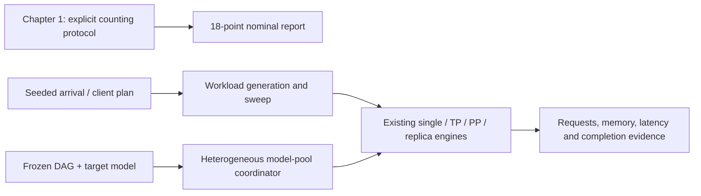

# Hello MLSys course workflows

Version 1.16 adds three opt-in workflows for the course's Chapter 1, Chapter 7 /
9.2 and Chapter 9.3 tasks. The existing fixed-arrival `simulate` and `predict`
contracts, causal-attention analytical formulas, Profile identities and measured
evidence remain unchanged. All new reports keep `hardware_validated=false`.

| Course task | Entry point | Main artifacts |
| --- | --- | --- |
| Chapter 1: three models × six shapes | `chapter1` | 18 predictions, 54 components, formula reconciliation, CSV, Chinese HTML/Markdown and four SVGs |
| Chapter 7 / 9.2: arrivals, concurrency and SLO | `generate-workload`, `sweep` | Canonical requests, every seed/run, original single-run metrics, pooled empirical quantiles, observed brackets, HTML/CSV/SVG |
| Chapter 9.3: dependent 32B/7B tasks | `dag` | Actual dependency releases, model-pool ledgers, makespan, resource drain, per-device KV/utilization, candidate comparison and Gantt |



## Run the supplied experiments

Each output directory must be new. These commands use only the installed CPU
library and standard-library dependencies; model files and GPU access are not
required.

```bash
mlsys-sim chapter1 --plan examples/course/chapter1.plan.json --out runs/course/ch1
mlsys-sim generate-workload --plan examples/course/load-workload.spec.json --out runs/course/requests
mlsys-sim sweep --experiment examples/course/load-queue.experiment.json --plan examples/course/load-poisson.plan.json --out runs/course/rates
mlsys-sim sweep --experiment examples/course/load-queue.experiment.json --plan examples/course/load-clients.plan.json --out runs/course/clients
mlsys-sim dag --plan examples/course/dag-fork-join.plan.json --out runs/course/fork-join
mlsys-sim dag --plan examples/course/dag-candidates.plan.json --out runs/course/candidates
```

The root `manifest.json` retains the input/source hashes, prediction ID and
current UTC storage time. Generated figures and detailed reports are under
`artifacts/`. New timestamps cannot establish that predictions preceded the
course's already published measurements. Selected timing, communication and
Workspace Profiles retain exact original bytes and SHA256; changes during a
sweep or candidate comparison are rejected. DAG replay plans reference the
saved copies, so later removal of an original Profile does not destroy replay.

## Counting agreement without replacing the default model

Chapter 1 explicitly uses full-square attention counting, separate matrix and
vector peaks and per-component roofline maxima followed by a component sum.
The ordinary serving model still uses its original causal triangle. The course
mode therefore does not silently invalidate old calibrated workloads.

The supplied 0.6B Prefill512 anchor has Attention AI 341.333333 FLOP/byte against
the declared matrix ridge 304.6875. Decode Attention AI is 2 for 0.6B/1.7B and
4 for 4B, following each model's Q/KV head ratio. Course approximate
tables and the stated naive-attention asymptote are reconciled against the
published equations: differences are visible, rather than fitting invented
efficiencies to force agreement. W7900D's unconfirmed parameters produce an
explicit pending AI-position diagram, not an invented hardware roofline.
See [Chapter 1 protocol](course-chapter1.md).

## Empirical load boundaries

Open-loop Poisson and periodic arrival plans expand into ordinary requests.
Closed-loop client plans issue the next request only after that client's actual
completion/failure/timeout plus declared think time. An online client count is
distinct from the engine's batch-size limit.

Every repetition is retained. The synthetic-only empirical step-scale option
models declared service-time variability; it does not modify measured Profile
latencies. Reports distinguish original arrival-cohort throughput including
drain from completions within the measurement window. Failed, timed-out or
unfinished requests veto an SLO pass; missing quantiles and small cohorts are
insufficient evidence. Out-of-window `NOT_ADMITTED` requests are not an overload
criterion.

The reported maximum is the largest accepted **observed grid point**, with
adjacent pass/fail or stable/overloaded brackets and resolution where present.
It is not a universal mathematical stability boundary. Curves may be noisy or
nonmonotonic; they are never sorted or trimmed to manufacture a trend.
See [load generation and scanning](load-generation-and-sweep.md).

## Causal DAG and heterogeneous pools

Each node identifies its target model and successful predecessors. Actual ready
time is the maximum of its declared release time and all parent completion
times. Queue wait begins there; dependency wait is reported separately. A
failed predecessor blocks descendants without stopping independent healthy
branches. Replaying fixed arrivals from another deployment cannot substitute
for this dependency calculation.

Each model pool has its own existing `Experiment`: model geometry and dtype,
TP/PP layout, replicas, KV, cache/swap policy and Profiles. Physical device IDs
must be exclusive across pools. All pools advance on one event timeline, and
idle pools retain cache. Budget truncation preserves in-flight ownership.
Task makespan excludes trailing PP feedback; resource-drain elapsed time is
reported separately. A candidate with incomplete drain or execution errors
cannot enter the completed-candidate ranking.

The 52-node example freezes an explicitly **synthetic teaching trace** and
compares three declared four-card placements: BF16 TP2 large model with two
small-model replicas, FP8 single-card large model with three small replicas,
and INT4 single-card large model with three small replicas. Model geometries
and hardware rates are declared assumptions. These are not a captured Claude
Code run, a recommendation for a real W7900D deployment or new hardware
accuracy results. A real frozen trace can be supplied through the same schema.
See [DAG and model pools](dag-and-model-pools.md).

Inter-model dispatch/data transfer, shared-fabric contention, power throttling
and semantic output quality remain outside these models. Actual W7900D
measurements and real course traces can be attached later through the existing
calibration/validation workflow; the teaching functionality does not depend on
claiming those measurements already exist.
