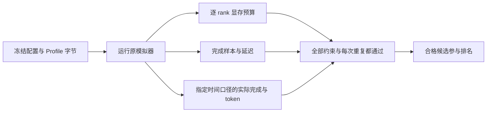

# 显存、延迟与吞吐联合约束

只满足 P99 上限不意味着部署可用：吞吐可能未达目标，也可能有一个显存较小的 rank 超过预算。
联合约束在现有模拟结果上逐项检查这些条件，并保留 `PASS`、`FAIL`、`UNKNOWN` 三态。
它不会重新拟合 Profile，也不把模型预测变成真机精度认证。



## 声明与调用

```json
{
  "schema_version": 1,
  "min_completed_samples": 100,
  "memory": {"max_budget_fraction": 0.9},
  "latency": {"p99_ttft_ms": 50, "p99_tpot_ms": 5, "p99_e2e_ms": 250},
  "throughput": {"basis": "measurement_window", "min_requests_per_s": 60, "min_output_tokens_per_s": 800}
}
```

至少声明 `memory`、`latency`、`throughput`、`task` 中的一类。
未知字段、bool 充当数字、非有限数值和不合法阈值都会报 `INVALID_CONSTRAINTS`。
`min_completed_samples` 默认 100，作用于每次评估及每个声明的延迟指标，不能把几个不足样本的重复合并后宣称每次都通过。
小型确定性教学例子可显式设为 1；它不代表经验 P99 已有可靠的统计精度。

```python
from mlsys_sim.constraints import evaluate_simulation_constraints
from mlsys_sim.engine import simulate

run = simulate(experiment)
assessment = evaluate_simulation_constraints(run, constraints)
print(assessment["verdict"], assessment["limiting_constraints"])
```

`evaluate_dag_constraints(result, constraints, pool_specs={"model_id": pool_constraints})`
同时支持 DAG 总体和显式指定的模型池；未知模型池会报错。
总体与任何指定池失败或未知，合并结果都不会通过。
evaluator 只读传入的结果、请求时间戳和内存账本，不重新打开 Profile。

## 显存按每个 rank 检查

每个设备的有效上限是以下值的最小值：

| 上限 | 来源 |
|---|---|
| 设备实际容量 | `device_memory_bytes` |
| 容量 × `max_budget_fraction` | 默认比例为 1；有效字节向下取整 |
| `max_budget_bytes_per_rank` | 可选的显式整数上限 |

检查值是 `budget_peak_bytes`：固定预留加实际观察到的 Workspace 峰值。
固定预算已经包含完整物理 KV 池、权重、运行时、PP buffer，以及 safety / external 预算。
`kv_used_bytes` 和 `peak_used_blocks × kv_block_bytes` 是逻辑使用量，**不能再次加到物理预留上**。
`physical_peak_bytes` 不含 safety / external 预算，不能替代预算约束。

TP / PP / replica / model pool 的各 rank 保留独立记录，显存较大的 GPU 不能通过平均值掩盖较小 GPU 的超限。
字节比较保留整数，超过 `2^53` 时也能识别相差 1 byte；fraction 使用声明十进制数的精确有理上限。
`memory={}` 仍有效，表示逐 rank 不得超过设备自身容量。
启动阶段的 `STATIC_MEMORY_INFEASIBLE` 由候选运行器保留为不可行候选；它不会产生虚构的完成或延迟样本。

## 延迟、token 与时间分母

普通模拟直接使用原报告 P99，样本数来自对应的完成请求。
DAG 总体和各池从原节点请求重算线性插值 P99，起点是节点 ready 后进入模型池的 arrival。
依赖等待不在这些节点 TTFT / E2E 内；完整工作流的时延用 `task.max_makespan_ms` 单独约束。

合法单输出请求没有 TPOT 样本。
多输出请求丢失 TPOT，或任何声明指标含 NaN、Inf、负值、bool，都属于未知证据；不能静默剔除坏值后让剩余样本通过。

`throughput.basis` 必须显式选择，且至少声明一个非负吞吐下限：

| basis | 分母与计数 |
|---|---|
| `measurement_window` | 显式到达测量窗口。只接收 `[0,T)` 到达队列；请求完成 / token emit 发生于窗口内才计数，包含 T 边界的已执行事件。 |
| `elapsed` | 普通模拟用完整 `simulated_ms`；DAG 总体及各池统一用完整全局 `elapsed_ms`，包含必要的反馈 / DMA 排空。 |
| `task_makespan` | 仅适用于全部节点完成且资源已排空的 DAG；分母是最后输出 token 的任务 makespan，不包含随后排空。各池也共享这个全局分母。 |

DAG 的 `min_requests_per_s` 表示 **节点请求 / 秒**，不是整个工作流的 tasks / 秒。
没有显式测量窗口时，`measurement_window` 返回未知；不会拿完整运行时长或 cohort 吞吐替代。
同理，普通模拟没有 DAG task makespan，使用该口径也返回未知。

输出 token 吞吐依据实际 `token_times_ms`，按选定窗口逐 token 计数。
例如输出发生于 10、15、20、25 ms，测量窗 T=20 ms，则有 3 个 token 在窗内，即 150 token/s；
请求到 25 ms 才完成，因此同窗请求吞吐为 0。不能用最终 4 token 算成 200 token/s，也不能因请求未在窗内完成而丢掉前 3 个 token。
缺少时间戳或计数不一致时返回 `UNKNOWN`。

原模拟器的 arrival-cohort 吞吐包含 drain 后完成数，仍按原规则保存；联合窗口约束不会误用这个可能更高的值。

## 三态判断与余量

| 判定 | 条件 |
|---|---|
| `FAIL` | 阈值明确违反，或请求失败、超时、未完成、依赖阻断、运行未完成，或 DAG 资源没有排空。 |
| `UNKNOWN` | 没有已知失败，但缺少指标 / 分母 / 每 rank 证据，或完成 / 指标样本数不足。 |
| `PASS` | 所有必需证据存在、完成状态可靠、所有约束和样本门槛均满足。 |

合并优先级为 `FAIL` → `UNKNOWN` → `PASS`。阈值比较包含等号。
每条 check 记录 scope、实值、关系、阈值、单位、样本数和原因；内存项还保留设备容量。
`limiting_constraints` 使用无量纲 headroom 排序：上限为 `(limit−actual)/limit`，下限为 `(actual−limit)/limit`。
余量为 0 表示刚好到界，负值表示超限；不能把 bytes 与 ms 的原数值混在一起排序。
阈值为 0 的下限没有可定义的相对余量，仍保留检查，但不参与这种排序。

## 负载扫描中的联合合格区

扫描计划可选 `constraints`，无需扩展旧 `slo` 字段：

```bash
mlsys-sim sweep --experiment examples/course/load-queue.experiment.json \
  --plan examples/course/joint-sweep.plan.json --out runs/joint-sweep
```

逐重复结果新增 `constraint_assessment`；逐点保留所有重复的检查、判定和无量纲余量。
HTML 报告可展开查看，CSV 同步包含判定和最小余量。
`slo_pass`、`sla_max_observed` 保留旧语义，联合接受单独使用 `joint_pass` / `joint_verdict`、`joint_max_observed` 及相邻 joint pass→fail bracket。
只有每个重复都满足旧 SLO、全部联合约束，且没有观察到开放过载，该点才联合通过。
声明最低吞吐时低负载可不合格、较高负载可合格，再升高负载又可能违反尾延迟；报告完整保留这种可行区，不能假设单调。

没有 `constraints` 的计划不增加字段、不改变原 SLO、CSV、HTML 或报告 SHA。
可参考 `joint-simulation.constraints.json`、`joint-dag.constraints.json` 与完整的 `joint-sweep.plan.json`。
Profile 仍由原运行器冻结：整个扫描从同一份只读快照计算，原字节、来源类型和 SHA 都随报告留存。
