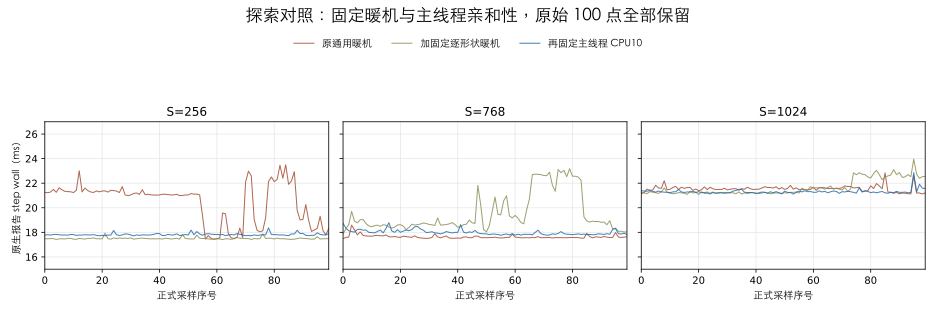
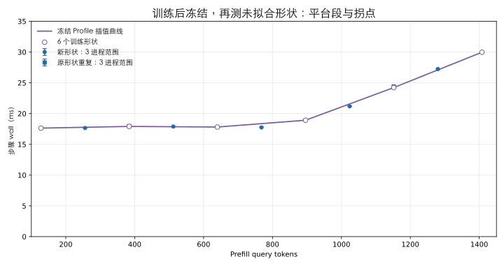
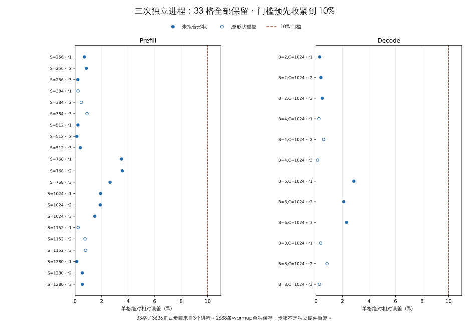

# Prefill 执行状态：时间线、稳态控制与独立留出

日期：2026-11-17（Asia/Singapore）。RX9070XT/gfx1201、Ryzen9 3900X、固定ROCm/vLLM镜像、Qwen3-0.6B BF16、TP1/PP1/单副本。

新独立留出 **PASS：33/33格、3636/3636正式报告步骤，全部误差≤10%，进程内与跨进程stationarity同时PASS**。Prefill MAPE **1.05%**、最大 **3.56%**；Decode回归 **0.89%**、最大 **2.85%**。总体 MAPE **0.99%**。

## 先定位，避免用留出结果改常数

此前21.01%的最坏Prefill误差保留不变。原训练S256前半段约21ms、后半段约17–18ms，进程中位数掩盖了内部切换。旧参数学到的约21.12ms固定项是混合状态的经验值，不能直接解释为CPU固定开销。

本次先按原条件采完整100次S256与100次S1024 CPU/HIP/GPU时间线，另采低扰动主机记录。200个request、67800个kernel均能按唯一HIP correlation对齐；每shape每request339个kernel，名称、顺序和次数不变，实际Graph调用为零。配置的FULL_AND_PIECEWISE不代表这些Prefill实际走了Graph。

S256主机execute段约20.5→16.9ms时，执行线程可见频率约3.46→4.32GHz，并伴随迁移。Profiler中相应窗口execute33.68→28.21ms，GPU kernel union7.02→6.92ms接近，间隙约减少5ms。Profiler显著增加了绝对耗时，所以这些值仅作诊断，不进入校准。已捕获GC暂停约0.27–0.30ms，晚于首次切换，不能解释持续块差；不据此声称捕获了所有调用间GC。

原通用暖机实际上交替B1/S512/max_tokens1与B4/context1024/max_tokens33，不能保证持续Prefill的主机执行状态。我们用固定128次逐形状暖机作对照：S256变稳，但不绑核的S768/S1024仍有迁移和慢块；再固定本任务主线程到CPU10后，S256五个20样本块execute中位数均约17.07ms。没有改系统governor、CPU频率或全局GPU设置。

S1024的原生调用后残差仍约4ms，不能与S256主机慢态混为一谈。其GPU工作较大，与主机提交存在重叠，简单统一截距不适合整个尺寸区间；本次复用已有网格Profile分段插值，不拿旧留出值改一个新常数。

## 冻结的运行域与训练

固定原镜像、GPU_MAX_HW_QUEUES=1、2GiB KV池、CPU/驱动/ROCm/RCCL实际信息；主线程亲和性CPU10，原120秒通用暖机后，每个被查询Prefill形状固定128次前置请求。次数不是按延迟自适应选择。正式hooks在额外暖机期间暂停，所有暖机原始值独立保存；这是准备后的成本，不是冷启动承诺。

仅两个全新训练进程、1968个正式报告步骤用于拟合：Prefill锚点128/384/640/896/1152/1408，Decode batch1/4/8，各记录100/128步。Profile的54个exact形状点采用每会话中位数的中位数；outlier全部保留，workspace仍取MAX（本次workspace未知，不用于容量认证）。

进程内Prefill100/20、Decode128/32连续块及跨进程比值门槛1.10预先固定，每个实际lookup形状另作检查。旧默认Profile仍用原mean/MAX；新的reported_l2_step_hook_wall_v1边界必须带原序proof、Runtime指纹及完整调度/内存域，不能通过改标签、混合形状或改变KV池跨域借用。

完整稳定性政策在首个训练进程的通用暖机期间写入主机，当时正式训练文件仍为0格；[政策回执](../../examples/prefill_state_20261117/receipts/training-policy-receipt.json)和[训练进程时序](../../examples/prefill_state_20261117/receipts/training-progress.json)均保留。此处不声称有逐请求正式起点的独立时间戳。

## 新的独立验证

主机在UTC `2026-11-17T02:32:08.947957+00:00` 保存Profile、输入及71条预测的raw/canonical哈希回执后，才启动三个全新进程。代码提交为 `ef2285eafef63ba0041f54332b63b5e0f2fb7f2b`。所有结果一次性评分，未重新拟合、改门槛或挑选有利进程。

| 分组 | 格数 | 正式报告步 | MAPE | ≤10% |
|:---|---:|---:|---:|---:|
| 未拟合形状 | 21 | 2268 | 1.29% | 21/21 |
| 原形状重复 | 12 | 1368 | 0.48% | 12/12 |

误差口径：abs(冻结预测中位数−每进程每形状实测中位数)/实测中位数。主留出与重复共享三个进程，不能算成六组独立采集；连续步骤与warmup也不当作独立硬件重复。所有失败、缺样、未知状态都保留为失败，不用总体平均误差掩盖坏单元。

| 形状 | r1 ms | r2 ms | r3 ms | 冻结预测 ms | max/min−1 |
|:---|---:|---:|---:|---:|---:|
| S=256 | 17.653 | 17.627 | 17.740 | 17.776 | 0.64% |
| S=384 | 17.954 | 17.831 | 18.077 | 17.915 | 1.38% |
| S=512 | 17.827 | 17.888 | 17.935 | 17.865 | 0.60% |
| S=768 | 17.748 | 17.738 | 17.897 | 18.369 | 0.90% |
| S=1024 | 21.172 | 21.176 | 21.261 | 21.577 | 0.42% |
| S=1152 | 24.176 | 24.414 | 24.423 | 24.231 | 1.02% |
| S=1280 | 27.067 | 27.247 | 27.249 | 27.101 | 0.67% |
| B=2,C=1024 | 4.508 | 4.504 | 4.499 | 4.520 | 0.19% |
| B=4,C=1024 | 4.626 | 4.642 | 4.621 | 4.616 | 0.47% |
| B=6,C=1024 | 5.180 | 5.140 | 5.151 | 5.033 | 0.78% |
| B=8,C=1024 | 5.474 | 5.501 | 5.469 | 5.455 | 0.58% |

## 证据和限制

- [全部正式步与逐格误差](cells.csv)、[原始逐步字段](steps.csv.gz)、[全部2688条新留出warmup](warmups.csv.gz)、[完整评估](report.json.gz)、[摘要](summary.json)。
- [实际训练数据、Profile、政策、冻结预测与主机回执](../../examples/prefill_state_20261117/README.md)。约328MB未压缩的完整CPU/GPU时间线、未准备状态、无绑核对照和原数据在本地与AMD机器保留；公开数据不包含SSH、主机地址或私有采样源码。
- [原21%误差报告](../runtime-step-20261117/README.md)保持原值。新方法改变了准备协议和模型，不能把不同运行域混成同一组配对前后实验。
- 主机频率/迁移记录和控制干预支持提交路径状态解释，不唯一归因某个固件或内核函数。正式新留出无profiler；实际逐步dispatch并未在所有正式步骤中观察。
- warmup的先后关系由source sampler SHA及job区间证明，没有另加独立formal-start时间戳。冷态、不同CPU/亲和性、其它GPU、TP/PP、多副本、缓存/混批策略、在线SLA与显存容量没有因此获得准确性认证。

[完整原始数据哈希与清理回执](raw-evidence-index.json)：9个进程、83个形状格、9252个报告步骤，以及5248个额外warmup全部保留。这些是探索、训练与新验证的总清单，不增加独立验证样本量。仅本任务容器与临时SSH副本已清理，GPU回到0%忙碌和原显存基线。
