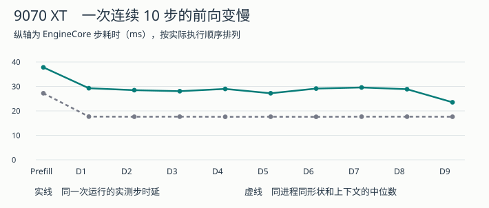

# RX 9070 XT 短输入并发 2 的前向长尾

在 Qwen3-4B BF16、TP1/PP1、同步 eager、ROCM_ATTN、每个请求输出 16 token 的闭环运行中，一段自然出现的前向变慢连续覆盖了一个 Prefill 和九个 Decode。主线程固定在逻辑 CPU10。下表比较同一进程、同一有序形状和上下文的 EngineCore 步耗时。

| 阶段 | 实际步时延 | 同形状参照 | 模型前向额外墙钟 |
|---|---:|---:|---:|
| Prefill | 37.80 ms | 27.22 ms | 10.37 ms |
| 随后的 9 个 Decode | 23.53–29.58 ms | 17.59–17.67 ms | 5.34–11.26 ms |



这段约 292 ms 的区间没有重叠的 Python GC。在运行时记录的 ROCm stream 上，前向区间也随之拉长。该区间包含设备工作和主机提交不及时形成的空闲，无法从这项计时单独计算 kernel 指令变慢了多少。外部采样器以约 100 ms 间隔读取 CPU 汇总计数，该进程有 755 个采样区间的中心落在正式负载中。CPU22 忙碌度至少 50% 的三个区间全部落在这十步中，忙碌度分别为 100%、100%、67%。CPU22 和 CPU10 共享同一物理核心。[逐步时间线和计数器](shared-episode.json)

固定的诊断标记要求运行中 Prefill 墙钟至少 38 ms，且紧邻的 Decode 至少达到自身同形状中位数的 1.30 倍。上述 Prefill 略低于 38 ms。第一批 2,048 个低扰动 Prefill 步、随后 1,536 个细分阶段的 Prefill 步均未命中完整标记。另一个孤立 Prefill 达到 40.45 ms，邻近 Decode 只有 18.8–20.0 ms。复用旧请求流时，先前 41.21 ms 的第 2,215 个 Core 调用这次为 27.16 ms。[各进程完整分母和来源摘要](diagnostic-processes.json)

另有三次进程在同一序号 4,879 的孤立 Decode 内记录到 Python 第 2 代 GC，耗时约 11.4–11.6 ms。在持续多步的区间中未观察到相应 GC。单独的 Torch CPU/HIP 采样窗口覆盖 32 个 Core 步、18,312 个设备活动，均有提交关联。该窗口中的最大 Prefill 墙钟达到 76.17 ms，探针开销明显，绝对值仅用于该进程内部的阶段对齐。[GC 记录](gc-events.json)

## 受控验证方法

在同一容器内启动一个低优先级 CPU 子进程。每个预登记窗口从目标 Prefill 的前两个 Decode 开始，持续六个 Core 步。按照事先固定的请求流和有序输入形状分配三种条件：子进程空载、在 CPU22 运行、在另一物理核心的 CPU23 运行。所有条件均记录实际子进程 CPU 时间和窗口边界。每类后台负载使用两个新进程校准，只有两次都观察到两个阶段的同核增幅至少为 10%、且对照核心影响较小时，才拟合候选并继续验证。

条件预测采用两个校准进程的阶段增量中位数，忙碌区间在预测前给出。候选使用正常离散事件调度器推进虚拟时间，再统计每个请求的首 token 与最后一个 token。每个留出进程分别检查六项阶段／条件中位数（10%）、TTFT 和端到端 P99（25%）。历史联合尖峰另有阳性验收：每个进程的同核窗口中须同时存在实测阳性和预测阳性，且两者的窗口占比相差不超过 20 个百分点。自然负载另外检验连续步，在新进程启动前冻结其预测。

## 冻结后的结果

以下误差来自六个新进程，共 3,072 个请求。先在测量主机登记模型、每步预测、逐请求预测摘要、脉冲计划、代码和检查点，再启动正式 worker。原生审计按每一步验证脉冲的实际开始、结束和增量 CPU 时间，重算服务端 token-ready 指标。

| 后台任务 | Prefill 增量 | Decode 增量 | 阶段／条件中位数最大误差 | TTFT P99 最大误差 | 端到端 P99 最大误差 | 同核窗口的历史阳性标记 |
|---|---:|---:|---:|---:|---:|---|
| 标量循环 | +8.28 ms | +5.73 ms | 1.56% | 1.53% | 5.52% | 预测 0、实测 0，共 88 窗口 |
| 256 KiB 缓冲区拷贝 | +19.88 ms | +13.89 ms | 2.45% | 2.44% | 1.68% | 预测 89、实测 89，共 89 窗口 |

缓存拷贝的三个验证进程分别有 29、30、30 个同核窗口；89 个窗口都预测并实测到联合尖峰。标量负载同核窗口没有观测阳性，该项严格阳性验收证据不足；另在对照核心条件和未施加脉冲区间各观测到一次联合尖峰，候选均未预测到。两类条件中的典型成本均通过各自门槛。两种负载的系数不同，外部忙碌度本身不足以选定一个通用增量。[标量逐组评分](scalar/score.json) · [缓存拷贝逐组评分](copy/score.json)

### 自然负载独立验证

第三批使用完整的 1,024 请求短输入、并发 2、16 个输出 token。三个新进程均采用原生采集，没有施加 CPU 脉冲。主预测使用已合并的短 Prefill v2，不把未声明的未来 CPU 占用当作已知输入。两个负载强度的条件参考也在这一批实测前按几何形状冻结。[预测与冻结回执](natural/receipt.json) · [条件场景](natural/conditional-scenarios.json)

| 进程 | 预测／实测联合事件数 | 预测／实测 TTFT P99（ms） | 预测／实测端到端 P99（ms） |
|---|---:|---:|---:|
| forward-c2-r0 | 0 / 0 | 28.80 / 29.77 | 295.58 / 313.81 |
| forward-c2-r1 | 0 / 0 | 28.80 / 30.23 | 295.58 / 310.43 |
| forward-c2-r2 | 0 / 0 | 28.80 / 30.60 | 295.58 / 313.29 |

自然对照共 1,536 个 Prefill 步，没有出现历史定义的联合阳性，无法据此确认自然尖峰预测能力。每次重复的预测和实测、与 CPU22 汇总计数的时间对齐均保留。[完整自然对照](natural/score.json) · [阳性步及 CPU 时间区间](natural/episode-context.json)

## 使用与复核

条件模式只覆盖经过校准的单卡同步短 C2 闭环输入。调用方在模拟前提供有序、不重叠的半开区间，索引从第一个在线 Core 步的 0 开始。使用下列样例可重放缓存拷贝的条件预测。所需的基础实验可按[短 Prefill Profile 说明](../../examples/qwen4b_short_prefill_20261124/README.md)生成。

```python
import gzip
import json
from pathlib import Path
from mlsys_sim import predict_closed_loop
from mlsys_sim.config import load_experiment

study = Path("docs/qwen4b-c2-shared-tail/copy")
experiment = load_experiment(Path("runs/short-prefill/experiment.json"))
spec = json.loads((study / "plan.json").read_bytes())["roles"]["holdout"]["spec"]
with gzip.open(study / "predictions.json.gz", "rt") as handle:
    scenario = json.load(handle)["scenario"]
prediction = predict_closed_loop(experiment, spec, sibling_contention=scenario)
```

```sh
study=docs/qwen4b-c2-shared-tail/copy
python scripts/fit_c2_contention.py --experiment runs/short-prefill/experiment.json \
  --plan "$study/plan.json" --calibration "$study/calibration.json.gz" --out runs/c2-copy-fit.json
python scripts/score_c2_contention.py --plan "$study/plan.json" --forecast "$study/predictions.json.gz" \
  --evidence "$study/validation.json.gz" --freeze "$study/receipt.json" --out runs/c2-copy-score.json
```

评分器对缺少阳性样本的严格门槛返回非零，并把中位数、P99 与阳性结果写入各自字段。原始 Scheduler/API/Core 账本、阶段及传感器原始记录、HIP trace 和受控窗口执行记录保留在 AMD 主机 `~/qwen4b-c2-timeline-20261124/`。索引列出 24 份逐进程原始归档及校验值，独立验证数据另附逐文件摘要。[原始归档索引](raw-archive-index.json)
