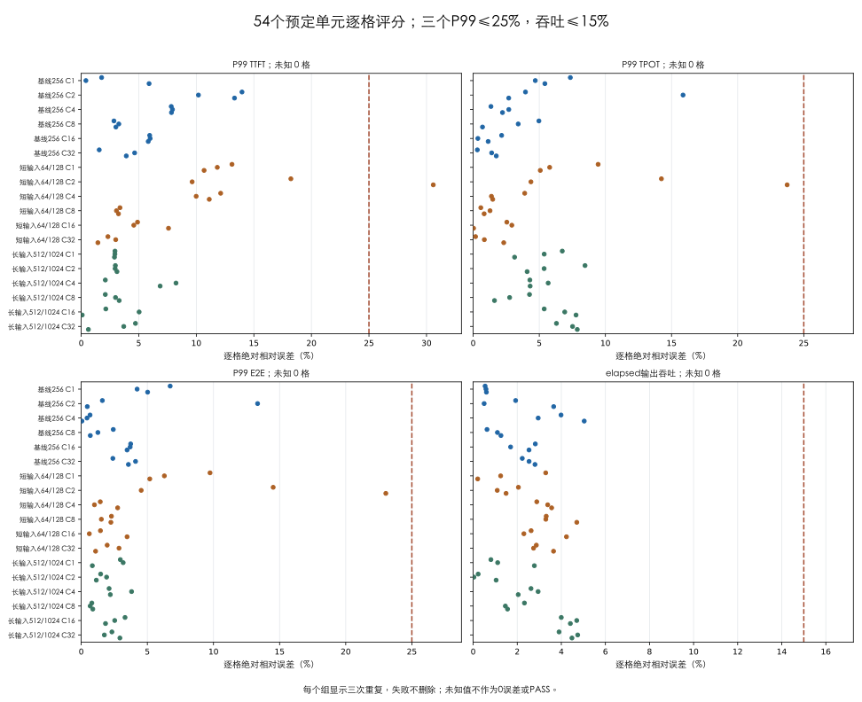
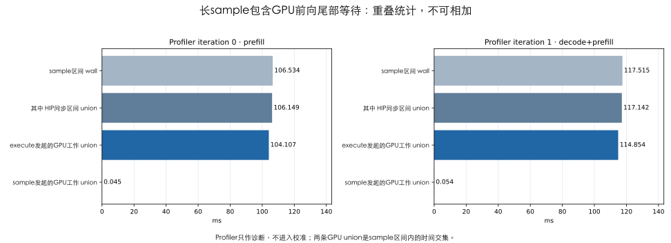
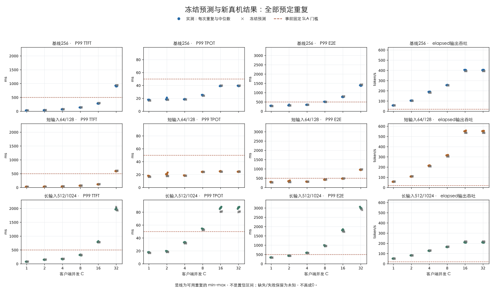

# Qwen3-4B 在线成本与调度：新校准及独立留出

独立新留出结论 **FAIL**：53/54格通过全部主条件，54/54个Runtime证据核验通过，实测核验27,648/27,648请求、442,368/442,368输出tokens；false-safe 0，false-unsafe 0，未知0。

本报告中的校准是推理成本采样与拟合，不是训练或更新Qwen权重。共享模型以只读方式加载。只有所有逐格数值目标及零false-safe均达到，整体状态才为PASS；合法过载导致的实测SLA失败与预测不准确分别报告。

| 指标 | 单格等权MAPE | 最大单格误差 | 达到预设目标 | 门槛 |
|:---|---:|---:|---:|---:|
| P99 TTFT | 6.04% | 30.59% | 53/54 | 25.00% |
| P99 TPOT | 4.47% | 23.74% | 54/54 | 25.00% |
| P99 E2E | 3.34% | 23.03% | 54/54 | 25.00% |
| elapsed输出吞吐 | 2.44% | 5.04% | 54/54 | 15.00% |

缺样或证据错误保留为未知/FAIL，不作为零误差；MAPE只在可评估格中计算，完整分母仍为54。

## 时间线先于校准

CPU/HIP/GPU诊断将EngineCore调度、execute返回、sample、发布与API返回分开记录。native切块使用剩余2048-token预算，旧模拟的每请求512上限没有与之对齐；新实验显式对齐chunk上限和16条活动请求上限。

完整Profiler trace包含34个iteration、19,596个GPU kernel；其中19,596个kernel匹配唯一HIP correlation。这些是诊断观察，不作为校准或独立留出样本。

上图横条存在重叠，不能相加。sample长区间包含execute发起的GPU前向尾部及HIP同步等待，即使thread CPU接近wall，也不能解释为CPU采样算法开销。Profiler只用于定位，不作为拟合标签。fulltrace与低扰动基线的负载不同，其绝对墙钟差不单独归因Profiler。未生效的初始化前taskset对照、初始化后有效亲和性对照均保留，不挑较快结果冒充同一运行域。

诊断与最终CPU准备政策可能不同，其绝对耗时不与新在线结果拼成同条件配对对照。

## 校准、拒绝与运行域

接受的v5校准仅使用2个全新controlled-micro进程、33,088条按事前操作规则选择的active EngineCore迭代。固定准备包含batch1/4/8/16×输入64/128/256/512/1024、每请求16输出；主线程CPU10，quiet缓冲进度。固定20个cohort准备之外，微探针的暖机和cleanup均单独保留，不按已见延迟自适应暖机。

v5微探针协议于UTC `2026-11-18T04:33:54.965271+00:00`、该批新数据开始前声明。每probe计划32次正式重复，实际每个精确shape/session至少32次且为偶数；N8只是没有放宽的最低拟合门禁，不是实际只采8次。

greedy的`max_tokens=16`仍保留，但校准不是每个probe自然跑完16输出：拟合选择从事前enqueue开始，直到目标full-B Decode或mixed返回的**全部active Core前缀**，包含首Token bootstrap；随后执行internal abort、empty flush与Runner/KV reset。cleanup原始记录保留但不拟合，选择依据是事前顺序和操作，不是耗时。这不同于失败v2/v3/v4的连续16输出设计；协议变更在新校准采样前声明，未把旧拒绝数据换label混入fit。原始[微探针计划与选择协议](../../examples/qwen4b_online_20261117/calibration/protocol/)和[方法/SHA摘要](calibration-protocol.json)均保留。

模型按Prefill/Decode/mixed和exact batch分别拟合非负a×nominal+c，保留batch拐点；每会话/精确形状中位数等权，源顺序与跨进程门槛固定1.10，最低N8及47个cell必须完整。拦截项是未建模EngineCore工作的经验修正，不是已测CPU或GPU分量。

| 先前校准尝试 | 状态 | 拒绝项 | 正式记录 | 每形状最低重复 |
|:---|:---|---:|---:|---:|
| v2-native-affinity：原生线程亲和性下的连续采样；原始稳定性拒绝保留，不进入最终接受模型。 | REJECTED | 1538 | 38,512 | 4 |
| v3-cpu10-n4：固定主线程 CPU10、每 probe 四次采样；原始稳定性拒绝保留。 | REJECTED | 18 | 38,512 | 4 |
| v4-cpu10-n8：固定主线程 CPU10、每 probe 八次采样；原始稳定性拒绝保留，未放宽 1.10 门槛。 | REJECTED | 8 | 77,024 | 8 |

这些是校准阶段拒绝，发生在正式留出前；其原始记录和policy仍保留，没有改标签混进接受的拟合。

运行域为实际RX9070XT、Qwen3-4B BF16、TP1/PP1/单副本、MRv1同步eager、原生ROCM_ATTN、3GiB KV池。完整CPU/环境/observer/准备policy、模型checkpoint、Runtime及调度/显存配置均由artifact和冻结回执绑定；不把旧0.6B Profile、Graph域或其他硬件的系数改名移植。

## 单独的校准诊断，不计入54格

另有9个N128校准诊断单元；unknown 0、false-safe 0、false-unsafe 1。它们用于检查候选成本和调度，角色明确为CALIBRATION_DIAGNOSTIC_NOT_HOLDOUT；不是正式独立验收，其请求或执行步不并入下方54格主分母。候选成本系数未因这些结果更新。

这些诊断有2,708个执行Core步，其中108步命中校准exact shape；10步的nominal坐标在已测跨度外。声明包络检查unknown为0步。exact shape命中和nominal坐标跨度不同于预算包络，不能写成全插值或全域实测。

| 阶段 | 执行步 | exact校准shape命中执行步 | 已测nominal跨度内执行步 |
|:---|---:|---:|---:|
| prefill | 108 | 53 | 105 |
| decode | 2302 | 53 | 2302 |
| mixed | 298 | 2 | 291 |

上表统计执行步，重复出现也重复计数；不是unique shape个数。声明包络内未见几何由参数族泛化，少量nominal跨度外步骤仍保留为诊断事实，不自动变成已测插值点。跨Python末位差异还可能改变nominal-span边界标志，原始JSON和SHA保持原值。

[9格原始诊断报告](calibration-diagnostic-report.json)、[逐组shape/span覆盖](calibration-shape-span-coverage.json)、[独立角色摘要与SHA](calibration-diagnostic-summary.json)。

## 冻结后才执行的新留出

最初一次控制器启动前有读取修复：以8MiB请求读取sysctl boot-ID时返回ENOMEM（errno12）；当时正式尝试为0，本任务正式GPU worker启动为0。修正仅将该小文件读取请求改为4096bytes，boot-ID原始字节及换行的SHA语义不变。它不是CUDA分配OOM，也不是54格中的一个正式失败。

原三组预测gzip/raw/canonical、模型、spec、jobs、阈值和库源码逐项复用原字节；没有重新生成预测、重新拟合系数或根据正式结果调参。仅控制器及由其派生的清单/回执时间/合同重新登记。旧冻结尝试`retained-frozen-attempt1`的28个文件和启动失败证据保留。[更正记录](../../examples/qwen4b_online_20261117/frozen/premeasurement-correction.json)与[旧回执原字节](../../examples/qwen4b_online_20261117/frozen/previous-freeze-receipt.json)随冻结数据公开，旧、新回执SHA和失败日志SHA另列在summary中。该boot修复的结果回执为`5f7a7ca76764dcdfa5cebd78f0754b7e86260625d269622ab519ad04d82aabfc`；若另有后续采集恢复，不把其最新控制器混作这条零样本链的终点。

随后确实发生过一次真实采集，不能归零或宣布无效：其白名单记录status、APIfeedback均为COMPLETED，shutdown完成，512个请求完成，固定16输出对应8192个输出tokens；原11份raw文件保持原字节。中断发生在worker返回后，host用户无法向Docker root拥有的输出目录交接日志；控制器退出且状态残留。其accuracy在盲恢复决策时未读、未评分，也未用于校准。

UTC `2026-11-18T09:44:06.840103+00:00`先固定重新采集完整54格为唯一主验收，旧1次仍在`retained-interrupted-acquisition1`单独保留且未评分。总采集尝试按1+54列示，不把旧1次混进本报告54格分母，也不称其是零样本启动失败。修正只在worker返回后通过owned container对唯一输出目录作stdlib非递归chown，没有改旧raw文件、native worker命令、计时边界、flags、模型、预测或阈值。

第二条恢复链保留`5f7a7ca76764dcdfa5cebd78f0754b7e86260625d269622ab519ad04d82aabfc`原回执并指向`2b7bb2c2a3b49613deeb04d97cfd1b22c8d98749b0280ad9bcec40995e471b82`最新回执；23份原payload及三组gzip/raw/canonical逐项复用，66份库源码承诺不变。[盲恢复决定](../../examples/qwen4b_online_20261117/frozen/blind-recovery-decision-v3.json)、[旧采集索引](../../examples/qwen4b_online_20261117/frozen/interrupted-attempt-inventory.json)、[状态白名单](../../examples/qwen4b_online_20261117/frozen/interrupted-whitelist-status-v3.json)、[权限scratch验证](../../examples/qwen4b_online_20261117/frozen/ownership-preflight-v3.receipt.json)与[恢复记录](../../examples/qwen4b_online_20261117/frozen/acquisition-recovery.json)均按原JSON/SHA保留。

测量主机冻结UTC：`2026-11-18T09:49:16.929114+00:00`；首个Runtime启动：`2026-11-18T09:58:45.172041+00:00`；最后结束：`2026-11-18T11:38:56.328355+00:00`。源码提交：`4169cbafc7b614bf5c3540647f81ab7ae45944db`。完整输入、接受模型和每个请求/Token的预测raw与canonical SHA在采样前落盘；独立evaluator在全部54次尝试结束后，才从原始Scheduler/API账本重算指标。

每个cohort预定并发1/2/4/8/16/32，每点计划3个fresh Runtime、512请求、固定16输出。基线输入256，短输入64/128，长输入512/1024；按重复共享预先固定的请求流。P99先在每请求计算TTFT/TPOT/E2E，再跨请求取分位；吞吐使用从首次真实enqueue至必要API drain结束的elapsed。

图中点是每次重复，竖线为可用重复min–max，不是置信区间；512请求的经验P99只有约5个尾部观测。完整设计的54个fresh Runtime不等于27,648次独立硬件实验，也不证明长期开放系统稳定性或HTTP传输SLA。

| 分布 | 预测最大三次均安全网格点 | 实测最大三次均安全网格点 |
|:---|---:|---:|
| 基线256 | 4 | 4 |
| 短输入64/128 | 16 | 16 |
| 长输入512/1024 | 2 | 2 |

没有对并发点插值；没有三次均安全点不表示容量为0。若离散安全点非单调，不推断所有更低并发都安全。全部逐格SLA判定、误差和失败原因见[cells.csv](cells.csv)。

## 唯一超预算点的边界复核

对 `41-short-c2-r2` 与同一主批的 `18-short-c2-r0`、`28-short-c2-r1` 做只读复核，原始 Scheduler/API 重算与冻结报告逐值一致。[复核汇总](forensic/summary.json)、[逐请求与 Core 调用 CSV](forensic/output-sha256.json)及[输入来源 SHA](forensic/input-source-sha256.json)均保留。

| 重复 | 实际 TTFT P95（ms） | 实际 TTFT P99（ms） | 原始单格结论 |
|:---|---:|---:|:---|
| 18-short-c2-r0 | 29.118700 | 32.589799 | PASS |
| 28-short-c2-r1 | 29.067466 | 29.495910 | PASS |
| 41-short-c2-r2 | 29.160947 | 38.399259 | FAIL |

失败格的实际 TTFT P99 为 38.399259ms，其中 38.333934ms（99.83%）位于包含该请求的 Core.step 调用区间，Core 外为 0.065325ms。这里沿用总 TTFT P99 对应的两个顺序统计量及插值权重分解，并非把各组件独立 P99 相加，也不是分解模拟误差。

三次最长 Prefill 调用均为 B2、`q=[128,64]`、`context=[0,0]`，墙时为 42.906492、41.510629、39.038255ms，涉及六个尾部请求；该形状在三次重复中的中位墙时为 27.401875、27.247126、27.236310ms。[同形状描述统计](forensic/exact-shape-descriptive-reference.csv)与[长调用原始观测](forensic/target-three-longest-prefill-calls.csv)支持将尾部定位在 Core 边界内。

thread CPU 接近 wall 不能证明 CPU 采样开销，驱动轮询也可能计入 thread CPU；这些记录不能进一步区分同期 GPU、driver 或 OS 原因。对照的冻结请求流不同，同形状统计只作描述，不拟合替换参数。本次事后分析没有新采样、重算预测、拟合、改阈值或覆盖原结果，53/54、整体 **FAIL** 保持不变。

## 软件验证、证据与限制

[冻结源码软件验证记录](software-evidence.json)列出 `4169…` 的CPU回归、源码与CI；软件测试通过不升级为硬件精度PASS。[原始证据SHA索引](raw-evidence-index.json)涵盖诊断、接受和拒绝的校准、暖机、正式留出及失败尝试。完整原始数据留存于测量主机和私有本地归档；公开包去除连接材料、机器路径和原始指针。

冻结preflight中的`/mnt/public/models/Qwen3-4B`是用户事先提供的通用共享模型目录，仅该字段与精确值作为挂载绑定事实保留；这不是对其它host路径的公开许可。

公开评估视图只对0格的自由文本错误移除路径/地址；状态、数值与分母不变，原始评估字节及canonical SHA另见[source-byte-commitments.json](source-byte-commitments.json)。

- [完整独立评估](report.json.gz)、[摘要](summary.json)、[冻结和重放包](../../examples/qwen4b_online_20261117/README.md)。
- [测前冻结的独立CPU评估器原字节与SHA](../../examples/qwen4b_online_20261117/audit/README.md)可供源码审阅。重新评分还需要完整原始study，不以公开汇总表冒充原始账本验证。库commit与辅助评估器SHA分别标注。
- [旧4B39格阴性报告](../course-sla-9070xt-20261111/README.md)与[旧0.6B稳态报告](../prefill-state-20261117/README.md)保持原样。新协议、准备、模型和样本量不同，不把两份历史结果拼成配对前后实验。
- 当前结论仅覆盖冻结的eager运行域、有限闭环负载和所列输入/输出长度。冷启动、量化、大模型、TP/PP、其它硬件、开放到达、HTTP端到端、显存容量与完整物理Workspace均未因此认证。
- CLI、Python、Web及Agent接口保留；新backend与artifact需要显式选择，Web/Agent默认解析配置不自动升级。

本地出版验证另外通过 1,736 项测试（6 项跳过）、Ruff、86 个源文件的 mypy、JavaScript 语法及编译检查，见[本地验证快照](publication-validation.json)。最终提交的 CI 与合并记录见 [PR #13](https://github.com/eyuansu62/mlsys-simulator/pull/13)，不把软件通过改写成硬件精度通过。
