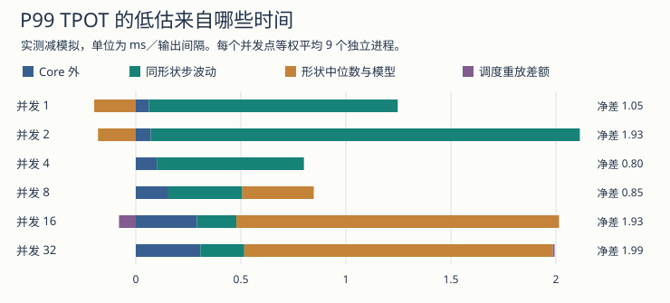
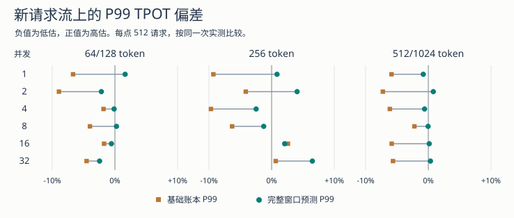

# Qwen3-4B P99 TPOT 校准与独立验证

本研究使用 RX 9070 XT 单卡、Qwen3-4B BF16、同步 eager、TP1/PP1，预测服务端 token 就绪边界的 P99 TPOT。每个请求固定生成 16 个 token，先计算从第一个到最后一个 token 的时间除以 15，再对本进程的 512 个请求取第 99 百分位。一次慢步可以影响整批请求，但单个 token 间隔的 P99 与这里的指标口径不同。

## 54 组原始留出的诊断

在原测量主机上，原始 Scheduler/API 账本重新计算出的数值与原冻结报告 54/54 组一致。逐组等权，实测减模拟的平均差在 P50 为 **0.056 ms**，在 P99 为 **1.427 ms**。并发 1、2、4、8 的 36 组全部低估，加上并发 16 的 6 组和并发 32 的 5 组，一共 47/54。[逐进程数据](historical-54.json)



对每个请求，用首、末 token 的原始纳秒时间截取所有相交的 Core 调用，涵盖处理其他请求的步骤。依次计算真实 TPOT、仅计相交 Core 墙钟、用同进程同形状中位数替换这些步、在真实调度顺序上用冻结成本模型替换这些步，最后对比测前冻结的模拟请求窗口。通过 `scripts/analyze_tpot_windows.py --chronology-control` 也可以对保留的逐进程原始账本复算顺序对照。每次替换都先构造 512 个完整请求窗口再取 P99；窗口两端的部分 Core 调用按实际时间重叠比例缩放。空 Core 在两种重放中保留实际墙钟。

| 按固定替换顺序的相邻 P99 差值 | 54 组均值，ms／输出间隔 |
|---|---:|
| Core 外的时间 | +0.165 |
| 同一有序形状在进程内的步耗时波动 | +0.779 |
| 同形状中位数与模型形状成本的差 | +0.494 |
| 原生调度重放与完整预测的剩余差 | −0.012 |

以每组实测 P99 为分母再等权平均，上述四项分别为 +0.470、+3.732、−0.018 和 −0.013 个百分点，合计低估 4.17%。高负载下局部形状偏差较大，跨负载有正负抵消。

这四项逐组相加等于实测 P99 减冻结 P99。它们是保留原生时序的反事实分解，替换顺序会影响单项数值。并发 2 的平均步波动项为 **2.04 ms**。最差的短输入重复，从实测 23.32 ms 除去 Core 外时间得到 23.24 ms，替换为同形状中位数后为 17.56 ms，冻结预测为 17.79 ms。并发 16、32 的长输入则分别有约 5.62、5.81 ms 落在形状成本差这一项。两个高并发组各有 3,220/4,651 步的精确形状只出现过一次，因此这些步的中位数仍包含该次观测的波动。

特别对三份短输入、并发 2 原始 trace 做了时间顺序对照。只在同一进程、同一有序形状和上下文内打乱步耗时，保留每一步与各请求窗口的对应关系及 Core 外差额，使用固定的 64 个随机种子。原始 P99 分别为 20.74、18.60、23.32 ms，打乱后的 P99 中位数为 18.81、18.02、19.03 ms。最差那组的 64 次打乱结果都介于 18.48 和 19.42 ms。这说明慢步在同一个请求窗口内聚集会显著抬高 P99；仅匹配单步耗时直方图仍会漏掉这部分。[顺序对照及全部置换结果](chronology-control.json)

再对定义 P99 的两个顺序统计量按原插值权重分解。并发 2 时，每个输出间隔平均有 19.84 ms 在处理该请求的纯 Decode 调用中，Core 外约 0.07 ms。并发 16、32 时，平均约 32.2 ms 对应含该请求的混合批调用，约 17.8 ms 对应纯 Decode 调用。这里分解的是实测总时长，不把混合步的全部墙钟归成该请求自身的算子成本。[54 组时间归属](p99-ownership.json)

## 校准方式

每个负载点用两个新原生进程，每个进程保留 512 个完整请求。对每个请求记录真实 TPOT，以及把基础运行时模型应用到本请求实际经历的 Core 形状和顺序得到的 TPOT。它们的有符号差包含这个请求所经历的 15 个间隔的共同影响。历史 54 组只用于上面的诊断。

预测时，从最新基础运行时 Profile 得到新请求流的模拟 TPOT。分别对每次校准取得的原生重放 TPOT 排序，在对应秩上转移该请求的完整窗口差值，然后重新计算这 512 个预测值的 P99。最终估计取两个校准进程预测 P99 的中位数。这种做法允许正负修正，保留窗口内部的时间相关性。它给出匹配负载下的总体分位数估计；无法用来识别哪一个新请求会变慢。不同进程的两项估计也不是置信区间。

使用范围绑定基础运行时文件的 SHA-256、输入长度分布、并发数、请求数、输出长度和闭环反馈配置。基础模型沿用已合并的短 Prefill v2。自定义 SMT 占用时间表属于另一个运行条件。模拟请求和 token 时钟继续支持按原口径计算 TTFT、TPOT、端到端和吞吐。

## 测前方案

3 种输入分布分别是固定 256 token、64/128 token 和 512/1,024 token，并发网格为 1、2、4、8、16、32。36 个独立校准进程结束后冻结预测。主验收每点预定一个新进程，另外两次短输入并发 2 重复单列并参与最坏误差检查。所有逐组误差以实测值为分母。[完整方案、顺序和请求流 SHA-256](plan.json)

要求全部 20 组的绝对相对误差均不超过 25%。18 个主比较点等权计算，平均绝对相对误差和平均有符号相对误差的绝对值都须优于同一批请求的基础模型，后者还须不超过 2%。主比较中低估和高估都最多允许 12 个点。

在读取留出实测前，18 个主比较点中有 17 个 P99 预测向上修正，固定 256-token、并发 16 的预测向下修正 0.20 ms。短输入并发 2 的基础预测为 17.79 ms，两个校准进程分别给出 19.07、19.14 ms，冻结估计为 19.11 ms。

## 新进程独立验证

完成 36 个校准进程后在主机上登记模型、校准样本、请求预测、运行时代码与检查点回执，再执行 20 个独立留出进程。36+20 个进程共 28,672 个请求、430,080 个请求内输出间隔。以下主结果等权比较同一批 18 个负载点。



| 指标 | 同批基础模拟 | 完整窗口预测 |
|---|---:|---:|
| 低估个数 | 16/18 | 9/18 |
| 高估个数 | 2/18 | 9/18 |
| 平均有符号相对误差 | -4.82% | 0.34% |
| 平均绝对相对误差 | 5.18% | 1.51% |
| 主比较中最大绝对相对误差 | 9.68% | 6.49% |

全部 20 次运行的最差绝对相对误差由 9.68% 变为 6.49%。校准后误差最大的点是固定 256-token、并发 32，基础为 39.82 ms，窗口预测为 42.13 ms，实测为 39.56 ms，局部误差增大。误差定义为（预测 − 实测）／实测，历史原报告的 47/54 和新独立样本分开计数。

| 短输入并发 2 | 基础 P99（ms） | 窗口预测 P99（ms） | 实测 P99（ms） | 校准后误差 |
|---|---:|---:|---:|---:|
| 重复 1 | 17.79 | 19.11 | 19.53 | -2.16% |
| 重复 2 | 17.79 | 19.11 | 19.22 | -0.59% |
| 重复 3 | 17.79 | 19.10 | 19.06 | 0.22% |

测前门槛的整体结论为 **PASS**。各项结果为 bias_improved PASS、bias_limit PASS、direction_balance PASS、individual PASS、mape_improved PASS。单次进程内的经验 P99 只有约五个尾部请求。以上分位数校准覆盖同硬件、同 Runtime 和已测闭环策略，对新输出长度、跨 GPU、开放到达或逐个 token 时延的精度需另行验证。

[完整逐组评分](score.json) · [冻结预测](prediction.json) · [主机冻结回执](receipt.json) · [校准窗口](calibration.json.gz) · [独立验证窗口](holdout.json.gz)。三份运行时基础账本的预测 token 时间也随包保存，文件名为 `base-requests-{baseline,short,long}.json.gz`。原始 Scheduler、API、Core、观察结果与日志保存在测量主机 `~/qwen4b-tpot-forward-20261124/`，每份逐进程压缩包与其成员的 SHA-256 见[归档索引](raw-inventory.json)。

```sh
study=docs/qwen4b-tpot-9070xt
python scripts/score_tpot_forward.py --plan "$study/plan.json" --forecast "$study/prediction.json" \
  --evidence "$study/holdout.json.gz" --receipt "$study/receipt.json" --out runs/tpot-forward-score.json
```

## 在 Python 中使用

先按[短 Prefill Profile 的说明](../../examples/qwen4b_short_prefill_20261124/README.md)生成基础实验文件。窗口校准数据使用该文件引用的运行时模型。选用窗口预测时，每个完整 run 会提供 `tpot_forecast.p99_ms`、基础账本 P99 和两个校准进程分别给出的估计。

```python
import gzip
import json
from pathlib import Path

from mlsys_sim import TpotWindowProfile, predict_closed_loop
from mlsys_sim.config import load_experiment

study = Path("docs/qwen4b-tpot-9070xt")
experiment = load_experiment(Path("runs/short-prefill/experiment.json"))
with gzip.open(study / "calibration.json.gz", "rt") as f:
    profile = TpotWindowProfile(json.load(f))
plan = json.loads((study / "plan.json").read_text())
spec = dict(plan["specs"]["holdout-short.json"], concurrency_grid=[2], replications=1)
report = predict_closed_loop(experiment, spec, tpot_window_profile=profile)
print(report["runs"][0]["tpot_forecast"])
```

在通用 `validate_closed_loop` 的冻结契约中，`window_tpot_p99_ms` 将此总体预测与实测 TPOT P99 比较，使用它时须登记完整预测的 `prediction_payload_sha256`。`tpot_p99_ms` 和常规 SLA 约束仍从请求账本计算。随研究附带的评分器还会检查独立会话、请求流、冻结时间及系统偏差。
