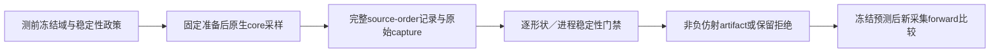

# EngineCore 整步成本后端

1.24新增显式 `calibration.backend="runtime"`。它用原有联合解析模型作为自变量，
针对每个阶段与**精确batch大小**拟合非负比例和截距，目标是同一Runtime域的
EngineCore整步墙钟。旧解析模型、whole-stage lookup Profile、旧reported-hook校准和
Web／Agent默认值不自动改用这个后端；核心库没有新增运行依赖。

本页说明软件接口与证据要求，不把尚未完成的AMD训练或forward采样写成精度通过。
既有[0.6B prepared Prefill窄域报告](prefill-state-20261117/README.md)及
[4B 39格闭环研究的失败结果](course-sla-9070xt-20261111/README.md)保持原样，
它们都不能自动授权新计时边界、模型或在线SLA范围。

## 新计时边界

| 通道 | 本页的用途与范围 |
| --- | --- |
| `engine_core_step_wall_v1` | 新成本模型的目标：实际 `EngineCore.step` 的 schedule、execute／future消费、sample、update／publish及活动observer开销 |
| Runner初始capture | 证明同一进程实际加载的模型与Runtime配置；保留原 `step_includes_output_and_sampling_v1`，不当作整步成本样本 |
| Scheduler token-ready | 独立的服务端token时间，用于请求TTFT／TPOT／E2E；不是成本拟合的别名 |
| Runtime API反馈 | 驱动闭环客户端补位并单独记录交付时刻；不能与core墙钟混加 |

collector不额外添加GPU同步。其CPU计时与记录代码属于明确的插桩域，不能称为无观测器的
纯GPU service。新边界也不同于历史 `reported_l2_step_hook_wall_v1`，不能只改字符串迁移
旧Profile、校准值或采集记录。更不能把profiler进程kernel sum从另一进程整步时间中扣除，
再宣称精确测到了CPU或采样开销。



## 成本模型与支持范围

每个 `(phase, exact_batch_size)` 单独拟合：

```text
T_core_ms = scale[phase,B] × T_analytical_joint_ms + intercept_ms[phase,B]
scale ≥ 0，intercept_ms ≥ 0
```

`T_analytical_joint_ms` 来自现有 `AnalyticalModel`，其效率、launch、framework和dequant
基准值完整保存在 `domain.nominal_calibration`，不暗中改成100%峰值坐标。
混合batch使用原来的联合宏模型和有序 `request_phases`；不把纯Prefill与纯Decode成本相加。
截距代表该拟合族未解释的整步工作，不是已独立测得的CPU、采样或GPU耗时。

首版限制为TP1、PP1、一个副本、stage0。Prefill、Decode和mixed可以各自声明cell；
mixed要求至少两个成员及明确的逐成员phase。它不插值batch，不跨阶段借参数，
也不把batch1校准直接乘到batch16。

每个cell测前声明query、context、两者总量和总token预算的上下界。包络内的新形状
是此有界函数的预测，不表示每个形状已经被实测。没有对应cell、超界或与调度预算
冲突时返回 `OUT_OF_CALIBRATION_DOMAIN`，不静默回退到解析／旧Profile。

## Python拟合：先冻结政策，再接收训练数据

当前没有专门的runtime拟合CLI；使用以下Python API。
`freeze_runtime_cost_policy` 的值应来自测前协议，不能看完训练或留出结果再放宽。
下列cell只展示格式，不是已测网格或可直接借用的硬件声明：

```python
import json
from pathlib import Path
from mlsys_sim.runtime_cost import freeze_runtime_cost_policy, fit_runtime_costs

cells = [{
    "phase": "prefill", "batch_size": 1,
    "min_query_tokens": 64, "max_query_tokens": 1024,
    "min_context_tokens": 0, "max_context_tokens": 0,
    "min_total_query_tokens": 64, "max_total_query_tokens": 1024,
    "min_total_context_tokens": 0, "max_total_context_tokens": 0,
    "max_total_tokens": 1024,
    "max_sequence_tokens": 1024,
}]
policy = freeze_runtime_cost_policy(
    cells, min_samples_per_shape_session=8,
    max_within_shape_ratio=1.10, max_cross_session_ratio=1.10,
)
with Path("runtime-policy.json").open("x", encoding="utf-8") as handle:
    json.dump(policy, handle, ensure_ascii=False, indent=2)

# 在政策已经落盘之后进行独立训练采样。此处不启动GPU或生成假观测。
training = json.loads(Path("runtime-cost-dataset.json").read_text(encoding="utf-8"))
artifact = fit_runtime_costs(training, policy, calibration_id="owned-core-cost-v1")
with Path("runtime-cost.json").open("x", encoding="utf-8") as handle:
    json.dump(artifact, handle, ensure_ascii=False, indent=2)
if artifact["kind"] != "runtime_cost_model_v1":
    raise SystemExit("训练门禁拒绝：保留拒绝artifact，不执行或挑选部分参数")
```

训练dataset为 `runtime_cost_dataset_v1`，包含 `runtime_cost_domain_v1`、实际来源以及完整
records。每行保留 `record_id/session_id/group_id/source_order`、phase、stage0、query／context
数组和正的 `duration_ms`；mixed额外保留 `request_phases`。`source_order` 必须按采集进程
严格递增，不允许按record ID排序后重建。Workspace可为null；缺失的资源观察不写成0。
来源只有 `measured` 或需显式 `allow_test_fixture=True` 的 `test_fixture`；fixture不升级为实测。

默认门禁要求每个进程／精确形状至少8个完整、偶数个样本，保留原顺序分成等长两半，
比较两半中位数；同一形状至少有两个独立训练session，并比较session中位数。
每个phase／exact-B还须至少两个可识别的不同解析坐标。默认两种比值上限均为1.10。
不稳定、样本不足或不可识别时输出 `runtime_cost_rejected_v1`，保留原因且不拟合可执行参数。

拟合对每个“session／精确形状”的中位数等权，而不是让高频形状凭原始步数占更多权重。
artifact保留冻结policy、完整归一化训练dataset、原顺序、各样本残差、非负约束诊断和SHA。
加载器会重新检查这些一致性证据；它们不等价于外部硬件认证，也不替代独立forward验证。

数值重放保留artifact原始参数与 `model_sha256`。原始观测、来源、运行域、冻结政策、ID和
整数形状仍严格校验；只有重新推导的解析坐标、系数诊断及残差使用固定
`rel_tol=1e-10, abs_tol=1e-12`，容纳不同Python版本浮点求和产生的舍入差异。
近零约束的重算标签可能翻转，因此约束标签按artifact自身的冻结参数及无约束诊断检查；
非边界的不一致仍被拒绝。加载不会用当前解释器重新计算的系数替换artifact，也不会
重写hash、放宽形状包络或改变拟合算法。

## 加载与模拟

`profile_path` 必须指向实际的 `runtime_cost_model_v1` artifact，不能指向旧lookup Profile或
训练拒绝文件。应从artifact的domain恢复完整配置，而不是凭模型名称补造绑定值：

Runtime模型及其完整原始证明的JSON上限为128 MiB，默认快照预算为384 MiB加64 KiB，
包含原始JSON字符串转义开销。旧阶段Profile默认16 MiB和用户显式指定的更小预算保持不变。

```python
import json
from pathlib import Path
from mlsys_sim import create_performance_model, experiment_from_dict

path = Path("runtime-cost.json").resolve()
artifact = json.loads(path.read_text(encoding="utf-8"))
domain = artifact["domain"]
experiment = experiment_from_dict({
    "strategy": domain["strategy"], "infra": domain["infra"],
    "calibration": {
        **domain["runtime"], **domain["nominal_calibration"],
        "backend": "runtime", "timing_boundary": "engine_core_step_wall_v1",
        "profile_path": str(path), "profile_version": artifact["calibration_id"],
    },
})
model = create_performance_model(experiment)
# 仅当artifact声明Prefill/B1及该形状包络时有效。
estimate = model.estimate_step("prefill", [128], [0])
print(estimate.duration_ms, estimate.source)
```

绑定覆盖完整Strategy（包括batch／token／active、chunk、mixed、cache、抢占及memory配置）、
Infra／模型／设备、实际Runtime版本与配置SHA、配置执行模式和Attention后端，以及解析基准。
改变KV池、安全余量或observer准备政策也不能静默复用同一artifact。`profile_path`读入后保持
不可变快照；域不匹配报 `CALIBRATION_MISMATCH`，不能通过 `allow_extrapolation` 绕过。
独立的analytical costs、通信／Workspace Profile、replica paths不与该后端叠加。

普通 `mlsys-sim simulate`、`predict` 和Python模拟工厂可读取上述配置。
通用 `predict` 同时请求Prefill和Decode，因而需要两种cell；只有单阶段包络时使用
`mlsys-sim-cost predict --phase ...`。该逐phase命令接受mixed的有序成员roles。
输出保存原始artifact字节与 `runtime_cost_v1` reader／SHA；例如通用CLI的
`runtime-cost.json`、manifest及 `profile_provenance` 可支持原文件删除后的离线重放。
Compare合同保留新core边界，不把它转换为旧stage或HTTP边界。

## 固定准备与quiet原生采集

`python -m mlsys_sim.vllm_sla_worker --help` 提供新的 `--runtime-cost-capture`、`--quiet`
和可选 `--main-thread-cpu N`。它仍使用已有闭环spec、显式experiment和本地checkpoint，
仅支持源绑定的BF16、单卡、同步MRv1、uni executor、无队列的原生 `EngineCore.step`。
MRv2、async、batch queue或其他ABI不被猜成同一计时域。

采集前在已安装ROCm PyTorch与固定vLLM的AMD主机准备配置；以下路径为占位符，
输出目录必须是新的。此命令是pilot采集格式，不是新真机结果：

```bash
python -m mlsys_sim.vllm_sla_worker \
  --model /absolute/path/to/local-checkpoint \
  --experiment /absolute/path/to/collection-experiment.json \
  --spec /absolute/path/to/closed-loop-study.json \
  --concurrency 1 --replication 0 --phase pilot \
  --runtime-cost-capture --quiet \
  --out /absolute/path/to/new-capture
```

准备过程固定执行batch1/4/8/16 × prompt64/128/256/512/1024、每请求16个输出token，
不依赖正式并发，也不按观测延迟决定何时停止warmup。Runner仅用于初始实际模型／Runtime绑定，
在正式计时前关闭；warmup的请求、队列与逻辑KV须排空。每个checkpoint的实际JSON／safetensors
字节在计时间隔之外形成哈希证据。

`--quiet` 将正式进度暂存到结束后写出，避免同步stdout写入正式循环；observer记录与Scheduler
token事件仍存在，其政策进入Runtime指纹。主线程CPU编号必须由调用方显式声明；Linux调用后
核对该线程实际亲和性，并记录CPU型号／governor／驱动事实，不推断整个Runtime已绑核。
有quiet与无quiet、有绑核与无绑核都属于不同准备域。

新增输出包括 `runtime-cost-capture.json`（warmup、formal、idle及错误的原始记录）、
`runtime-cost-dataset.json`（完整formal scheduled steps）、`formal-progress.json`，
并保留Runner binding、Scheduler server trace和API feedback。转换dataset要求capture已关闭、
实际绑定完整且无捕获错误；空正式数据或被裁剪／失败的采集不会生成可用于拟合的假样本。
当前资源数据仍含raw Torch allocator诊断，不能自动代表完整物理Workspace。

正式forward还须使用 `--phase formal` 和测前的 `--freeze-receipt`，绑定实际Runtime SHA、
checkpoint及采集源码；使用独立session，保持训练artifact与预测冻结字节不变。
拟合完整性、稳定性门禁通过与闭环P99／SLA预测通过是不同结论，需分别报告。
