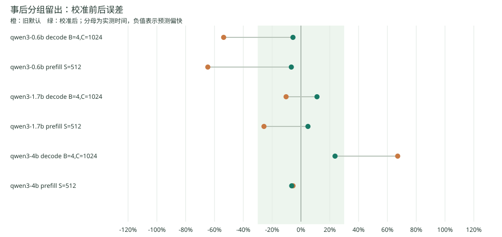

# 固定开销与 Attention 成本：事后分组留出

主留出等权单元 MAPE **37.82% → 9.72%**，覆盖684/684步、3个独立进程、6个形状／阶段单元；6/6满足拟合前冻结的30%门槛。保留形状重复MAPE **34.77% → 8.64%**，12/12通过。

逐步观测嵌套于进程，不是684次独立试验。本数据此前已被查看，是事后留出；没有新增盲测或GPU采样。参数仅绑定已记录的MRv2/async/配置Graph/RocmAttentionImpl，不声称实际逐步Graph分派或eager准确性。

| 模型／阶段 | 形状 | 实测中位数 ms | 旧默认 ms | 校准 ms | 旧误差 | 校准误差 |
| --- | --- | ---: | ---: | ---: | ---: | ---: |
| qwen3-0.6b decode | B=4,C=1024 | 11.899 | 5.515 | 11.239 | -53.65% | -5.54% |
| qwen3-0.6b prefill | S=512 | 21.868 | 7.733 | 20.407 | -64.64% | -6.68% |
| qwen3-1.7b decode | B=4,C=1024 | 13.993 | 12.550 | 15.551 | -10.31% | +11.13% |
| qwen3-1.7b prefill | S=512 | 26.401 | 19.625 | 27.685 | -25.67% | +4.87% |
| qwen3-4b decode | B=4,C=1024 | 16.430 | 27.462 | 20.317 | +67.15% | +23.66% |
| qwen3-4b prefill | S=512 | 48.367 | 45.703 | 45.266 | -5.51% | -6.41% |

上述值为每个留出session/shape单元的中位数；误差为(预测−实测)/实测。1.7B Decode与4B Prefill略有退步，保留原结果，没有逐点选择旧／新模型或重新拟合。

[完整HTML](report.html) · [全部逐步误差、拒绝记录JSON（gzip）](report.json.gz) · [分组CSV](cells.csv) · [摘要](summary.json) · [拟合与原始观测](../../examples/runtime_cost_20261116/README.md)

训练只使用正式进程1/2的端点形状与profiler端点分量。主留出为进程3的S512/B4，重复验证为同一批进程3的端点，因此两类验证并不相互独立。所有6174条观测与未使用成员保留。

固定项是经验残差校正，不能解释为测得的CPU/launch成本。分量来自不同profiler进程，Decode聚合上下文对齐有近似，KV状态差异保留但未证明因果。本文只验证隔离阶段成本；没有验证显存可行性或在线SLA。

详见[方法、冻结划分与复现](../runtime-cost-calibration.md)。hardware_validated=false。
