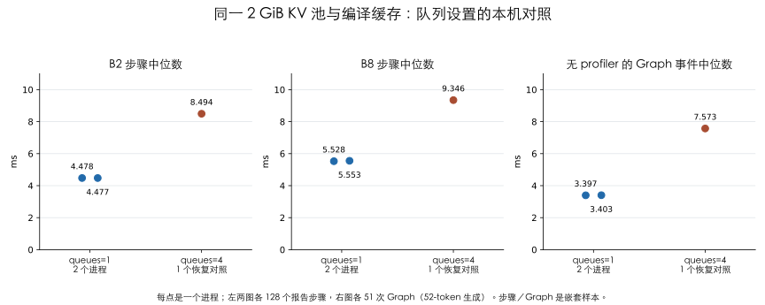
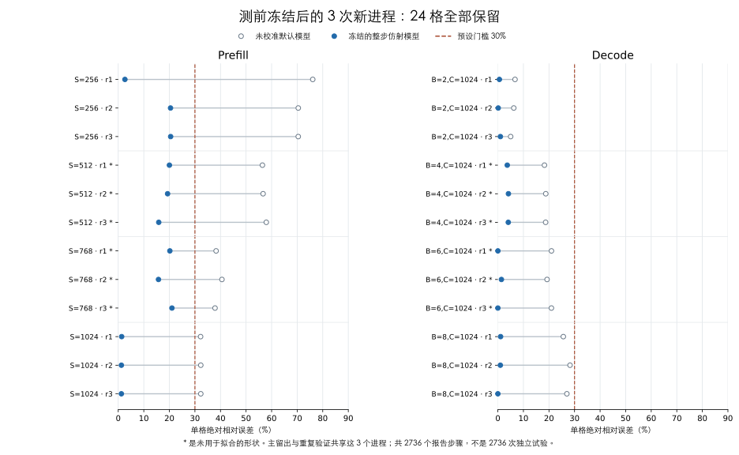

# 0.6B Decode：队列调度对照与独立前瞻验证

日期：2026-11-17（Asia/Singapore）。本轮模型为 Qwen3-0.6B，机器为 RX9070XT 16GB / gfx1201、Ryzen 9 3900X；固定原 ROCm/vLLM 镜像，BF16、TP1/PP1、单副本。

独立前瞻结论：**PASS，24/24 格、2736/2736 个报告步骤完整，每格误差均 ≤30%。** 三次全新进程在主机登记预测回执后启动，参数和阈值未因本轮结果调整。

按进程×形状等权的总体 MAPE：未校准默认模型 **34.04%**，新模型 **7.36%**。Decode 为 **1.43%**，最大 **4.13%**；Prefill 最大仍为 **21.01%**。

## 为什么原先会出现快慢进程

保留的旧自动分配数据中，B2 为 5.134 / 9.213 / 9.145 ms，B8 为 5.820 / 9.775 / 9.740 ms。execute_model 的主机返回时间和 step 间隙接近；无 hook 对照仍存在差异。可见时钟／温度不支持简单的热降频解释。

新探索先复现了慢状态，再逐项检查分配和缓存。固定 2GiB KV 池两次仍约 8.53/9.40ms；四个共享缓存的短探针也未恢复快状态。旧快／慢进程缓存中的78个HSACO代码、只读数据和内核元数据段全部相同，六个调优配置选择也相同；文件整体哈希差异不能直接当成不同机器代码。

队列上限2的两次探索仍为B2约8.57/8.70ms，未当成有效修复。早期附加Graph探针受原采样器硬退出影响未落盘，纯步骤数据仍完整保留；随后只在原生计时结束后拦截退出补充探针。正式训练与forward不启用这些额外探针或profiler。

本机单变量队列对照进一步复现了显著变化：固定同一KV池和经逐文件核对的缓存工作副本（原缓存保持只读），只改变进程启动时的 GPU_MAX_HW_QUEUES。上限1的两次结果接近，恢复4后重新变慢：

| 进程 | 队列上限 | B2 步骤 ms | B8 步骤 ms | 无 profiler Graph ms |
|:---|---:|---:|---:|---:|
| queues1-a | 1 | 4.478 | 5.528 | 3.397 |
| queues1-b | 1 | 4.477 | 5.553 | 3.403 |
| queues4-event-reversal | 4 | 8.494 | 9.346 | 7.573 |

Graph事件在原生步骤取样之后、profiler之前采集，使用当前stream上的事件对，整次generate结束后才同步读数；事件插桩前后各三次整段基线接近。三组都采用52-token探针、51次Graph；它与每格8次generation×16个报告步骤的正式计时分别记录，不能混为独立样本。

最后的profiler trace方向一致：queue1 Graph span约4.08ms，queue4约8.25ms；queue4多出约3ms的“无记录kernel区间”，出现大量20–50µs间隙。Attention kernel中位约42µs，仅小幅变化，不能把多出的4ms全计入Attention。无记录kernel区间不等于整个GPU空闲，可能含依赖、屏障或未记录工作。queue4一组Graph少记录了一个GEMM事件，该组保留未补值／删除。

这些结果支持本机HIP队列／Graph调度路径的规避方案，不唯一归因某个MES固件函数。[AMD环境变量说明](https://rocm.docs.amd.com/en/docs-10.1.0/reference/environment-variables/index.html)定义了队列上限；[TheRock #9980](https://github.com/ROCm/TheRock/issues/9980)和[#9228](https://github.com/ROCm/TheRock/issues/9228)记录了同架构相关现象。这里的结论来自本机对照，不将上游其他显卡结果当成本机验证。

## 修正的校准方法与范围

新包绑定实际GPU_MAX_HW_QUEUES=1、kv_cache_memory_bytes=2147483648、固定镜像、原采样器SHA、当前构造参数和预加载机器码清单。环境变量在进程启动前设置；没有改全局SSH、系统驱动、原模型或私有采样源码。队列上限只用于本次单卡域，不全局套到TP/PP，通信并行效果仍需各自验证。

新增整步仿射族采用非负 a×(nominal N+A)+c，以进程×形状中位数等权拟合。不伪造GPU分量标签，也不把c解释成直接测得的CPU时间。每形状至少两个训练进程；训练max/min门槛1.25单独冻结，不稳定时保存拒绝结果且不生成可执行参数。原四参数分量族、Profile ABI、默认CLI/Python/Web/Agent接口均保留。

训练仅使用两次新进程的S256/S1024、B2/B8，共912步。第三个实际采集进程作为内部回顾性留出／重复，456+456步；这些真实观测用于完整数据集绑定，不参与拟合。之后重新冻结308条预测，再另起三个进程。前瞻主留出为S512/S768、B4/B6，重复为原形状，全部单元都需通过。

## 全部前瞻结果

| 分组 | 格数 | 报告步骤 | 未校准 MAPE | 新模型 MAPE | ≤30% 格数 |
|:---|---:|---:|---:|---:|---:|
| 未拟合形状 | 12 | 1368 | 33.71% | 10.45% | 12/12 |
| 原形状重复 | 12 | 1368 | 34.38% | 4.27% | 12/12 |

每格误差为 abs(预测步骤中位数−实测步骤中位数)/实测步骤中位数。主留出与重复共享三个进程，步骤嵌套于进程，不作为几千次独立硬件重复；不提供未经支持的置信区间。

| 形状 | r1 实测 ms | r2 实测 ms | r3 实测 ms | 冻结预测 ms | 进程max/min−1 |
|:---|---:|---:|---:|---:|---:|
| S=256 | 21.798 | 17.625 | 17.618 | 21.229 | 23.73% |
| S=512 | 17.736 | 17.842 | 18.375 | 21.286 | 3.60% |
| S=768 | 17.771 | 18.454 | 17.650 | 21.358 | 4.55% |
| S=1024 | 21.150 | 21.173 | 21.173 | 21.434 | 0.11% |
| B=2,C=1024 | 4.465 | 4.485 | 4.537 | 4.492 | 1.63% |
| B=4,C=1024 | 4.665 | 4.644 | 4.647 | 4.836 | 0.43% |
| B=6,C=1024 | 5.180 | 5.254 | 5.180 | 5.181 | 1.44% |
| B=8,C=1024 | 5.586 | 5.472 | 5.525 | 5.526 | 2.08% |

Prefill S256仍有约23.7%的跨进程中位数比值差；本次没有为了减少它的误差而使用留出值重新拟合。Decode同形状最大比值差约2.08%，本轮精度目标已达到，不能据此声称所有阶段和全部机器都稳定。

## 可复核证据

- 模型拟合SHA：`fa4f12338390484b4ce8bff5bf20a6f37d3c62d86ccce2f12d0a7e893d759fd1`。冻结预测的代码提交：`1f09f5d766e7b5e01d6036dbf7673bbebf8df2d9`。
- 主机预测登记UTC：`2026-11-16T17:36:29.693840+00:00`，早于三个forward进程启动。原ZIP SHA仍为`32567daea53b3a0700d07be9a0f332577fddb2c87070f6515d43df15cb49bb85`。
- 新训练归档SHA：`cda7b74f44f65c493a7dffb6d19e93d0a45cd0eaec28cd01ef1d6592eb320fae`；独立留出归档SHA：`16b47bed3d414c8588ddf545ea74b5a8fad55062b3ba4b2a2ae3225d701054bd`。
- [全部24格CSV](cells.csv)、[全部逐步记录CSV（gzip）](steps.csv.gz)、[完整评估JSON（gzip）](report.json.gz)、[队列探针数据](queue-controls.json)、[逐Graph对照](graph-comparison.csv)、[全部153个Graph](graphs.csv.gz)、[摘要](summary.json)。
- [冻结输入、预测表、校准参数、1824条训练/内部观测与回执](../../examples/runtime_step_20261117/README.md)。旧的失败结果、完整GPU时间线、原始JSONL、监控、启动异常和编译缓存均保留在本地与原AMD主机；公开仓库不含SSH配置、密钥、主机名或私有采样源码。

当前训练与前瞻使用同一采样器文件及依赖SHA；历史旧实验没有可认证的同一采样文件哈希，因此旧trace协议兼容和新采集字节匹配分开说明。正式forward仅记录配置的Graph选择器，单独的因果探针观察了实际Graph；不声称每个正式步骤的dispatch都已观察。此报告不是广域硬件认证、在线服务SLA、显存容量或模型语义质量认证。

先前未受控域的失败结果也保留：[原36格CSV](previous-forward-cells.csv)、[原摘要](previous-forward-summary.json)。它们的配置、拟合和分母与本轮不同，不能直接混成一组前后对比。

[完整原始数据归档清单与生命周期核验](evidence-index.json)：21个进程、100格、11400个报告步骤均保留；其中真正的独立前瞻为3进程24格，不能把所有探索数据当成独立留出。
